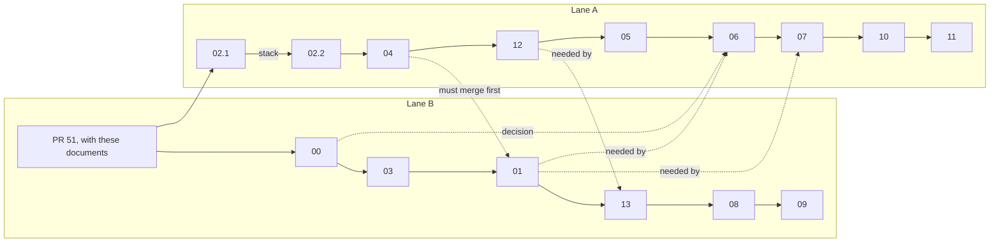

# Detection generalization — delivery plan

**Draft. Nothing in it exists yet.** It says where each pull request is built, what it is called, what it
starts from and what must be true first. The [series contract](contract.md) owns the rules.

Two lanes, fifteen pull requests. These documents come first, in PR 51. **One branch per PR. One open branch
per lane at a time, except the one stack in §3.**

## 1. Worktrees

| Lane | Worktree (sibling of `.bare/`) | Work |
|---|---|---|
| **A** | `detgen-lane-a` | Checks, authorization, account recovery, input validation |
| **B** | `detgen-lane-b` | Recognition, SQL, configuration |

Both are reused: a lane moves to its next branch in the same folder. [Worktree
setup](../../docs/worktree-setup.md#required-model) says each spec normally has its own worktree; the owner
asked for two reusable ones on 2026-11-25, and this series is that exception. It allows no other worktree,
no `.claude/worktrees/`, and no `claude/*` branch.

## 2. Branches and pull requests

Names are flat: `detgen-<number>-<slug>`. The number is the specification's name, not its place. The order
is this table, read per lane.

| PR | Branch | Lane | Starts from | PR base | Starts when |
|---:|---|---|---|---|---|
| 00 | `detgen-00-operation-inventory` | B | `origin/stage` | `stage` | PR 51 is merged |
| 02.1 | `detgen-02-1-check-fields` | A | `origin/stage` | `stage` | PR 51 is merged |
| 02.2 | `detgen-02-2-handler-checks` | A | `detgen-02-1-check-fields` | `detgen-02-1-check-fields`, then `stage` | 02.1 open and green |
| 03 | `detgen-03-sql-calls` | B | `origin/stage` | `stage` | 00 merged, or the owner lets 03 start before it |
| 01 | `detgen-01-storage-identity` | B | `origin/stage` | `stage` | 03 merged or dropped. **Paid checkpoint and merge only after 04 is merged** |
| 13 | `detgen-13-storage-calls` | B | `origin/stage` | `stage` | 01, 03, 04 and 12 merged |
| 04 | `detgen-04-middleware-checks` | A | `origin/stage` | `stage` | 02.2 merged |
| 12 | `detgen-12-http-entries` | A | `origin/stage` | `stage` | 04 merged |
| 05 | `detgen-05-record-selection` | A | `origin/stage` | `stage` | 12 merged or dropped |
| 06 | `detgen-06-create-ownership` | A | `origin/stage` | `stage` | 01 and 02.2 merged, 00 decided, 05 merged or dropped |
| 07 | `detgen-07-response-disclosure` | A | `origin/stage` | `stage` | 01 merged, 00 decided, 06 merged or dropped |
| 08 | `detgen-08-credential-cookies` | B | `origin/stage` | `stage` | 00 decided, 13 merged or dropped |
| 09 | `detgen-09-cross-origin` | B | `origin/stage` | `stage` | 08 merged or dropped |
| 10 | `detgen-10-credential-change` | A | `origin/stage` | `stage` | 05 merged, 00 decided, 07 merged or dropped |
| 11 | `detgen-11-rejection-without-stop` | A | `origin/stage` | `stage` | 04 merged, and its occurrence count passes |

"00 decided" means the owner has accepted its result, not only that its PR is open.



PR titles. Labels follow the [PR process](../../standards/pr-process.md); correct them to the packages
changed.

| PR | Title |
|---:|---|
| 00 | `[DOC] Detection generalization 00: operation inventory results` |
| 01 | `[PARSE+DOC] Detection generalization 01: resolve model identity across module forms` |
| 02.1 | `[ANALYSIS+PARSE] Detection generalization 02.1: shared check fields` |
| 02.2 | `[PARSE+ANALYSIS+JUDGE+REPORT+DOC] Detection generalization 02.2: handler checks as evidence` |
| 03 | `[PARSE+ANALYSIS+JUDGE+REPORT+DOC] Detection generalization 03: SQL calls without a contract` |
| 04 | `[PARSE+JUDGE+DOC] Detection generalization 04: local middleware as evidence` |
| 05 | `[PARSE+DOC] Detection generalization 05: record selection through several steps` |
| 06 | `[PARSE+ANALYSIS+JUDGE+DOC] Detection generalization 06: ownership on create` |
| 07 | `[PARSE+ANALYSIS+JUDGE+DOC] Detection generalization 07: response disclosure` |
| 08 | `[PARSE+ANALYSIS+DOC] Detection generalization 08: credential cookie settings` |
| 09 | `[PARSE+ANALYSIS+REPORT+DOC] Detection generalization 09: credentialed cross-origin reads` |
| 10 | `[PARSE+ANALYSIS+JUDGE+DOC] Detection generalization 10: proof of a credential change` |
| 12 | `[PARSE+DOC] Detection generalization 12: operation families on every HTTP entry` |
| 13 | `[PARSE+ANALYSIS+JUDGE+DOC] Detection generalization 13: storage calls without a contract` |
| 11 | `[PARSE+JUDGE+DOC] Detection generalization 11: rejection that does not stop` |

First lines of every PR body: `Lane`, `Series PR <n> of the delivery plan`, `Specification`, `Depends on`,
`Base commit`, `Stop-rule result`, `Paid requests used`. A stacked PR adds `Stacked on #<number>: review
after it`.

## 3. The only stack

`detgen-02-2-handler-checks` on `detgen-02-1-check-fields`, both in `detgen-lane-a`. No third layer. 02.1 is
small and the injection false-positive work waits for it. That work starts from `stage` after 02.1 merges,
in its own worktree.

`gh stack rebase` fails in this repository ("branch stage is checked out in multiple worktrees"), so rebase
with Git. PRs here are often squash-merged, so **record the old base before the lower PR merges**:

```bash
git rev-parse detgen-02-1-check-fields   # write this SHA in the lane's run log as OLD
```

After 02.1 changes but is not merged:

```bash
git rebase --onto detgen-02-1-check-fields <OLD> detgen-02-2-handler-checks
```

After 02.1 merges (squash or merge commit), and the 02.2 PR shows base `stage`:

```bash
git fetch origin
git rebase --onto origin/stage <OLD> detgen-02-2-handler-checks
git log --oneline origin/stage..HEAD     # only 02.2 commits may be listed
```

A force push needs the owner's word and uses `--force-with-lease` on that one branch.

## 4. Setup, once, when the owner asks

From the container folder, after PR 51 merges. These commands are for that time; none has been run.

```bash
git --git-dir=.bare fetch origin
git --git-dir=.bare worktree add --no-track -b detgen-00-operation-inventory detgen-lane-b origin/stage
git --git-dir=.bare worktree add --no-track -b detgen-02-1-check-fields detgen-lane-a origin/stage
```

Open each Claude session **on the lane folder, with the app's worktree option off**. Copy `.env` only into a
lane that has an approved paid run; never print it.

Before either lane starts, check that `origin/stage` holds this directory. The PR 51 worktree,
`generalize-analysis-try-1`, is not a lane: no implementation happens there.

## 5. Start of every session

Run from the lane folder, and stop if any answer differs from §2.

```bash
pwd
git branch --show-current
git status --short --branch
git worktree list
git fetch origin
git log --oneline -1 origin/stage
gh pr list --state all --search "head:detgen-" --json number,state,headRefName,baseRefName
```

1. The folder is the lane of this branch.
2. The tree is clean. Uncommitted work is not yours to move: ask.
3. The "starts when" column is met. Check GitHub, not memory.
4. No other branch of this lane has an open PR, except the §3 stack.
5. No other session is working in this folder. Ask the owner if unsure.
6. Read the series contract, this plan, the specification, and the lane's run log.

## 6. Moving a lane to its next branch

Only when the previous PR is merged, or dropped by its stop rule, and the tree is clean:

```bash
git fetch origin
git switch --no-track -c detgen-04-middleware-checks origin/stage
git merge-base --is-ancestor <sha of the previous merge> HEAD && echo ok
```

Use the branch name from §2. First push, when the owner asks: `git push -u origin <branch>`. `--no-track`
prevents a new branch from tracking, and pushing to, `stage`.

A dropped specification: close its PR, record the result, keep its branch until the owner says, and start
the next branch from `origin/stage`. **Never start from a dropped branch.**

## 7. What collides, and who waits

| Shared thing | Rule |
|---|---|
| `authorization` and `account` protocols, questions and policy | Lane A only. Each PR takes the next protocol number from `stage` when it starts |
| SQL and `configuration` protocols, questions and policy | Lane B only, the same way |
| `analysispacks/families.go`, `descriptors.go`; `judge/client.go`, `bundle.go`; `report/application_findings.go` | Both lanes may touch. Keep edits to your family. The PR that merges second rebases and repeats gates G1 to G6 |
| `spec-index.md`, `implementation-plan.md`, capability pages | Edit only your own row or section |
| Results | One file per PR: `.zazz/evaluation/detection-generalization-results/<number>.md`. No shared results file |
| Run log | One per lane, ignored by Git: `.zazz/ephemeral/detection-generalization-run-log.md` inside each worktree. Cross-lane facts go in the PR, since the other lane cannot see it |
| Paid runs | One lane at a time. State the base commit: a rebase that changes requests makes earlier answers unusable |
| Held-out applications | Assigned by the key session. A lane does not open another lane's applications |

**After a rebase**, rerun G1 and G2. If any request digest changed, earlier judged results for those records
no longer count, and repeating them is a new decision for the owner.

## 8. Never

- Merge a PR, merge locally into `stage`, push to `stage`, or stash, reset or switch in the other lane's
  folder.
- Open a branch that is not in §2, or rename one.
- Stack anything except 02.2, or base a PR on a branch whose PR is not open.
- Use `git add -A`. Add files by name.
- Start a later specification because an earlier one is waiting for review. Ask.

## 9. For the human

One look at the state: `gh pr list --state all --search "head:detgen-"`. Read the PR number and the lane in
the title and first lines. Merge in §2 order within a lane. A question before each merge: does [contract
§7](contract.md#7-detection-and-false-positive-accuracy-must-not-fall) hold with no exception, did the stop
rule pass, are the gates on the current `stage`, and is any judged result older than the last rebase?

Live status is on GitHub and not in this file: two lanes editing one status table would conflict.
