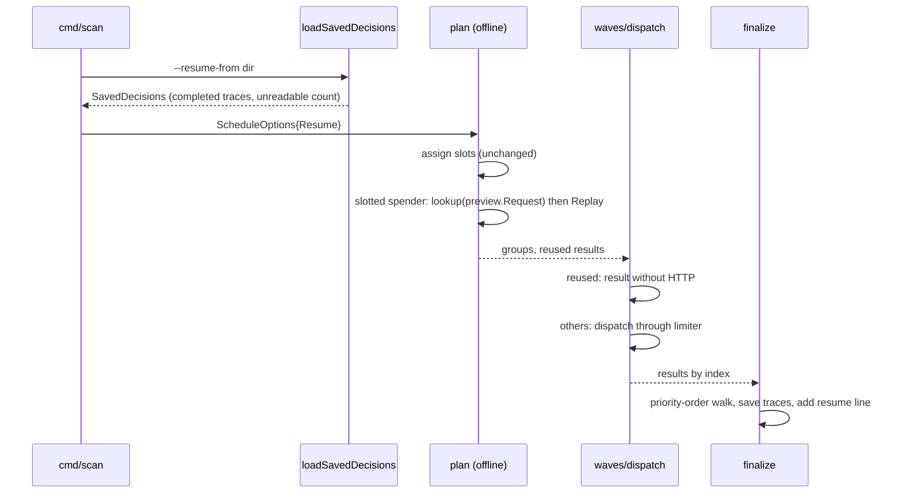

# Judge scan resume from saved decisions

**Status:** deferred (2026-11-18). After judged scans stopped halting on per-candidate failures,
a scan stops early only for an account failure or an unresponsive model, so resume is not needed
for CI reliability. A scheduler slice was built and reverted; restore it from commit `5c6cc35` if
stops remain common.
**Worktree / branch:** `parallel-judge` (owner choice, §11 OQ-1)
**Depends on:** architecture phase 4, parallel judge requests
([spec](architecture-phase-4-parallel-judge.md)), and the transient retry deliverable
([spec](judge-transient-retry-and-token-estimate.md)); both are on branch `parallel-judge`, not yet
merged, tracked in PR 27
**Delivery topology:** extends the `parallel-judge` branch and its draft PR 27 into `stage`; no new PR
**Coordination:** Lead Agent alone; Sonnet subagents allowed for disjoint files
**Run log:** `.zazz/ephemeral/judge-scan-resume-run-log.md`
**Drafted:** 2026-11-18

## 1. Capability

A judged scan can still stop part-way: a timeout, a non-retried provider error, an exhausted retry
budget or a TPM refusal halts the limiter, the report keeps the completed answers and marks the
rest as stopped. Today the user must rerun the whole scan, which for Juice Shop is 157 paid
requests again.

After this change, `scan --analyze --judge <provider> --resume-from <dir>` reads the traces an
earlier run saved with `--trace-dir <dir>`. Every candidate that the new run would send is first
checked against those traces. When a saved, successful trace has exactly the request the new run
would send (same request bytes, which include the provider wire shape and the model; same protocol
version; same request digest and component provenance), the saved answer is applied through the
existing `Replay` path and no request is sent. Only the remaining candidates reach the provider.

With the same inputs and `--judge-limit`, the resumed run's report has exactly the same assessments,
findings and order as one uninterrupted run whose provider returned the saved answers. The only
difference is one added report limitation that counts reused and newly sent decisions.

## 2. Required reading

- **Phase 4 spec:** [architecture-phase-4-parallel-judge.md](architecture-phase-4-parallel-judge.md)
  §3 invariants and §5 D-1 (offline slot assignment, no refunds).
- **Retry spec:** [judge-transient-retry-and-token-estimate.md](judge-transient-retry-and-token-estimate.md)
  §5 D-3 (the cap counts candidates sent, not HTTP attempts).
- **Code:**
  - `internal/judge/schedule.go`: `ScheduleOptions`, `plan`, `waves`, `dispatch`, `finalize`.
  - `internal/judge/trace.go`: `DecisionTrace`, `Replay`, `Preview`, `sameRequest`,
    `sameComponents`.
  - `internal/judge/components.go`: `requestDigest` (empty for kinds with no registered protocol).
  - `internal/judge/client.go`: `payloadForm` (the request bytes carry `model` and the
    provider-specific shape), `assess`.
  - `internal/judge/limits.go`: `LimitSummary`.
  - `internal/judge/transport.go`: the retry policy; resume does not change it.
  - `cmd/scan/main.go` (flag parsing and validation), `cmd/scan/analysis.go`
    (`runAnalysisConfigured`, `writeTrace`), `cmd/scan/judge_limits.go` (`judgeRuntime`),
    `cmd/scan/discovery.go` (discovery traces share the trace directory).
- **Tests to reuse:** `internal/judge/schedule_parallel_test.go` (`scheduleStub`,
  `scheduleScenario`, `prepareScheduleScenario`, `runPrepared`, `failOrdinal`) and the CLI stub
  pattern in `cmd/scan/schedule_cli_test.go` (`newJudgeClient` replacement).
- **Standards:** [Testing](../standards/testing.md) §6 concurrency and §7 semantic adapter stubbing;
  [spec hygiene](../standards/spec-hygiene.md).
- **User docs:** [running scans](../../docs/scan/running-scans.md) (trace and rate controls);
  [decision models](../../docs/scan/decision-models.md), the equivalence paragraph that says there is no
  persistent answer cache.
- **Rules:** [AGENTS.md](../../AGENTS.md), credentials and live model calls.

## 3. Invariants

- A saved trace is reused only when `Replay` returns `completed` for the current candidate. That
  requires `http_status` 200, the exact compacted request bytes, the current protocol version, a
  matching request digest when one is saved, and equal component provenance. Nothing else, such as
  the candidate ID or trace filename, is a match key.
- Because the request bytes include `model` and the provider's wire shape, a trace saved with a
  different provider or model never matches. Resume never sends to another provider or model.
- Without `--resume-from`, behaviour, request bytes, digests, goldens and reports are unchanged.
  `TestArchitectureBaseline` and every golden in `internal/judge/testdata/schedule_serial/` pass
  with no update.
- Slot assignment stays the phase 4 offline plan. A reused decision occupies the slot it was
  assigned, exactly as a sent decision would (D-3).
- A reused decision sends no HTTP request, acquires nothing from the limiter and is not counted in
  `LimitSummary` attempts, tokens or retries.
- Reuse is resolved in the offline plan pass, before any request starts. Report and trace output
  never depends on completion order.
- The saved-trace directory is read once, before scheduling. It is never modified by the loader.
  New traces are written only through the existing `--trace-dir` path.
- Report content never includes the resume directory path.

## 4. Scope and review shape

| Path | New / modified | Purpose |
|---|---|---|
| `internal/judge/resume.go` | new | `SavedDecisions`: read-only index of completed saved traces by compacted request hash, plus load counts |
| `internal/judge/schedule.go` | modified | `ScheduleOptions.Resume`; `plan` marks reusable slotted spenders; `waves` applies them without dispatch; `finalize` writes the resume limitation; refusal when nothing matches (D-6) |
| `internal/judge/resume_test.go` | new | Scheduler-level match matrix, determinism, slot, wording and refusal tests |
| `cmd/scan/main.go` | modified | `--resume-from` flag, help text and validation |
| `cmd/scan/judge_limits.go` | modified | `judgeRuntime` carries the loaded `*judge.SavedDecisions` |
| `cmd/scan/analysis.go` | modified | Pass `SavedDecisions` into `ScheduleOptions` |
| `cmd/scan/resume.go` | new | `loadSavedDecisions(dir)`: read top-level `*.json` trace files into `judge.SavedDecisions` |
| `cmd/scan/resume_test.go` | new | Flag validation, loader edge cases, end-to-end halt-then-resume through `run` |
| `docs/running-scans.md` | modified | How to resume a stopped scan; reuse rules; slot and cost meaning |
| `docs/decision-models.md` | modified | Replace "no persistent answer cache" with the opt-in, exact-match resume statement |

Allowed directories: `internal/judge/`, `cmd/scan/`, `docs/`, plus this spec and the run log.

Out of scope:

- reusing discovery (`--discover-routes`) traces;
- reusing a decision whose request differs in any byte, including "close enough" or
  same-candidate-ID matches;
- an offline replay mode that runs with no provider key;
- a persistent cross-scan answer cache, or reuse of traces from other repositories;
- changing retry, timeout or halt policy;
- per-assessment "reused" fields in the report schema (see §11 OQ-4);
- paid calls without an owner-stated provider, model and numeric cap.

Review shape: commits added to draft PR 27 (§11 OQ-1).



## 5. Decisions

- **D-1 One flag, `--resume-from <dir>`, pointing at an earlier `--trace-dir` directory.**
  - **Why:** the traces already hold every exact request and response, so no new file format,
    manifest or report parsing is needed. Users already know the directory they passed.
  - **Validation:** requires `--analyze` and `--judge`; the path must exist and be a directory,
    else exit 2 with `scan: --resume-from requires an existing trace directory from --trace-dir`.
  - **Rejected alternative:** resuming from `findings.json`. The report does not carry raw
    responses, so `Replay` could not re-apply the current decoder and policy.
- **D-2 Match by exact request through `Replay`, indexed by the SHA-256 of the compacted request.**
  - **What:** the loader indexes only traces with `http_status` 200. The key is computed from the
    request bytes at load, not taken from `request_digest`, because that field is empty for kinds
    with no registered protocol. A hit is then checked by `Replay`, which also checks the protocol
    version, digest and components. A hit that `Replay` rejects is treated as no hit, and the
    candidate is sent normally.
  - **Why:** it is the replay rule the project already trusts, and the request bytes bind provider
    and model. Keying by candidate ID would reuse an answer for changed evidence.
  - **Duplicate keys:** when two files hold the same request, the lexically first filename wins. In
    practice identical requests carry identical responses, since members replay their leader.
- **D-3 A reused decision consumes the `--judge-limit` slot it was assigned.**
  - **Why:** with the same `--judge-limit`, the resumed run then judges exactly the candidates an
    uninterrupted run would, which is what makes the report identical. Paid requests this run are
    the slots minus the reused decisions.
  - **Rejected alternative:** reuse as free extra slots. Resuming with `--judge-limit 10` after 7
    reused decisions would then judge 17 candidates and produce a different report from the
    uninterrupted run.
  - **Consequence:** a saved decision for a candidate that gets no slot in the new run, for example
    after lowering `--judge-limit`, is not reused and is counted as not matched.
- **D-4 Reported counts live in one new limitation line; assessments and `LimitSummary` keep their
  current meaning.**
  - **What:** when `--resume-from` is given, `finalize` appends, after the "Judged N distinct
    candidate signatures" line:
    `Judge resume: reused R saved decisions without a request; sent S candidates this run; M saved decisions did not match this scan; U trace files could not be read.`
    R counts slotted candidates satisfied from saved traces. S counts slotted candidates sent this
    run. M counts indexed successful traces that were not reused. U counts unreadable or malformed
    files. Reused assessments carry exactly the fields a sent one would, including `usage` decoded
    from the saved response.
  - **`LimitSummary`:** unchanged text. Its attempts, tokens and retries already describe only HTTP
    sent by this run; the docs say that reused decisions are not in it.
  - **Why:** a per-assessment marker would make the resumed report differ from an uninterrupted
    one on every reused record, which defeats the determinism goal. One line gives the user the
    cost picture.
- **D-5 Reuse is decided in the offline plan pass.**
  - **What:** for each spender that holds a slot, including a member promoted after its leader's
    non-halting failure, `plan` or the promotion step looks up the preview request and calls
    `Replay`. A completed result is stored on the planned candidate. `waves` records it as the
    result without dispatch, so it never occupies a worker.
  - **Why:** `Replay` makes no request and touches no limiter state, so deciding it offline keeps
    dispatch unchanged, keeps output independent of completion order, and lets D-6 act before any
    request.
- **D-6 Refuse to send when saved decisions exist but none match.**
  - **What:** if the directory has at least one successful trace and the plan reuses none, the run
    sends nothing. Each slotted candidate is `not_run` with reason
    `judge resume: no saved decision matches this scan's provider, model, evidence or protocol; nothing was sent`,
    and the scan exits 1. An empty directory, or one with only failed traces, proceeds normally.
  - **Why:** the usual cause is a changed model, provider, binary or source, and silently sending
    the whole scan again is the paid surprise the user is trying to avoid. Owner confirmation in
    §11 OQ-2.
- **D-7 `--resume-from` is rejected together with `--discover-routes`.**
  - **Why:** discovery reuse is out of scope, and fresh discovery answers can change the candidate
    set, so the determinism promise would not hold. Owner confirmation in §11 OQ-3.
- **D-8 The resume directory may also be the `--trace-dir` directory.**
  - **What:** the loader reads a snapshot before scheduling. The new run rewrites each candidate's
    trace file; a reused candidate's file is rewritten with the saved trace unchanged. A run that
    halts again can then be resumed from the same directory.
  - **Why:** "rerun the same command with `--resume-from` added" is the simplest user story.

## 6. Agent implementation rules

- **Authority and worktree:** follow [AGENTS.md](../../AGENTS.md) authorization and worktree rules.
  Work only in the worktree and branch the owner names in §11 OQ-1. Verify `pwd`, the branch,
  `git status --short --branch` and `git worktree list` before editing. Never edit in `stage/`, and
  never use `.claude/worktrees/`.
- **Discipline:** follow [execution discipline](../docs/agent-execution-discipline.md) and the
  `spec-driven` skill. Record a fresh [standards index](../standards/index.yaml) lookup in the run
  log.
- **Commits:** one green commit per §9 step, with `[AREA]` prefixes. Push the feature branch at
  completion; the PR is a draft targeting `stage`, or the existing PR per OQ-1. Never merge.
- **Verification:** `gofmt -l` on changed Go files, `go vet ./...`, `go build ./...`,
  `go test -race ./... -count=1`, and `go test ./cmd/scan -run TestArchitectureBaseline -count=1`.
- **Paid calls:** none. All tests use `httptest` stubs. An optional live check needs the owner to
  state the provider, model and a numeric request cap in the session.
- **Halts:**
  - any §11 open question is unresolved;
  - any existing golden or `TestArchitectureBaseline` changes;
  - a request digest or request byte changes for a run without `--resume-from`;
  - reuse would need any match key other than D-2's;
  - the resumed report differs from the uninterrupted one in anything but the D-4 line;
  - a file outside §4 needs changing;
  - the same test fails three iterations in a row.

## 7. Acceptance criteria

1. **AC1 Flag validation.**
   - **Behaviour:** `--resume-from` without `--analyze`, or without `--judge`, exits 2 with
     `scan: --resume-from requires --analyze with --judge`. A missing path or a regular file exits 2
     with the D-1 message. `--resume-from` with `--discover-routes` exits 2 with
     `scan: --resume-from cannot be combined with --discover-routes`. No request is sent in any case.
   - **Test:** table `TestResumeFromValidation` in `cmd/scan/resume_test.go`.
2. **AC2 Loader.**
   - **Behaviour:** a directory holding one 200 trace, one 503 trace, one malformed `.json`, one
     `.txt` file, one subdirectory and one symlink to a valid trace indexes exactly 1 decision and
     counts U=1. The `.txt`, subdirectory and symlink are ignored and not counted. A file larger
     than 4 MiB counts as unreadable. The loader never writes to the directory (modification times
     unchanged).
   - **Test:** `TestLoadSavedDecisions`.
3. **AC3 Exact-match reuse only.**
   - **Behaviour:** traces from a complete stub run are saved, then one trace per row is altered:
     one request byte, `question_version`, `analysis_components`, `request_digest`, `http_status`
     503, an undecodable `response`, and a different `model` in the request. In the resumed run,
     each altered candidate is sent exactly once and every unaltered one is sent zero times.
   - **Test:** table `TestResumeReusesOnlyExactMatches` in `internal/judge/resume_test.go`.
4. **AC4 Same report as an uninterrupted run.**
   - **Behaviour:** for a `scheduleScenario` with several groups and members, `--judge-limit` L and
     N ∈ {1, 4}:
     - run A uses `failOrdinal(k, 400)` and halts;
     - run B resumes from A's traces with an all-200 stub;
     - run C is uninterrupted with an all-200 stub.
     B's report JSON equals C's after removing only the D-4 line. B's saved traces equal C's. B's
     stub receives exactly C's request count minus the number of requests that completed in A
     (in-flight requests that finished after A's halt included), and no request body B sends equals
     a completed A request. A chained row also passes: A halts at k1, B resumes into
     the same trace set and halts at k2, and C′ resumes from B and equals the uninterrupted run.
   - **Test:** `TestResumeMatchesUninterruptedRun` (rows: N=1, N=4, chained).
5. **AC5 Reuse consumes slots.**
   - **Behaviour:** run A completes 3 leaders with limit 3. Resuming with limit 5 sends exactly 2
     requests and judges the same 5 candidates as an uninterrupted limit-5 run. Resuming with limit
     2 sends 0 requests, reuses 2, gives the third candidate `not_run` with
     `judge request limit reached`, and reports M=1.
   - **Test:** `TestResumeReuseConsumesSlots`.
6. **AC6 Wording and accounting.**
   - **Behaviour:** the D-4 line appears once, with exact text and counts, after the "Judged …"
     line, and only when `Resume` is set. It contains no path. Reused assessments have no field
     beyond those of a sent assessment. With `JUDGE_RPM` set, `LimitSummary` attempts equal the
     requests the stub received in the resumed run.
   - **Test:** `TestResumeReportLine`.
7. **AC7 Nothing-matches refusal.**
   - **Behaviour:** traces saved with model `fixture-model` and a resumed client using
     `other-model` give 0 stub requests, every slotted candidate `not_run` with the D-6 reason, and
     `failed` true. A directory with only a 503 trace, and an empty directory, both proceed and send
     every slotted candidate.
   - **Test:** `TestResumeRefusesWhenNothingMatches`.
8. **AC8 End to end through the CLI.**
   - **Behaviour:** with `newJudgeClient` replaced by a stub, a first `run` with `--trace-dir D`
     whose stub fails request #2 with 400 exits 1. A second `run` with the same arguments plus
     `--resume-from D` and an all-200 stub exits 0, sends the total minus the completed count, and
     its `--json` report equals an uninterrupted run's after removing the D-4 line.
   - **Test:** `TestResumeFromCLI`.
9. **AC9 Concurrency safety:** `go test -race ./internal/judge -run Resume -count=5` passes.
10. **AC10 No change without the flag:** every existing golden, `TestArchitectureBaseline` and the
    existing CLI tests pass unchanged.
11. **AC11 Docs.**
    - **Content:** `docs/running-scans.md` explains how to resume (rerun with `--resume-from` set to
      the earlier `--trace-dir`), the exact-match rule, that a different provider, model, source or
      zazzles version is not reused, that reuse counts against `--judge-limit`, the D-4 line, and
      that `LimitSummary` covers only requests sent. `docs/decision-models.md` no longer says there
      is no persistent answer cache without qualification.
    - **Check:** PR review plus `doc-check`.
12. **AC12 Gate:** every §6 verification command passes.

## 8. Test strategy

- **Scheduler tests in `internal/judge/resume_test.go`:** reuse `scheduleStub`, `scheduleScenario`,
  `prepareScheduleScenario`, `runPrepared` and `failOrdinal`. The stub already answers
  deterministically from the request's question names, so an uninterrupted run is a fixed reference
  and needs no new golden file. A small helper turns run A's collected trace map into
  `SavedDecisions` with `NewSavedDecisions`, so these tests do no file I/O.
- **Comparison:** one helper removes the D-4 line from `report.Limitations` and compares JSON
  bytes. It is shared by AC4, AC5 and AC8, so "identical except the line" is asserted the same way
  everywhere.
- **AC3 matrix:** a single table of trace mutations, each row asserting which candidate IDs reached
  the stub. A mismatch is proven by observable sends, not by inspecting internals.
- **Loader tests in `cmd/scan/resume_test.go`:** `t.TempDir()` with hand-written trace files
  produced by `writeTrace`, so the loader reads exactly what the scanner writes.
- **CLI test:** follows the `newJudgeClient` replacement pattern in `schedule_cli_test.go`, with an
  existing small regression repository from `internal/langjs/testdata/` that yields at least 3
  assessable candidates. The run log names the chosen fixture.
- **Omitted:** no new golden files, since the uninterrupted run is the reference. No separate
  limiter test, since AC6's attempts assertion covers "reuse does not acquire". No Gemini or Jev
  variant, since provider binding is proven by AC3's model row and the request bytes carry the
  provider shape.

## 9. TDD entry point and execution sequence

1. Add `internal/judge/resume.go` with the type and constructor only, and
   `TestResumeMatchesUninterruptedRun`. **Red:** B sends every slotted candidate again.

   ```go
   // SavedDecisions indexes successful traces from an earlier run by the SHA-256
   // of their compacted request bytes. It is read-only after construction and
   // safe for concurrent use. A hit is only a candidate for reuse; Replay decides.
   type SavedDecisions struct {
   	byRequest  map[string]DecisionTrace
   	unreadable int
   }

   // NamedTrace is one loaded trace file; Name orders duplicate requests.
   type NamedTrace struct {
   	Name  string
   	Trace DecisionTrace
   }

   func NewSavedDecisions(traces []NamedTrace, unreadable int) *SavedDecisions
   func (s *SavedDecisions) lookup(payload []byte) (DecisionTrace, bool)
   func (s *SavedDecisions) Completed() int // indexed 200 traces
   ```

2. Wire reuse into the scheduler:

   ```go
   type ScheduleOptions struct {
   	// ...existing fields...
   	// Resume, when set, supplies saved decisions that slotted candidates reuse
   	// instead of sending when Replay accepts them.
   	Resume *SavedDecisions
   }

   type planned struct {
   	// ...existing fields...
   	reused *result // saved decision Replay accepted; applied without dispatch
   }

   // reuse is offline: no HTTP, no limiter.
   func (c *Client) reuse(p *planned, saved *SavedDecisions) {
   	if saved == nil || !p.spends || !p.slot {
   		return
   	}
   	if t, ok := saved.lookup(p.preview.Request); ok {
   		if a := c.Replay(p.use, t); a.Status == "completed" {
   			p.reused = &result{assessment: a, trace: t}
   		}
   	}
   }
   ```

   Call `reuse` after slot assignment in `plan` and when `waves` promotes a member. In `waves`,
   record reused results directly and dispatch only the rest. Make AC4 and AC5 green.
3. Add the D-4 line and the D-6 refusal in `AssessScheduled` and `finalize`; add
   `TestResumeReportLine`, `TestResumeRefusesWhenNothingMatches` and
   `TestResumeReusesOnlyExactMatches` (AC3, AC6, AC7). Confirm the existing goldens (AC10).
4. Add `cmd/scan/resume.go`, the flag and validation, and the `judgeRuntime` field;
   add `TestResumeFromValidation`, `TestLoadSavedDecisions` and `TestResumeFromCLI` (AC1, AC2, AC8).

   ```go
   // loadSavedDecisions reads top-level regular *.json files written by
   // --trace-dir. Unreadable, oversized or malformed files are counted, not fatal;
   // only an unreadable directory is an error. It never writes.
   func loadSavedDecisions(dir string) (*judge.SavedDecisions, error)
   ```

5. Update the docs (AC11), run the race check (AC9) and the gate (AC12), and push.

## 10. Definition of done

- [ ] Required reading done; standards lookup recorded.
- [ ] §11 open questions resolved and recorded in the run log.
- [ ] AC1–AC12 verified, with evidence in the run log.
- [ ] The branch diff matches §4.
- [ ] The PR states D-3 (reuse consumes slots), D-6 (nothing-matches refusal) and the D-4 wording.
- [ ] Live behaviour is either verified with an owner-capped run or stated as unverified.

## 11. Open questions

Resolved by the owner in session on 2026-11-18, taking every recommended answer:

- **OQ-1 Placement:** (a) extend `parallel-judge` and draft PR 27.
- **OQ-2 D-6 refusal:** send nothing and exit 1 when saved decisions exist but none match.
- **OQ-3 D-7:** reject `--resume-from` with `--discover-routes`.
- **OQ-4 Report marker:** the single D-4 line only; no per-assessment field.
- **OQ-5 Trace directory:** `--resume-from` runs without `--trace-dir`; the docs advise passing the
  same directory to both.
- **OQ-6 D-3:** reused decisions consume `--judge-limit` slots.

## 12. Run log protocol

Append-only in `.zazz/ephemeral/judge-scan-resume-run-log.md`, following the plan's
[common rules](architecture-update-plan.md#common-agent-implementation-rules). Record the standards
lookup, verbatim OQ answers, the CLI fixture chosen for AC8, red and green per §9 step, and gate
results.

## 13. Agent implementation prompt

> Work only in the sibling worktree and branch the owner chose in §11 OQ-1 of
> `.zazz/specifications/judge-scan-resume.md`; do not create other worktrees and never use
> `.claude/worktrees/`. Read AGENTS.md, the orientation contents, this spec, and its §2 reading.
> Confirm that every §11 question has a recorded answer in the run log before editing code. Execute
> §9 in order with one green commit per step. Make no paid calls: every test uses `httptest`
> stubs. Stop on any §6 halt. Finish by pushing the branch and adding AC1–AC12 evidence to the draft
> PR description targeting `stage`; never merge. Verifier: a fresh-context subagent runs
> `go test -race ./internal/judge ./cmd/scan -count=3` and reads `schedule.go` and `resume.go` to
> confirm four things: reuse happens only when `Replay` returns `completed`; a reused candidate
> never reaches `dispatch` or the limiter; a reused candidate keeps its offline slot; and without
> `Resume` no code path changes behaviour. It reports PASS or FAIL.

## 14. Implementation and review change log

No changes recorded.
