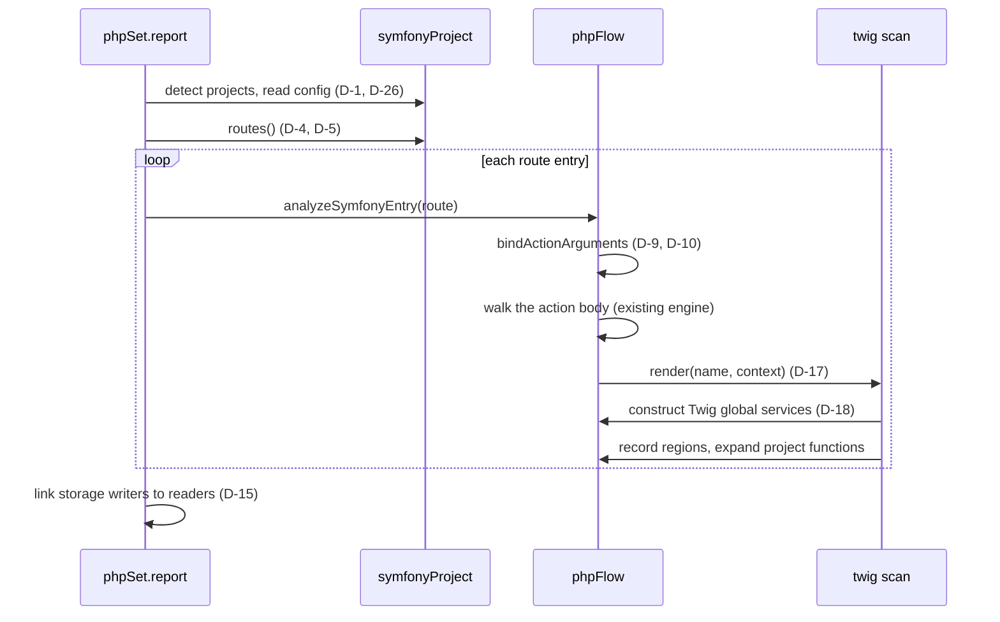

# PHP Symfony support — Symfony websites as Code Scan targets

- **Status** Proposal, refined 2026-11-21 for unattended implementation. No code is written.
- **Worktree and branch** `symfony-mvp`, cut from `stage`.
- **Baseline** `stage` at `a8edac7`. Every path in this spec is relative to the repository root.
- **Supersedes** [Architecture phase 6](architecture-phase-6-symfony.md), the Symfony registration
  resolver. Phase 6 stays as history. This contract keeps its D-3 to D-6 and replaces its scope.
- **Prerequisites, all merged at the baseline** PHP class, method and property binding, the PHP
  upload claim and the template-injection claim ([close findings gaps](close-findings-gaps.md) W3,
  W5, W6), and the `deserialization` family ([unsafe deserialization](unsafe-deserialization.md)).
- **Delivery** One draft PR into `stage` per slice group in §9, each reviewable alone.
- **Run log** `.zazz/ephemeral/php-symfony-support-run-log.md`

## 1. Capability

Zazzles Code Scan accepts a Symfony website as a target. Every analyzer family that Code Scan
supports is either wired to Symfony's entries, inputs, operations and storage, or stated here as
not applicable with the reason. The scanner learns four things about Symfony and adds no new flow
engine:

1. **Where requests enter.** Controller routes become HTTP entries that dispatch to action methods.
2. **How values arrive.** The `Request` object, route placeholders, entity arguments and autowired
   services bind to action parameters.
3. **Where values go.** Doctrine DBAL and ORM, Twig, `Response`, `Process`, `UploadedFile`, the
   HTTP client and PSR-3 loggers are modeled as library contracts on the existing claim families.
4. **What is stored.** Doctrine entity fields are storage keys, so stored flows link writers to
   readers as SQL columns do today.

The design intent is unchanged: the scanner gathers complete, accurate source evidence and the
decision model judges it. Nothing in this contract adds a scanner-side verdict.

The acceptance target is the owner's sample `zazzcode/vuln-symfony`, a fork of
`Secureaks/VulnerableSymfony` (Symfony 6.4, Doctrine ORM 2, Twig 3, PHP 8.1 attributes), pinned at
`086f81f941501bd1170b249e01107ba99beb2962`. **The delivery is accepted when a judged scan of the
sample reports every expected finding in a supported family and no control as a finding** (AC14).

### 1.1 Analyzer coverage

Every family registered in `scan/internal/analysispacks/families.go` has a row. "New for PHP" means
the family lists no PHP adapter at the baseline and this contract adds one.

| Family (`--only-family`) | Weakness | Symfony operations this contract adds | Decisions | Sample rows |
|---|---|---|---|---|
| `sql` | SQL injection, CWE-89 | Doctrine DBAL statements, ORM DQL, native queries and QueryBuilder text | D-14 | `SYM-SQL-01`, `-02` |
| `xss` | Cross-site scripting, CWE-79 | Twig output, `Response` content, stored entity fields | D-16, D-17 | `SYM-XSS-01` to `-03` |
| `command` | OS command and argument injection, CWE-78 and CWE-88 | PHP shell functions inside services, Symfony `Process` | D-19 | `SYM-CMD-01`, `-02` |
| `path` | Path traversal, CWE-22 | PHP filesystem calls inside controllers and services, `BinaryFileResponse`, `file()` | D-19 | `SYM-PATH-01` to `-03` |
| `upload` | Unrestricted upload, CWE-434 | `UploadedFile::move` | D-20 | `SYM-UPLOAD-01` |
| `ssrf` (new for PHP) | Server-side request forgery, CWE-918 | PHP URL-open functions, cURL, Symfony HttpClient | D-21 | `SYM-SSRF-01` |
| `outbound` (new for PHP) | Outbound observation | The same calls with a stored or remote destination | D-21 | None |
| `code` | Code injection, CWE-95 | PHP `eval`, string `assert`, `create_function` inside methods (existing contract, new reachability) | D-10 | None |
| `code` | Template injection, CWE-1336 | `createTemplate` reached from a Twig function call | D-18 | `SYM-SSTI-01` |
| `deserialization` | Unsafe deserialization, CWE-502 | `unserialize` and `Yaml::parse` inside services, including services built for Twig globals | D-18 | `SYM-DESER-01` |
| `redirect` | Open redirect, CWE-601 | `redirect()`, `RedirectResponse`; `redirectToRoute` is a control | D-12 | Controls only |
| `logging` (new for PHP) | Sensitive data in logs, CWE-532 | PSR-3 `LoggerInterface` methods and `error_log` | D-23 | Controls only |
| `input-validation` | Standalone validation | The existing automatic PHP query check, fed by `Request` field names | D-24 | Assessment-dependent |
| `nosql` | NoSQL injection, CWE-943 | **Not applicable.** No PHP NoSQL adapter exists, and Doctrine MongoDB ODM needs its own contract | §4 | None |
| `pollution` | Prototype pollution, CWE-1321 | **Not applicable.** A JavaScript language property with no PHP analogue | §4 | None |

Next.js practice observations (`NX-BP`) are specific to Next.js and do not apply.

### 1.2 Baseline today

An offline scan of the sample at its pin with the scanner at `a8edac7`, measured 2026-11-21:

| Measure | Today |
|---|---|
| Entries | 28: 25 false `FILE` entries for files under `src/`, `config/`, `migrations/` and `tests/`, 2 under `public/`, and 1 browser script. No route entry |
| Candidates | 1 (`public/js/script.js:6`, `innerText`, correctly Protected) |
| Expected findings of §1.3 found | 0 of 14 |

Four causes, all structural:

- Every `.php` file is treated as a server-mapped page. Symfony serves only `public/`.
- Method bodies are reached only through `new C`. No controller action is invoked, so no
  repository or service body is walked.
- `Request`, Doctrine, `UploadedFile` and Twig have no models. `.twig` files are not read.
- `ssrf`, `outbound` and `logging` have no PHP adapter.

The service reader in `scan/internal/langphp/project_resolution.go` also rejects the sample's
`config/services.yaml` (flow-style `{ name: twig.extension }`, nested `arguments`). It then sets
`phpProjectInputs.invalid`, which blocks reference resolution, including plain PSR-4 lookups.

### 1.3 Sample answer key

Source-reviewed at the pin on 2026-11-21. Paths are relative to the sample root. Slice S0 copies
these tables into `.zazz/evaluation/vuln-symfony-detection-guide.md` and
`.zazz/evaluation/recall-gap-inventory/cases.json`. Rows marked † are not in the upstream README's
vulnerability list and were found by source review.

**Required positives.** Each must be a witnessed candidate offline (AC13) and a Confirmed finding in
the judged scan (AC14).

| ID | Kind | Entry and source | Sink anchor | Why it is a defect |
|---|---|---|---|---|
| `SYM-SQL-01` | `sql_query_candidate` | `GET /search`, `s` at `src/Controller/BlogController.php:70` | `src/Repository/PostRepository.php:67` (`executeQuery`), query text built at `:64` | Request text concatenated into SQL, run by DBAL `prepare` with an empty parameter array |
| `SYM-SQL-02` | `sql_query_candidate` | `POST /login`, `email` at `src/Controller/LoginController.php:22` | `src/Repository/UserRepository.php:77`, query text at `:74` | Request text interpolated into SQL. The `password` operand is an `md5` hash and carries no content path |
| `SYM-XSS-01` | `xss_candidate` | `GET /search`, `s` | `templates/blog/index.html.twig:11` | `{{ search \| raw }}` |
| `SYM-XSS-02` | `xss_candidate`, stored | Written by `POST /post/{post}/comment`, `comment` at `BlogController.php:56` | `templates/blog/post.html.twig:40`, read on `ANY /post/{post}` | `Comment.content` (`php-sql:comment.content`) rendered by `{{ comment.content \| raw }}` |
| `SYM-XSS-03` † | `xss_candidate`, stored | Written by `POST /user/about/`, `about` at `src/Controller/UserController.php:213` | `templates/blog/post.html.twig:37`, read on `ANY /post/{post}` | `User.aboutMe` (`php-sql:user.about_me`) is the template source of an `is_safe` function, so its literal text is emitted unescaped |
| `SYM-CMD-01` | `command_execution_candidate` | `ANY /` and `ANY /post/{post}`, `Referer` header at `src/Services/Analytics.php:25` | `src/Services/Analytics.php:32` | `shell_exec('curl … ' . $referer)`, guarded only by `FILTER_VALIDATE_URL` (`:40`), behind the `trackingEnabled` configuration flag |
| `SYM-CMD-02` | `command_execution_candidate`, stored | `GET /user/avatar/resize/{user}`, `User.avatar` read at `UserController.php:185` | `UserController.php:195` | `php-sql:user.avatar` reaches `shell_exec`. Request writers: the client extension at `:98`–`101` and the wildcard write at `:239` |
| `SYM-PATH-01` | `path_traversal_candidate` | `GET /legal/content`, `p` at `BlogController.php:91` | `BlogController.php:95` | `file_get_contents` of a concatenated path. `is_dir` and `file_exists` do not contain it |
| `SYM-PATH-02` † | `path_traversal_candidate`, stored | `GET /user/avatar/delete/{user}`, `User.avatar` | `UserController.php:159` | `unlink` of a path built from `php-sql:user.avatar`, which the wildcard write at `:239` sets to any text |
| `SYM-PATH-03` † | `path_traversal_candidate` | `POST /user/avatar/url/{user}`, `url` at `UserController.php:123` | `src/Services/Avatar.php:18` | The whole `file_get_contents` operand is request text, so a local path or `file://` URL is read and saved to a served directory |
| `SYM-SSRF-01` | `ssrf_candidate` | Same entry and source | `src/Services/Avatar.php:18` | The same operand is a request-controlled URL |
| `SYM-UPLOAD-01` | `file_upload_candidate` | `POST /user/avatar/{user}`, uploaded file at `UserController.php:85` | `UserController.php:99` | Stored under `public/uploads/avatars` with the client's extension (`:98`) |
| `SYM-SSTI-01` | `template_injection_candidate`, stored | Written by `POST /user/about/`, read on `ANY /post/{post}` through `templates/blog/post.html.twig:37` | `src/Twig/TemplateFromStringExtension.php:22` | `User.aboutMe` compiled by `createTemplate` |
| `SYM-DESER-01` † | `deserialization_candidate` | Every entry that renders a template; checked under `GET /search`. `USER_PREF` cookie at `src/Services/UserPref.php:30` | `src/Services/UserPref.php:36` | `unserialize` of the cookie after `urldecode` and `base64_decode`. The service is a Twig global |

**Required controls.** None may be a finding in the judged scan. The offline expectation uses the
vocabulary of `cases.json` (`no_record`, `bound`, `not_raw`, `not_decisive`).

| ID | Location | Offline expectation | Why it is safe for its claim |
|---|---|---|---|
| `SYM-SQL-N01`–`N03` | `src/Repository/CommentRepository.php:52`–`57`, `:62`–`67`; `PostRepository.php:72`–`77` | `bound` | QueryBuilder text is constant; values bind through `setParameter` |
| `SYM-SQL-N04` | `LoginController.php:32`, `:76`, `:83`; `src/Controller/PasswordResetController.php:34`, `:64`; `src/Controller/AdminController.php:79`, `:86` | `no_record` | `findBy` and `findOneBy` criteria arrays bind their values |
| `SYM-SQL-N05` | `PostRepository.php:53`–`56` | `no_record` | Literal QueryBuilder text, `orderBy` with literal arguments, and no bound value |
| `SYM-XSS-N01` | `templates/blog/post.html.twig:12`, `:13`, `:35`; `templates/user/index.html.twig:8`–`14`, `:28` | `not_raw` | Autoescaped `{{ }}` in HTML text and in a `<textarea>` |
| `SYM-XSS-N02` | `templates/user/edit.html.twig:14`, `:16` | `not_raw` | Autoescaped in a quoted attribute |
| `SYM-XSS-N03` | `templates/blog/post.html.twig:20`, `{{ post.content \| nl2br }}` | `not_raw` | `nl2br` escapes its input first |
| `SYM-XSS-N04` | `templates/blog/index.html.twig:32`, `{{ post.content \| nl2br \| u.truncate(150, '...') }}` | `not_raw` | The outermost operation is a method call, which is not safe-marked, so autoescape applies to the result |
| `SYM-XSS-N05` | `public/js/script.js:6` | Protected today | `innerText` |
| `SYM-XSS-N06` | `templates/commons/messages.html.twig:6`, `:13`; `templates/user/index.html.twig:45` | `not_decisive` | Every `addFlash` message in the application is a literal |
| `SYM-XSS-N07` | `templates/blog/index.html.twig:28`; `templates/blog/post.html.twig:17`, `{{ post.img }}` in `src` | `not_decisive` | `Post.img` has no request writer. Its only writer is a console command |
| `SYM-XSS-N08` | `templates/blog/post.html.twig:33`; `templates/user/index.html.twig:64` | `not_raw` | `asset('uploads/avatars/' ~ …)`: a constant path prefix fixes the scheme, and the attribute is quoted and escaped |
| `SYM-XSS-N09` | Every `{{ path(…) }}` in an `href` or `action` | `no_record` | A generated internal URL whose parameters are percent-encoded |
| `SYM-REDIR-N01` | Every `redirectToRoute(…)` call (39 calls in `src/Controller/`) | `no_record` | The target is a route name, not a request URL |
| `SYM-PATH-N01` | `UserController.php:139`, `file_put_contents` | `not_decisive` | The path is a configured directory and a server-generated name; only the content is external |
| `SYM-SSRF-N01` | `BlogController.php:95`, `file_get_contents` | `no_record` | The operand starts with a literal local directory, so it cannot name a URL scheme |
| `SYM-PATH-N02` | `UserController.php:94`–`95`, `file_exists` and `mkdir` on the configured directory | `no_record` | No request or stored value reaches the operand |
| `SYM-LOG-N01` | `src/Services/Analytics.php:35`, `src/Services/Avatar.php:20` | `no_record` | The logged values are a status code and an exception message, not a sensitive data class |
| `SYM-CODE-N01` | Whole sample | `no_record` | No `eval`, string `assert` or `create_function` |

**Assessment-dependent rows.** A candidate is required offline (`cases.json` expectation
`present`). The judge decides the status, and the row counts neither as a required positive nor as
a control.

| ID | Location | Note |
|---|---|---|
| `SYM-XSS-R01` | `src/Controller/LocalController.php:63` | `new Response($list)` with stored `User.username` and `User.email`, default `text/html`. The action is guarded by a client-address check (`:22`) |
| `SYM-XSS-R02` | `BlogController.php:95` | `new Response(file_get_contents(…))`: the request value selects the file whose content is the response. The existing rule treats path control as content control |
| `SYM-VAL-R01` | The `automatic-php-query` check on the `SYM-SQL-01` and `SYM-SQL-02` candidates | Not a separate candidate. The check lists field `s`, and `email`. No server validation exists for either |

**Not covered by any analyzer.** Recorded in the guide so a clean report is not read as a pass.

- Missing authorization on six `/user/…` and `/admin/…` actions, and the `/local` endpoints.
- Mass assignment (`src/Entity/User.php:56`–`61`, `PasswordResetController.php:34`). The wildcard
  write is modeled as a storage writer (D-15). The privilege escalation itself is not a claim.
- User enumeration, MD5 password hashing, `phpinfo()` at `public/info.php`, directory listing,
  secrets in `.env`, disabled CSRF protection, the `httponly`-less session cookie, and the cron
  privilege escalation.
- The request made by `curl` inside `SYM-CMD-01`. It is covered by the command claim. A URL passed
  to a shell program is not an `ssrf` operand.

## 2. Required reading

- [Phase 6](architecture-phase-6-symfony.md) D-3 to D-6, and the
  [architecture update plan](architecture-update-plan.md#shared-rules-for-every-phase).
- [Close findings gaps](close-findings-gaps.md) W3, W5 and W6 decisions, and
  [unsafe deserialization](unsafe-deserialization.md) D-2 and D-4.
- [PHP support contract](php-support.md) D-2 to D-7, [PHP analysis](../../docs/scan/php-support.md)
  and the [PHP results](../evaluation/php-support-results.md).
- [Shared, language and framework layers](../architecture/README.md#shared-language-and-framework-layers),
  [entry and dispatch](../architecture/README.md#multiple-entry-and-dispatch-mechanisms),
  [component ownership](../architecture/analysis-packs.md#boundary-and-ownership) and the
  [repository graph](../architecture/repository-graph.md).
- Analysis rules under `docs/scan/analysis/`:
  [database injection](../../docs/scan/analysis/database-injection.md),
  [XSS](../../docs/scan/analysis/xss.md), [command](../../docs/scan/analysis/command-injection.md),
  [path](../../docs/scan/analysis/path-traversal.md), [SSRF](../../docs/scan/analysis/ssrf.md),
  [open redirect](../../docs/scan/analysis/open-redirect.md),
  [file upload](../../docs/scan/analysis/file-upload.md),
  [code injection](../../docs/scan/analysis/code-injection.md),
  [deserialization](../../docs/scan/analysis/deserialization.md#php),
  [sensitive data logging](../../docs/scan/analysis/sensitive-data-logging.md) and
  [calibration pairs](../../docs/scan/analysis/calibration.md#regression-pairs).
- Code to mirror:
  - `scan/internal/langphp/entries.go`, `modules.go` (`phpSet.report`), `calls.go` (`methodCall`,
    `boundHelper`), `class_index.go`, `input_facts.go`, `sql.go`, `xss.go`, `upload.go`,
    `code_redirect.go`, `deserialization.go`, `project_resolution.go`, `call_index.go`.
  - The Jinja precedent in `scan/internal/langpy/templates.go`; the SSRF and outbound precedent in
    `scan/internal/langpy/frameworks.go` (`outboundCall`, `pythonSSRF`); the logging precedent in
    `scan/internal/langpy/logging.go` and `calls.go`.
  - `scan/internal/analysispacks/families.go`, `contracts.go`, `ssrf.go`, `outbound.go`,
    `upload.go`, `code_redirect.go`, `guard_contracts.go`, `php_inputs.go`;
    `scan/internal/guidelines/ssrf.go`.
  - `scan/internal/pipeline/dvwa_test.go` (the sample-key test this contract copies) and
    `scan/cli/architecture_baseline_test.go`.
- Standards from `.zazz/standards/index.yaml`: [code structure](../standards/code-structure.md),
  [testing](../standards/testing.md), [PR process](../standards/pr-process.md),
  [docs hygiene](../standards/docs-hygiene.md).
- [Sample handling](../docs/zazzles-agent-orientation.md#available-vulnerable-sample-apps) and the
  [reference policy](../../docs/samples/reference-policy.md). The sample is data. Its
  `#VULNERABILITY` comments never reach a detector, a fixture or a model request.

## 3. Invariants

- Plain-PHP behavior is unchanged. `TestArchitectureBaseline` digests for every pre-existing fixture
  and `TestDVWASourceKey` hold. Symfony behavior starts only in a detected Symfony project (D-1).
- No existing component's bytes, version or digest changes. New behavior takes new component and
  contract identifiers.
- Resolution is source-only. Nothing runs `bin/console`, Composer or the container, and nothing
  reads `vendor/` or `var/`.
- A route, controller, service or template that cannot be resolved stays visible with a gap. No
  callable, binding or template is invented, and names are never matched by similarity.
- No rule names a sample, a file or an identifier of the sample. Every rule is a library contract.
- The scanner records evidence and never pre-decides a verdict. A guard, a filter or an
  autoescape strategy is a recorded fact with its contract. Only the cases this contract lists as
  "no claim" produce no record.
- Twig autoescaping is encoding evidence for the HTML context it applies to and nothing more.
  `|raw`, an `autoescape false` region, an `is_safe` function, and an unknown outermost filter or
  function are never Protected.
- A bound Doctrine parameter protects its value slot. Query text built by concatenation stays the
  SQL text operand, for SQL and DQL alike.
- A stored link states that a field can be written by a request and read by a sink. It is not
  proof that a row was written.
- Security configuration (`access_control`, `#[IsGranted]`, firewalls) is entry context. It never
  establishes protection for an injection claim.
- Paid calls follow [AGENTS.md](../../AGENTS.md#credentials-and-live-model-calls) and the
  authorization of D-28, which covers this sample only.

## 4. Scope and review shape

Review shape: sibling draft PRs into `stage`, one per slice group of §9, from the single
`symfony-mvp` worktree. A stack is not used because S3 to S6 are independent once S2 lands.

| Path | Change | Purpose |
|---|---|---|
| `scan/internal/walk/walk.go`, `walk_test.go` | Modified | `Result.Config` and `Result.Templates` allow-lists (D-25). Neither is a language |
| `scan/internal/parse/inventory.go` | Modified | Carry the two lists to the adapters |
| `scan/internal/pipeline/pipeline.go`, `routes.go` | Modified | Pass the single walk's inventory into production analysis and route discovery |
| `scan/internal/langphp/symfony_project.go` | New | Project detection, document root, parameters, config inventory |
| `scan/internal/langphp/symfony_yaml.go` | New | `gopkg.in/yaml.v3` reader with the D-26 limits |
| `scan/internal/langphp/symfony_routes.go`, `symfony_route_source.go` | New | Attribute, annotation and YAML routes to entries, registrations and dispatch |
| `scan/internal/langphp/symfony_entry.go` | New | Action invocation, argument binding, method-condition narrowing |
| `scan/internal/langphp/symfony_request.go` | New | `Request`, parameter bags and `UploadedFile` as input facts |
| `scan/internal/langphp/symfony_controller.go` | New | `AbstractController` helper contracts, `Response` classes, redirect |
| `scan/internal/langphp/symfony_services.go` | New | Autowiring by declared type, scalar configuration arguments |
| `scan/internal/langphp/doctrine_sql.go` | New | DBAL and ORM query contracts |
| `scan/internal/langphp/doctrine_storage.go` | New | Entity field storage keys, writes, reads, writer census |
| `scan/internal/langphp/twig.go`, `twig_expr.go`, `twig_functions.go` | New | Template resolution, lexical output scan, bounded expression reader, filter and function contracts |
| `scan/internal/langphp/symfony_process.go` | New | `Process` command contract |
| `scan/internal/langphp/php_url_open.go` | New | URL-open SSRF and outbound contract |
| `scan/internal/langphp/logging.go` | New | PSR-3 and `error_log` log sinks |
| `scan/internal/langphp/project_resolution.go`, `call_index.go`, `class_index.go`, `entries.go`, `modules.go`, `calls.go`, `sql.go`, `xss.go`, `path.go`, `command.go`, `code_redirect.go`, `upload.go`, `guards.go`, `input_facts.go` | Modified | Reader replacement, scoped invalidation, entry selection, dispatch of new method contracts, storage linking for every claim kind (D-15), `UploadedFile::move`, `filter_var` guards, Symfony input origin |
| `scan/internal/langphp/*_test.go`, `scan/internal/langphp/testdata/symfony/<case>/` | New | Fixtures and tests of §8 |
| `scan/internal/analysispacks/` (`families.go`, `contracts.go`, `ssrf.go`, `outbound.go`, `upload.go`, `command.go`, `path.go`, `code_redirect.go`, `guard_contracts.go`, `xss.go`, `logging.go`, new `symfony_inputs.go`, tests) | Modified, new | PHP in `ssrf`, `outbound` and `logging`; the contract identifiers of D-27; `filter_var` guard contracts |
| `scan/internal/guidelines/` (`ssrf.go`, new `ssrf_php.md`, `php.md`, tests) | Modified, new | PHP SSRF guideline; Symfony limits in the PHP guideline only if its digest rule allows (§6 halt 2) |
| `scan/internal/analysis/` (`entries.go` validation only if a mechanism list exists, `outbound.go`) | Modified | Accept the three route mechanisms and PHP outbound facts |
| `scan/internal/pipeline/symfony_test.go` | New | `TestSymfonySourceKey`, enabled by `ZAZZLES_VULN_SYMFONY` |
| `scan/cli/testdata/architecture-baseline.json` | Modified | New Symfony fixture rows only |
| `go.mod`, `go.sum` | Modified | `gopkg.in/yaml.v3` (approved, OQ-2) |
| `README.md` | Modified | Symfony in the coverage table (AC16) |
| `docs/scan/symfony-support.md` | New | User guide: supported subset and limits |
| `docs/scan/php-support.md`, `docs/scan/detection-capabilities.md`, `docs/scan/detection-capabilities/*.md`, `docs/scan/analysis/*.md`, `docs/scan/README.md`, `docs/README.md` | Modified | Detection capability and analysis rule updates listed in AC16 |
| `.zazz/evaluation/vuln-symfony-detection-guide.md`, `.zazz/evaluation/symfony-results.md`, `.zazz/evaluation/recall-gap-inventory/cases.json` (and `check.py`, `accuracy.py`, `test_check.py` only if a new app needs it), `.zazz/evaluation/sample-reference-manifests.json` | New, modified | Key, results, frozen rows, file-hash manifest |
| `.zazz/project/vulnerable-sample-apps.md`, `.zazz/project/implementation-plan.md`, `.zazz/architecture/README.md`, `.zazz/specifications/README.md`, `.zazz/docs/zazzles-agent-orientation.md` | Modified | Catalog row, capability checklist, package map, spec index, documentation map |

The diff MUST stay inside `scan/`, `docs/`, `.zazz/`, `README.md`, `go.mod` and `go.sum`.

Out of scope:

- Authorization, mass assignment, CSRF, secrets, session-cookie flags and cryptography analyzers.
- A PHP NoSQL adapter (Doctrine MongoDB ODM) and prototype pollution (§1.1).
- XML and PHP-file route definitions (a gap when present), API Platform, Symfony Forms and
  Validator constraint semantics, event subscribers, Messenger handlers and console commands as
  entries. Console commands are read only as storage writers (D-15).
- Full Twig grammar: macros, `embed` overrides, dynamic template names, sandbox policy.
- Doctrine XML or YAML mappings, custom naming strategies, DQL parsing, lifecycle listeners.
- Email bodies (`Symfony\Component\Mime\Email::html`) as an XSS sink.
- Publishing a `vuln-symfony` report under `docs/samples/`. The sample is a test target only
  (owner decision, 2026-11-21). Its reports stay in `_test-findings/`, outside the repository.
- Other frameworks. Laravel and Drupal ([phase 9](architecture-phase-9-drupal.md)) reuse the PHP
  class binding and the project layer, not this adapter.

## 5. Decisions

Each decision states the rule and why. Tables are closed lists: a name outside a table is
unmodeled and follows the "anything else" row.

### Project and entries

- **D-1. Detection.** A directory is a Symfony project when its `composer.json` `require` object
  has the key `symfony/framework-bundle`. The nearest `composer.json` at or above a file decides,
  so a Symfony application nested in a larger repository is detected without changing its
  neighbours. A project root is stored relative to the scan root.
  **Why.** The framework bundle is what wires routing and controllers. `symfony/http-foundation`
  alone is a library use, not a Symfony website.
- **D-2. Only the document root is file-mapped.** In a Symfony project, `.php` files under the
  document root keep `server_file_mapping` entries. Files elsewhere in the project are not
  entries. The document root is `public/` unless `composer.json` `extra.public-dir` names another
  directory. PHP files under the project's `var/` directory are not read at all: they are not
  entries and are not indexed as classes.
  **Why.** `src/` is not web-reachable, so 25 of today's file entries are false.
  `public/index.php` stays, as phase 6 D-5 requires, and so does `public/info.php`. `var/cache`
  holds the compiled container and compiled templates, which would duplicate every class.
- **D-3. PHP source decides before configuration.** A type-hinted class resolves through the
  declared-name index and PSR-4 without `services.yaml`. Configuration adds aliases, interface
  bindings, scalar arguments, parameters and route imports. A config file the reader cannot parse
  records one `symfony_config_unread` gap naming the file, and no longer sets
  `phpProjectInputs.invalid`. `invalid` remains only for an unsafe or unparseable `composer.json`.
  **Why.** One flow-style line in `services.yaml` currently disables all resolution.
- **D-4. Routes.** Three sources. Each yields one registration per route.

  | Source | Recognized form | Mechanism |
  |---|---|---|
  | PHP 8 attribute | `#[Route(...)]` whose name resolves through `use` to `Symfony\Component\Routing\Attribute\Route` or `Symfony\Component\Routing\Annotation\Route`, on a public method or on the class | `attribute_route` |
  | Docblock annotation | `@Route(...)` in the docblock of a public method or class, when the file imports one of the two classes above | `annotation_route` |
  | YAML | `config/routes.yaml` and `config/routes/*.yaml`: a map entry with `path` and `controller` | `config_route` |

  Fields read from an attribute or annotation: the first positional argument or `path`, `name`,
  `methods` (a string or an array of string literals), `requirements`, `defaults`. Several
  attributes on one method are several routes. A class-level route supplies a path prefix and a
  name prefix to every method route of the class and is not itself a route. A path joins as
  `rtrim(prefix, '/') + '/' + ltrim(path, '/')`, so a method path of `/` under prefix `/local`
  is `/local/`. An empty method path yields the prefix alone. A non-literal path or method list
  is an unresolved registration with gap `symfony_route_dynamic`.
- **D-5. Import evidence.** YAML `resource` imports are read in three forms: a string directory or
  file, the map form `{ path: ..., namespace: ... }`, and `type: attribute` or `type: annotation`,
  each with optional `prefix` and `name_prefix`. A `resource` beginning with `@` names a bundle and
  is skipped without a gap.

  | State | Result |
  |---|---|
  | A readable routing file imports the controller's class or directory | Dispatch `resolved` |
  | Routing config is readable and does not import it | Dispatch `unresolved`, gap `symfony_route_not_imported` |
  | No routing config is readable | Dispatch `resolved`, entry gap `symfony_config_unread` |

  **Why.** An attribute alone does not register a route in Symfony. The scanner reports the
  registration it can show and says when it could not check.
- **D-6. Entry identity.** One entry per HTTP method and path.

  | Field | Value |
  |---|---|
  | `kind` | `http` |
  | `name` | `<METHOD> <path>`, for example `GET /search`. A route with no `methods` is `ANY <path>` |
  | `http.method` | The method, or empty for `ANY` |
  | `http.path` | The joined path with `{placeholder}` segments kept verbatim |
  | `http.framework` | `symfony` |
  | `http.source_path` | The controller file |
  | `instance_id` | `php:<controller file>:<file hash>:<Class>::<method>` |
  | Callable | The action method, language `php` |

  Entries are emitted in order of controller file path, then method declaration order, then route
  declaration order, then method name.

  An entry is built as `analyzeEntry` in `scan/internal/langphp/entries.go` builds a file entry:
  an `EntryPoint`, a registration whose origin is the route attribute, docblock or YAML node, and
  `parse.RegisterInvocation` with the route mechanism. The action then runs as a bound method
  call: `$this` is an object of the controller class, so private helper methods expand and the
  D-12 helpers match, and the arguments are the D-9 bindings. An unresolved dispatch registers the
  entry and its gap and walks nothing.

  The route inventory (`scan --routes`, `langphp.Routes`) lists the same routes with framework
  `symfony`. `--entry <controller file>` selects every route entry whose action is declared in
  that file, and `--route <path>` matches `http.path` exactly.

  The report's existing PHP `limitations` strings keep their bytes. Symfony limitation strings
  are appended only when a Symfony project is detected.

  The sample's 29 method-level route attributes (two of them `GET` and `POST`) yield 31 route
  entries. With 2 document-root file entries and 1 browser entry the sample has 34 entries.
- **D-7. Controller resolution** uses phase 6 D-3: PSR-4, `Class::method`, and `__invoke` for a
  class-only controller. A service ID, a closure, a missing class or a missing or non-public method
  is an unresolved dispatch with gap `symfony_controller_unresolved`.
- **D-8. Request-method narrowing.** In an entry with one fixed method, the conditions
  `$request->isMethod('X')`, `$request->getMethod() === 'X'` and `'X' === $request->getMethod()`
  (and their `==`, `!==`, `!=` forms) with a string literal are decided by the entry's method, case
  insensitively, and only the matching branch is walked. In an `ANY` entry both branches are
  walked. Any other use of the method value is an ordinary unknown value.
  **Why.** `/login` is registered for `GET` and `POST`, and its SQL runs only under `POST`. Without
  this rule `SYM-SQL-02` is duplicated under `GET /login`, where the code is unreachable.

### Arguments, inputs and services

- **D-9. Action arguments bind by declared type and attribute.** The first matching row wins.

  | Parameter | Binding |
  |---|---|
  | Type `Symfony\Component\HttpFoundation\Request` | The request object (D-11) |
  | `#[MapQueryParameter]` | Query input fact named by the attribute's `name`, else the parameter name |
  | `#[MapQueryString]`, `#[MapRequestPayload]` on a class-typed parameter | An object whose every property is a query (or body) input fact named by the property. Its constraints are not read |
  | `#[CurrentUser]`, or type implementing `UserInterface` with that attribute | The session user entity: an entity object with stored origin (D-15) and no request identifier |
  | Scalar or untyped parameter whose name matches a `{placeholder}` | Path input fact with that name |
  | Class with `#[ORM\Entity]` whose parameter name matches a placeholder, or `#[MapEntity]` | An entity loaded by a request-chosen identifier. Its fields carry stored origin (D-15). The identifier is bound by the ORM and makes no SQL claim |
  | Another class or interface that resolves in the project | An autowired service object (D-10) |
  | A class or interface outside the scanned files | An opaque object with `class` set to the fully qualified name, so library contracts match by type |
  | Anything else | Unknown value with gap `symfony_argument_unresolved` |

- **D-10. Services are constructed by declared type.** An autowired object is created like
  `new C(...)` in the existing class binding: `__construct` is expanded, and constructor-promoted
  properties hold their arguments, so `$this->repo->search($s)` expands through the bounded helper
  engine. Each constructor parameter binds by the D-9 rows for class types. A scalar parameter
  binds as follows.

  | Source of the scalar | Value |
  |---|---|
  | `services.yaml` `arguments` or `bind` with a literal | That literal |
  | A `%name%` reference to a literal parameter (D-13) | That literal |
  | `%env(...)%`, or a parameter that resolves to one | An unknown value with origin `configuration` |
  | No configuration | Unknown value with gap `symfony_argument_unresolved` |

  A `configuration` value that guards a branch is recorded on the path as an evidence item of the
  new kind `configuration_precondition`, beside the existing `branch_precondition` item. Both
  branches are walked. It neither blocks nor proves reachability. An interface resolves to a class
  through a `services.yaml` alias, or when exactly one class in the project implements it. Service
  construction counts against the existing helper depth and work limits, and one service class is
  constructed at most once per entry.
  **Why.** This is what makes `SYM-CMD-01` reachable and keeps its `trackingEnabled` flag visible
  to the judge as a precondition instead of a silent assumption.
- **D-11. Request sources.** Receivers match by declared type. `$r` is a `Request`.

  | API | `origin` | Container and name |
  |---|---|---|
  | `$r->query->get('k')`, `->all()`, `->has`, array access | `http.query` | `query`, `k` or the whole container |
  | `$r->request->get('k')`, `->all()` | `http.form` | `request`, `k` or the whole container |
  | `$r->getPayload()->get('k')`, `$r->toArray()['k']`, `$r->getContent()` | `http.body` | `body`, `k` or none |
  | `$r->attributes->get('k')`, and a placeholder argument (D-9) | `http.path` | `attributes`, `k` |
  | `$r->cookies->get('k')` | `http.cookies` | `cookies`, `k` |
  | `$r->headers->get('k')` | `http.headers` | `headers`, `k` |
  | `$r->server->get('K')` | The origin the existing `serverKeyOrigin` gives `K` | `SERVER`, `K` |
  | `$r->files->get('k')` | `http.upload` | `files`, `k`; the value is an `UploadedFile` object |
  | `$r->get('k')` | `http.path_query_or_form` (new): Symfony reads path attributes, then query, then form | `any`, `k` |
  | `getUri`, `getRequestUri`, `getPathInfo`, `getQueryString`, `getSchemeAndHttpHost` | `http.url` | `url`, the method name |
  | `getHost`, `getClientIp`, `getClientIps` | `http.headers` | `headers`, the method name |
  | `getInt`, `getBoolean`, `getDigits`, `getAlpha`, `getAlnum`, `getEnum` on a bag | The bag's origin, with a typed-conversion guard fact and its contract | The bag, `k` |
  | `UploadedFile::getClientOriginalName`, `getClientOriginalExtension` | `http.upload_filename` | `files`, the field |
  | `UploadedFile::getClientMimeType` | `http.upload_content_type` | `files`, the field |
  | `UploadedFile::getContent`, and the file as a whole | `http.upload_content` | `files`, the field |
  | `UploadedFile::guessExtension`, `getMimeType` | `http.upload_content`, with a content-derived transform | `files`, the field |
  | `UploadedFile::getPathname`, `getRealPath` | No request origin: the server temporary path | none |

  A value of `getMethod()` or `isMethod()` is not an input fact (D-8). The `query`, `request`,
  `cookies`, `files` and `any` containers are whole-request containers for
  `phpRequestContainer`.

  Symfony facts use the existing input fact schema with `framework: symfony`. The acquisition
  component is the new `source.symfony-input-v1` (D-27), so `source.php-input-v1` keeps its bytes.
  Superglobals inside services keep working (`$_SERVER['HTTP_REFERER']` in the sample's
  `Analytics`, `$_COOKIE` in `UserPref`).
- **D-12. `AbstractController` helpers are contracts.** The class is in `vendor/` and is never
  expanded. A call matches when the enclosing class extends
  `Symfony\Bundle\FrameworkBundle\Controller\AbstractController` in its `extends` chain.

  | Helper | Model |
  |---|---|
  | `render($name, $context)`, `renderView`, `renderBlock` | Render the Twig template with the context array (D-17) |
  | `redirectToRoute(...)` | Terminating response. No redirect claim |
  | `redirect($url)`, `new RedirectResponse($url)` | Redirect destination operand, contract `symfony-redirect-v1` |
  | `json(...)`, `new JsonResponse(...)` | Non-HTML response. No XSS sink |
  | `file($path)`, `new BinaryFileResponse($path)` | Path read operand, contract `symfony-file-response-v1` |
  | `getParameter('k')` | The parameter value (D-13) |
  | `addFlash($type, $message)` | Write to storage key `php-session:flash.<type>`; a non-literal type writes `php-session:flash.*` |
  | `getUser()` | The session user entity, as `#[CurrentUser]` |
  | `createNotFoundException(...)`, `createAccessDeniedException(...)` | A value that terminates the path when thrown |
  | `new Response($content, ...)` | HTML response sink (D-16) |

- **D-13. Parameters.** `getParameter('k')` and `%k%` resolve from the `parameters:` map in
  `config/services.yaml` when the value is a string literal or `%kernel.project_dir%/…`.
  `%kernel.project_dir%` is the project root. A resolved directory under the document root is a
  served directory for the upload claim. `%env(…)%` values are `configuration` origin.
  **Why.** This makes `public/uploads/avatars` a known, served directory for `SYM-UPLOAD-01`.

### Sinks and storage

- **D-14. Doctrine SQL.** Receivers resolve by declared type or by a call chain from one.

  | Receiver | Reached as |
  |---|---|
  | `Doctrine\DBAL\Connection` | A typed parameter or property, or `->getConnection()` on an entity manager |
  | Entity manager | Type `EntityManagerInterface`, `EntityManager` or `ObjectManager`; `->getEntityManager()` or `$this->_em` inside a repository; `ManagerRegistry::getManager()` |
  | Repository | A class whose `extends` chain names `ServiceEntityRepository` or `EntityRepository`; `->getRepository(X::class)` |
  | QueryBuilder | `->createQueryBuilder(...)` on a repository or entity manager, and the fluent chain from it |

  DBAL, contract `php-doctrine-dbal-v1`:

  | Call | Operands |
  |---|---|
  | `executeQuery($sql, $params)`, `executeStatement`, `fetchOne`, `fetchAssociative`, `fetchNumeric`, `fetchAllAssociative`, `fetchAllNumeric`, `fetchFirstColumn`, `iterateAssociative` on a connection | Argument 0 is SQL text. Argument 1 holds bound values |
  | `prepare($sql)` | Argument 0 is SQL text; returns a statement |
  | `bindValue`, `bindParam` on a statement | A bound value and a binding control |
  | `executeQuery($params)`, `executeStatement($params)` on a statement | Runs the prepared text. The candidate is recorded here. The parameter array holds bound values |
  | `fetchAssociative`, `fetchAllAssociative`, `fetchOne` and siblings on a result | A row or rows read from the tables of the statement (D-15) |

  ORM, contract `php-doctrine-orm-v1`:

  | Call | Operands |
  |---|---|
  | `createQuery($dql)`, `createNativeQuery($sql, $rsm)` on an entity manager | Argument 0 is query text |
  | QueryBuilder `where`, `andWhere`, `orWhere`, `having`, `andHaving`, `orHaving`, `select`, `addSelect`, `orderBy`, `addOrderBy`, `groupBy`, `addGroupBy`, `join`, `innerJoin`, `leftJoin` (join condition argument), `set` | Each string argument is query text |
  | `setParameter`, `setParameters` | Bound values and a binding control |
  | `getQuery()->getResult()`, `getOneOrNullResult`, `getSingleResult`, `getSingleScalarResult`, `getArrayResult`, `execute` | Runs the built text. The candidate is recorded here |
  | `find`, `findBy`, `findOneBy`, `findAll`, `count`, magic `findBy<Field>` and `findOneBy<Field>` on a repository; `find` on an entity manager | Bound criteria. A storage read (D-15) and no SQL claim |

  Rules:
  - A candidate is recorded when the query text is built from a non-literal part, or when the
    text or a bound value carries a dependency. This is the existing mysqli and PDO rule in
    `sqlClaim`. A statement with fully literal text and no dependent value records nothing.
  - A literal placeholder (`?`, `:name`) with a bound value yields the existing binding control
    evidence. A request value in the bound array is a parameter operand, never query text.
  - A request value in an `orderBy`, `groupBy` or `select` text argument stays query text, because
    binding does not protect identifiers.
  - An unresolvable receiver gives gap `php_call_unresolved` and no claim.
- **D-15. Entity fields are storage keys.** A class with `#[ORM\Entity]` or `@ORM\Entity` maps
  each property carrying `#[ORM\Column]` to `php-sql:<table>.<column>`.

  | Name | Rule |
  |---|---|
  | Table | `#[ORM\Table(name: 'x')]`, else the class short name through the naming strategy |
  | Column | `#[ORM\Column(name: 'x')]`, else the property name through the naming strategy |
  | Naming strategy | Read from `doctrine.orm.naming_strategy` in `config/packages/doctrine.yaml`. Absent or `doctrine.orm.naming_strategy.default`: the name unchanged. `doctrine.orm.naming_strategy.underscore` and `…underscore_number_aware`: lower snake case, so `aboutMe` is `about_me` and `User` is `user`. Any other value leaves every mapping unresolved with gap `doctrine_naming_unresolved` |
  | Association | `#[ORM\ManyToOne]`, `OneToOne`, `OneToMany`, `ManyToMany`: the property holds an entity (or a collection of entities) of the declared property type or `targetEntity`, followed to depth 3 |

  An entity object is a class-bound object whose mapped properties each hold a `storage_source`
  dependency with the field's storage key, unless the current entry wrote the property first.
  A repository's entity is the class named by `parent::__construct($registry, E::class)` in the
  repository constructor, or the entity whose `#[ORM\Entity(repositoryClass: R::class)]` names
  the repository. A repository with neither returns unknown values with gap `php_call_unresolved`.

  - **Read.** A getter call or property access on an entity object returns the property value
    through the existing method expansion. Entity objects come from: an entity argument (D-9), the
    session user, a finder, a QueryBuilder result of `createQueryBuilder` on a repository of that
    entity, and a `foreach` element of such a list. A DBAL row is an array whose key `<column>`
    reads `php-sql:<table>.<column>` for the table named in a literal `FROM <table>`.
  - **Write.** A setter call or property assignment on an entity object, with a value that carries
    dependencies, is a storage write of that field when the object is managed in the same entry.
    Managed means: loaded (any source in the Read list), or passed to `persist` directly or through
    a resolved helper such as a repository `save`. A `flush` call is not required.
  - **Wildcard write.** A dynamic property write `$this->$key = $value` inside an entity method,
    fed by a request container, is a request writer of every mapped field of that class, with
    evidence kind `storage_write_wildcard`.
  - **Writer census.** After all entries are analyzed, every remaining setter call or property
    write on an entity class in the project's PHP files, including console commands, is listed as a
    non-entry writer. A field whose writers are only literals, server-generated values or non-entry
    code carries no request content, as stored SQL columns do today.

  Writes register in the existing `phpSet.writes` map and link in `linkStorage`
  (`scan/internal/langphp/sql.go`), which this contract extends from XSS renders and stored-only
  SQL to every claim kind whose operand carries a `php-sql:` or `php-session:` dependency.

  **Why.** One key space lets a raw DBAL read (`SELECT * FROM post`) and an ORM write of the same
  column link, and reuses the existing stored-origin census, `closed_store` fact and resolution
  questions unchanged. The wildcard writer is what links mass assignment to `SYM-CMD-02` and
  `SYM-PATH-02`.
- **D-16. `Response` output.** `new Response($content, $status, $headers)` with a class that
  resolves to `Symfony\Component\HttpFoundation\Response` is an HTML response sink for argument 0,
  output context `html_text`.

  | Condition | Result |
  |---|---|
  | No `Content-Type` in a literal headers array, and no `headers->set('Content-Type', …)` on the object | HTML sink |
  | A literal `Content-Type` that does not start with `text/html` | No XSS sink |
  | A variable or computed content type | HTML sink with gap `render_protection_unresolved` |
  | `JsonResponse`, `$this->json` | No XSS sink |

  A `file_get_contents` return used as content keeps the existing rule: its dependencies are the
  path's dependencies with a `file_read` transfer, because path control is content control. The
  judge decides the claim (`SYM-XSS-R02`).
- **D-17. Twig is a bounded lexical scan** (phase 6 D-4, extended).

  **Templates.** A template name resolves under `templates/`, or under the literal
  `twig.default_path` of `config/packages/twig.yaml` when present. A leading `/` is ignored. Only
  files in `walk.Result.Templates` are read. A name that is not a string literal, or does not
  resolve, is gap `twig_template_unresolved`.

  **Regions.** The scanner splits a template into `{{ expr }}`, ``, `{# comment #}` and
  text. The text before an output region gives its output context through the existing inline-HTML
  classifier (`scan/internal/parse/html_context.go`): text, quoted attribute, unquoted attribute,
  URL attribute, script, style.

  **Expressions.** The reader accepts exactly these forms. Anything else is gap
  `twig_expression_unresolved` on the region and the region's value is unknown.

  | Form | Value |
  |---|---|
  | String, number, `true`, `false`, `null` literal | Constant |
  | `name` | A variable of the render context (below) |
  | `a.b`, `a['k']`, `a.b()` with no arguments | Property read of an object or row: a getter `getB`, `isB`, `hasB`, `b` or a property `b`, matched case-insensitively. On an entity it reads the storage key (D-15) |
  | `a.m(args)` on a non-entity value | Unknown method: the receiver's dependencies with an unknown transform |
  | `x ~ y` | Concatenation, keeping a literal prefix |
  | `c ? x : y`, `x ?: y`, `x ?? y` | The union of the value branches. The condition contributes no content |
  | `x in y`, `x not in y`, `is` tests, comparisons, `and`, `or`, `not` | A boolean constant with no dependencies |
  | `x \| f(args)` | Filter contract (below) |
  | `f(args)` | Function contract (below) |
  | `(expr)` | The inner value |

  **Context variables.** From the `render` context array's string-literal keys;
  `` and `` element bindings; ``;
  ``, `` and `{{ include('name') }}` with literal names,
  which share the caller's context, and `with {…}` additions. `` bodies are scanned in
  the template that declares them. Both branches of `` are scanned, and a tag condition
  is never an output. A `for` over a value that is not a known list binds the element to that
  value with the same dependencies. Built-in variables:

  | Variable | Value |
  |---|---|
  | `app.request.query.get('k')`, `app.request.get('k')`, and the other D-11 accessors on `app.request` | The same input fact as in PHP |
  | `app.user` | The session user entity |
  | `app.flashes`, `app.flashes('t')`, `app.flashes([...])` | A read of `php-session:flash.<t>`, or of every flash key |
  | A name in `twig.globals` of `config/packages/twig.yaml` whose value is `'@Class'` | That service, constructed per D-10 |
  | A name in `twig.globals` with a literal value | That constant |
  | An undefined name | Unknown value, no gap |

  **Escaping is decided by the outermost operation of the expression.** This is how Twig's escaper
  works: it escapes the final value unless the outermost node is marked safe.

  | Outermost operation | Protection in a `.html.twig` template |
  |---|---|
  | Variable, property read, method call, concatenation, conditional, or a filter or function not marked safe | `encoded` for HTML text and quoted attributes |
  | `\|raw` | `raw` |
  | `\|e`, `\|escape` with no argument or `'html'` | `encoded` for HTML text and quoted attributes |
  | `\|e('js')`, `('css')`, `('url')`, `('html_attr')` | `encoded` only for the matching context; otherwise `unknown` |
  | `\|nl2br` | `encoded`: it escapes first and adds only `<br />` |
  | A project filter or function registered with `is_safe` containing `html` | `raw`. Its PHP callable is expanded with the template arguments and its return value is the output |
  | An unknown filter or function as the outermost operation, with an argument that carries dependencies | `unknown`, gap `twig_expression_unresolved` |
  | Anything inside `…` | `raw` |
  | Anything in a template whose name does not end in `.html.twig` | `unknown`, gap `render_protection_unresolved` |

  An `encoded` value in a script, style, unquoted-attribute or URL-attribute context is not
  credited: it stays a candidate with the context recorded and protection `unknown`, and the
  literal prefix of a concatenation is kept as a fact. A region whose value has no dependencies
  records nothing, whatever its filters.

  **Filter and function contracts.** The implementer MUST confirm each row against the Twig 3 and
  Symfony Twig bridge documentation and cite the page in `scan/internal/langphp/twig_functions.go`.

  | Name | Kind | Effect on the value |
  |---|---|---|
  | `upper`, `lower`, `capitalize`, `title`, `trim`, `default`, `first`, `last`, `join`, `slice`, `reverse`, `replace`, `format`, `striptags`, `u`, `merge`, `sort`, `keys`, `batch`, `split`, `abs`, `round`, `number_format`, `url_encode`, `json_encode` | Filter | Keeps the dependencies. Not marked safe |
  | `date`, `length`, `format_datetime`, `format_date`, `format_number`, `format_currency` | Filter | Server-formatted or numeric: no dependencies |
  | `path`, `url` | Function | A generated URL: no dependencies and no record (`SYM-XSS-N09`) |
  | `asset`, `absolute_url` | Function | Keeps the argument's dependencies and literal prefix. Not marked safe |
  | `is_granted`, `csrf_token`, `random`, `range`, `constant`, `max`, `min`, `date`, `cycle` | Function | No dependencies |
  | `include`, `source` | Function | `include` with a literal name is scanned as a tag; `source` and a non-literal name are gap `twig_template_unresolved` |
  | `dump`, `form`, `form_*`, `render`, `render_esi`, `controller` | Function | Unmodeled: `unknown` when an argument carries dependencies |
  | `template_from_string` (from `Twig\Extension\StringLoaderExtension`) | Function | Template-source operand (D-18) |

  **Project Twig extensions.** A class whose `extends` chain names
  `Twig\Extension\AbstractExtension` registers each `new TwigFunction('name', callable, options)`
  returned by `getFunctions` and each `new TwigFilter(...)` returned by `getFilters`. The callable
  `[$this, 'method']`, `[self::class, 'method']`, `$this->method(...)` or a first-class callable
  resolves to a method of the class. Options `needs_environment`, `needs_context` and
  `needs_charset` each prepend one PHP parameter that the template does not pass: the environment
  parameter binds to an object of class `Twig\Environment`, the others to unknown values. A name
  registered by a project extension takes precedence over the table above.

  **Recording.** A region's sink evidence is the `{{ … }}` span in the template file. Its claim is
  recorded under the entry whose action rendered the template, with the action's `render` call as
  context evidence. Each rendering entry is a separate invocation of the same sink, as helper
  expansion is today.
  **Why.** This is the Jinja precedent with the Twig facts the sample exercises. A full grammar
  would not add a row to the key. The outermost-operation rule is exact for Twig and removes any
  need to reason about filter order.
- **D-18. Calls made from a template run PHP.** Two cases reach existing PHP claims.
  - A project Twig function or filter call expands its PHP callable (D-17). Inside it, the existing
    `Twig\Environment::createTemplate` and `template_from_string` contracts
    (`php-template-source-v1`) record a `template_injection_candidate` at the PHP call, under the
    rendering entry, with the template region as a transfer.
  - A Twig global that names a service constructs that service (D-10) once per rendering entry,
    before the template is scanned. Claims inside its constructor, such as `unserialize`, are
    recorded under the rendering entry. The records of one sink across entries form one sink
    group, as a helper sink reached from several entries does today.
  **Why.** `SYM-SSTI-01` and `SYM-DESER-01` are reachable only through a template.
- **D-19. Command and path.** The existing PHP shell and filesystem contracts apply unchanged
  inside action methods, repositories and services. Added contracts:

  | Call | Contract | Operands |
  |---|---|---|
  | `Process::fromShellCommandline($cmd, …)` | `symfony-process-v1` | Argument 0 is shell text |
  | `new Process([$program, $arg…], …)` | `symfony-process-v1` | Argument 0 is an argv array: element 0 is the program, later elements are arguments with no shell (the existing argument-injection facet) |
  | `$this->file($path)`, `new BinaryFileResponse($path)` | `symfony-file-response-v1` | Argument 0 is a read path |

  A stored dependency (D-15) on a command or path operand links to its request writers exactly as a
  stored SQL column links to an XSS render today.
- **D-20. Upload.** `$file->move($directory, $name)` on an `UploadedFile` object is a
  `file_upload_candidate`, contract `symfony-uploaded-file-move-v1`, and a path write for the same
  operands.

  | Fact | Value |
  |---|---|
  | `stored_name` | `client` when the name is `getClientOriginalName()`; `server_generated` when it has no request dependency; `mixed` when a server value is joined with client metadata; else `unknown` |
  | `extension_origin` | `client` for `getClientOriginalExtension()` or an extension parsed from the client name; `content_derived` for `guessExtension()`; `fixed` for a literal; `allow_listed` when a rejecting membership test on a literal list guards it; else `unknown` |
  | `type_controls` | Each guard on `getMimeType()`, `getClientMimeType()`, `guessExtension()` or the extension, with its evidence |
  | `destination_served` | `yes` when the directory resolves under the document root (D-13), `no` when it resolves outside it, else `unknown` |

  A one-argument `move($directory)` stores the temporary name: `stored_name` is `server_generated`
  and `extension_origin` is `unknown`.
- **D-21. PHP URL open is an SSRF contract.** PHP joins the `ssrf` and `outbound` families.

  | Call | Contract | Destination operand |
  |---|---|---|
  | `file_get_contents`, `fopen`, `readfile`, `file`, `copy` (source) | `php-url-open-v1` | Argument 0 |
  | `curl_init($url)`; `curl_setopt($h, CURLOPT_URL, $url)`; `curl_setopt_array($h, [CURLOPT_URL => $url])` | `php-url-open-v1` | The URL value |
  | `HttpClientInterface::request($method, $url, …)` and the same method on a typed client | `symfony-http-client-v1` | Argument 1 |

  | Destination | Record |
  |---|---|
  | A dependency with source kind `input_source` | `ssrf_candidate` with the Python fact shape: `Outbound.Operation`, `ContractID`, `DestinationOrigin: request`, one path per dependency, guards cited from the flow |
  | Only stored or remote-response dependencies | `outbound_http_candidate`, `DestinationOrigin: external_data` |
  | A constant, or a constant prefix that fixes scheme and host with no further dependency | No record |

  For the stream functions the existing filesystem read claim (`php-filesystem-v1`) coexists with
  the SSRF claim on the same call, because one operand accepts a local path and stream wrappers
  such as `file://` and `php://`. A destination whose literal prefix fixes the scheme and host
  records the SSRF claim with that prefix and no filesystem claim. A destination whose literal
  prefix is a local path (it contains no `://`, and starts with `/`, `./`, `../` or a `__DIR__`
  or `dirname(...)` expression) records only the filesystem claim.
  **Why.** PHP has no SSRF contract today, and one operand carries both defects in the sample.
- **D-22. Guard contracts.** Add `filter_var($v, FILTER_VALIDATE_URL)`, `FILTER_VALIDATE_EMAIL`,
  `FILTER_VALIDATE_INT`, `FILTER_VALIDATE_IP`, `FILTER_VALIDATE_BOOLEAN` and
  `FILTER_VALIDATE_DOMAIN` to `scan/internal/analysispacks/guard_contracts.go`. Each states the
  accepted set from the PHP manual page it cites. The `FILTER_VALIDATE_URL` contract MUST state that
  the function checks URL structure and name the shell metacharacters a valid URL can still contain.
  A guard reached through a predicate helper, a method whose body is a single `return` of the guard
  expression (`$this->validate($referer)`), is recorded on the caller's branch with the helper's
  `return` statement as the guard evidence and the same contract. The text is source-reviewed at
  implementation and never asserts adequacy.
  **Why.** The judge can decide `SYM-CMD-01` only if it knows what the single guard accepts.
- **D-23. PSR-3 logging.** PHP joins the `logging` family.

  | Call | Sink |
  |---|---|
  | `debug`, `info`, `notice`, `warning`, `error`, `critical`, `alert`, `emergency` on an object typed `Psr\Log\LoggerInterface` or `Monolog\Logger` | Argument 0 (message) and argument 1 (context array) |
  | `log($level, $message, $context)` on the same types | Arguments 1 and 2 |
  | `error_log($message)` | Argument 0 |

  A `log_sink_candidate` is recorded only when a logged dependency has a sensitive data class from
  `parse.LogDataClass`, exactly as the Python adapter does, with the same gap kinds
  (`log_protocol_credential`, `log_request_container`, `log_destination_unresolved`). A logged value
  with no sensitive class records nothing.
  **Why.** Symfony injects a PSR-3 logger into most services, and `LOG-N02` in the
  [logging coverage page](../../docs/scan/detection-capabilities/sensitive-data-logging.md) names
  this gap.
- **D-24. Input validation.** No new validation behavior. A Doctrine SQL candidate carries the
  existing `automatic-php-query` check with the `Request` field names of its dependencies.
  Validator constraints, Form types and `#[Assert\…]` attributes are not read.
  **Why.** Constraint semantics need their own contract. Reading them partially would let a
  declared rule be mistaken for enforcement.

### Configuration and packaging

- **D-25. The walk lists configuration and templates.** `walk.Result` gains two sorted lists.
  They are not languages: they do not appear in `ByLanguage` or `Files`, and `Examined` and
  `Unsupported` keep their current values. The existing skip list applies, so nothing under
  `vendor/` is listed, and nothing under a project's `var/` is listed:
  - `Config`: `composer.json`, `config/routes.yaml`, `config/routes/*.yaml`,
    `config/services.yaml`, `config/packages/twig.yaml`, `config/packages/doctrine.yaml`,
    `config/packages/security.yaml`, each relative to any directory that holds a `composer.json`.
  - `Templates`: every `*.twig` file under a directory named `templates` that is a sibling of a
    `composer.json`.
  **Why.** The walk stays the single inventory (phase 6 D-2), and the allow-list keeps arbitrary
  YAML and HTML out of the scan.
- **D-26. YAML.** Replace the hand-written block-map reader in `project_resolution.go` with
  `gopkg.in/yaml.v3` (pure Go, approved by the owner on 2026-11-19), used only on files in
  `walk.Result.Config`. A file over 1 MiB, a symlink, a non-regular file, a parse error, or a
  custom tag other than `!tagged_iterator`, `!service`, `!php/const` is a `symfony_config_unread`
  gap for that file. `when@<env>` blocks are read as alternatives and never merged into the base
  configuration; a value that appears only under `when@<env>`, or differs between the base and an
  environment, is `configuration` origin. The existing `symfony-resolution` and `drupal-resolution`
  fixtures keep their results.
  **Why.** A default Symfony skeleton uses flow maps, lists and nested arguments. The current
  reader rejects all three, and extending it by hand means reimplementing YAML.
- **D-27. New identifiers.** Every new operation takes a new identifier, so no existing digest
  changes.

  | Identifier | Kind | Family |
  |---|---|---|
  | `attribute_route`, `annotation_route`, `config_route` | Dispatch mechanism | Entries |
  | `source.symfony-input-v1` | Input interpretation component | All PHP families |
  | `php-doctrine-dbal-v1`, `php-doctrine-orm-v1` | SQL contract | `sql` |
  | `render.twig-html-output-v1`, `render.symfony-response-v1` | Render component | `xss` |
  | `symfony-process-v1` | Command contract | `command` |
  | `symfony-file-response-v1` | Path contract | `path` |
  | `symfony-uploaded-file-move-v1` | Upload contract | `upload` |
  | `php-url-open-v1`, `symfony-http-client-v1` | SSRF contract | `ssrf`, `outbound` |
  | `symfony-redirect-v1` | Redirect contract | `redirect` |
  | `language.ssrf.php`, `language.logging.php` | Language guidance | `ssrf`, `logging` |

  Every contract's `Semantics` text states the operand positions of its decision table and cites
  the library documentation page as `Reference`. New gap kinds: `symfony_config_unread`,
  `symfony_route_not_imported`, `symfony_route_dynamic`, `symfony_controller_unresolved`,
  `symfony_argument_unresolved`, `doctrine_naming_unresolved`, `twig_template_unresolved`,
  `twig_expression_unresolved`. New evidence kinds: `configuration_precondition`,
  `storage_write_wildcard`. New input origin: `http.path_query_or_form`.
- **D-28. Paid judged runs on the sample are authorized, and iterate until the key is met**
  (owner decision, 2026-11-21). The agent runs judged scans of `vuln-symfony` without asking
  again, in this loop:

  1. Run a full judged scan with `--judge openai --judge-model gpt-6-luna`, the default judge
     limit, `JUDGE_RPM=4500` and `JUDGE_TPM=1800000`, and `--trace-dir` set beside the output
     directory.
  2. Score it against §1.3 with `check.py`. Stop when AC14 holds.
  3. For each missed positive, control finding or unexpected Review, read the saved request and
     response and name the first failing stage: entry, binding, flow, storage link, guard
     evidence, contract text, request selection, or judgment.
  4. Fix the scanner's evidence in general terms, add or extend a §8 case that fails before the
     fix, and pass the offline gates (AC12, AC13).
  5. Recheck only the affected rows with a scoped judged run (`--only-family`, `--entry` or
     `--route`), then return to step 1 for the full run that AC14 counts.

  Bounds:
  - The authorization covers this sample, this provider and this model. Another sample, provider
    or model needs the owner's word. No automatic fallback.
  - A fix never names the sample, a file or an identifier of it, never edits the key, and never
    adds a scanner-side verdict. The answer is better evidence, not a rule that decides.
  - Every run is logged with its run ID, scope, request count, input tokens and the row statuses
    before and after.
  - Halt and report to the owner after 10 judged runs in total, or when two consecutive full
    runs change no row's status (§6 halt 8). The owner may raise either bound.

  **Why.** Offline tests prove the evidence exists. Only the judged run proves the decision model
  can reach the right verdict from it, and the owner wants that loop closed without a prompt
  for each scan.

## 6. Agent implementation rules

Follow the [common rules](architecture-update-plan.md#common-agent-implementation-rules) and
[execution discipline](../docs/agent-execution-discipline.md).

- **Integration.** Commit and push the `symfony-mvp` branch only. Open draft PRs into `stage`.
  Never merge.
- **Working directory.** Run every command from the worktree root, where `go.mod` is.
- **Test first.** Each slice starts by adding its fixtures and its failing test, and records the
  failing output in the run log before any non-test file changes.
- **Fixtures.** Written for this contract from the case tables in §8. No fixture copies sample
  source, and no fixture contains a `#VULNERABILITY` comment.
- **Sample.** Read-only. Verify `git status --porcelain --ignored` is empty and `HEAD` is the pin
  before and after every scan. Write scan output with `--output-dir` to
  `<DEV_ROOT>/zazzcode/zazzles/_test-findings/vuln-symfony/run-<id>/`.
- **Hard constraints.** §3, the tables of §5, the ACs and the case expectations of §8.
- **Adaptive guidance.** File names inside `scan/internal/langphp/`, helper names, skeleton bodies
  and test helper mechanics may change when the code calls for it. Record each such change in the
  run log.
- **Delegation.** The Lead Agent delivers S0 to S2 alone. S3, S4, S5 and S6 may go to separate
  Contributor Agents in the same worktree with the file ownership of §9. `calls.go` is shared:
  only the Lead Agent edits it, by adding one dispatch line per contract that calls into the
  slice's own file. The Lead Agent reviews every diff and runs the gates.

The owner authorizes changes in this worktree to any files required to implement the contract.
The §4 file table records expected ownership. If production wiring, tests or documentation require
another file, record the path and reason in §4 and the run log, then continue in the same session.
Run narrower diagnostics and correct recoverable failures before treating them as blockers.

Halt and ask the owner when:

1. An existing fixture row of `scan/cli/testdata/architecture-baseline.json` or a DVWA keyed
   outcome changes.
2. Adding PHP to the `ssrf`, `outbound` or `logging` family, or adding a Symfony sentence to
   `scan/internal/guidelines/php.md`, changes the selected component digest of any existing
   JavaScript, TypeScript, Python or plain-PHP request.
3. The input fact schema needs a version bump (D-11).
4. A slice would need to read `vendor/` or `var/` to make a key row pass.
5. A §1.3 required positive cannot reach a witnessed candidate without a rule that names the
   sample, or the row appears wrong on source review. Do not relabel a row; bring the source
   evidence to the owner.
6. The same test fails three iterations in a row with no clear recovery, or completing the work
   would require changing behavior outside this contract.
7. A newly applicable standard conflicts with a hard requirement. Load and follow any compatible
   standard, and record it in the run log.
8. The D-28 loop reaches 10 judged runs, or two consecutive full runs change no row's status,
   with AC14 still unmet. Report each open row with its first failing stage.
9. A paid call is needed outside D-28: another sample, provider or model.

## 7. Acceptance criteria

Each criterion names its verifying test. Case identifiers refer to the tables in §8. "Candidate"
means an entry of `uses` in the JSON report with the stated `kind`.

1. **AC1 (S0, key and baseline).** `.zazz/evaluation/vuln-symfony-detection-guide.md` holds the
   §1.3 tables with source evidence per row. `cases.json` has the pin under `pins` and one row per
   positive, control and assessment-dependent ID, with `app: vuln-symfony`. The catalog and the
   file-hash manifest list the sample at the pin. `symfony-results.md` records the §1.2 baseline.
   Verified by `python3 .zazz/evaluation/recall-gap-inventory/test_check.py` and by running
   `check.py` on a baseline offline report, which reports 0 of 14 positives.
2. **AC2 (S1, project and entries).** Cases `RT-01` to `RT-14` pass in
   `TestSymfonyRoutes` (`scan/internal/langphp/symfony_routes_test.go`): attribute, annotation and
   YAML routes produce the entry names, methods, mechanisms and resolutions of the table; a file
   under `src/` yields no `FILE` entry; `public/index.php` still does; a plain-PHP directory beside
   a Symfony project is unchanged; the route inventory and `--entry` selection match D-6.
3. **AC3 (S1, configuration).** Cases `CF-01` to `CF-08` pass in `TestSymfonyConfig`: flow-style
   and nested YAML is read; an unparseable, oversize or symlinked file records
   `symfony_config_unread` and PSR-4 resolution still works; `when@prod` values are not merged.
   `TestWalkConfigAndTemplates` (`scan/internal/walk/walk_test.go`) proves the two allow-lists and
   that `ByLanguage` and `Files` are unchanged for an existing fixture.
4. **AC4 (S2, inputs and services).** Cases `IN-01` to `IN-14` pass in `TestSymfonyInputs`: each
   source reaches a sink dependency with the stated `origin` and name in its input fact; `getInt`
   records its conversion guard; an entity argument's getter carries a `storage_source` dependency
   and no `input_source`; an autowired service method is expanded; a configuration flag is recorded
   as a precondition with both branches walked; `isMethod('POST')` is narrowed per D-8.
5. **AC5 (S3, SQL).** Cases `SQL-01` to `SQL-12` pass in `TestDoctrineSQL`: concatenated DBAL and
   DQL text is a `sql_query_candidate` with the request source and contract ID; bound forms carry
   binding control evidence and no `query_text_interpolated` gap; finders and fully literal
   QueryBuilder chains with no bound value record no candidate; a request value in `orderBy` text
   is a candidate; an unresolvable receiver gives `php_call_unresolved` and no candidate.
6. **AC6 (S4, Twig and Response).** Cases `TW-01` to `TW-20` pass in `TestTwigOutput`, and
   `RS-01` to `RS-04` in `TestSymfonyResponse`: the protection and output context of each region
   match the table; includes, loops and `set` keep their sources; an `is_safe` project function is
   raw with its callable's return value; an expression outside D-17 gives
   `twig_expression_unresolved`.
7. **AC7 (S4, storage).** Cases `ST-01` to `ST-08` pass in `TestDoctrineStorage`: a setter write of
   a request value on a persisted entity links to a raw read of that field in another entry, with
   `storage_key` and the writing entry in `xss.related_entries`; the naming strategies map as
   D-15 states; a wildcard write is a writer of every mapped field; a field with only literal or
   console-command writers carries no request content; a flash write links to an `app.flashes`
   read.
8. **AC8 (S5, command, path, SSRF, guards).** Cases `SV-01` to `SV-12` pass in
   `TestSymfonyServices`: the service-side command candidate appears under the controller's entry
   with the `filter_var` guard evidence, its contract and the configuration precondition; the
   URL-open cases yield the stated `ssrf_candidate`, `outbound_http_candidate`,
   `path_traversal_candidate` or no record; `Process` shell and argv forms carry their operand
   kinds; a stored field reaching `shell_exec` links to its request writer.
   `TestSSRFComponentSelection` selects `language.ssrf.php` and `api.php-url-open-v1` for a PHP
   candidate and is unchanged for JavaScript and Python.
9. **AC9 (S6, upload, template, deserialization, redirect, code).** Cases `UP-01` to `UP-04`,
   `TI-01` to `TI-03`, `DS-01` to `DS-03`, `RD-01` to `RD-04` and `CD-01` to `CD-02` pass in
   `TestSymfonyOperations`.
10. **AC10 (S6, logging).** Cases `LG-01` to `LG-04` pass in `TestPHPLogging`: a request password
    logged through an injected `LoggerInterface` is a `log_sink_candidate`; a status code or a
    literal message records nothing; an untyped receiver named `$logger` records nothing.
11. **AC11 (component catalog).** `go test ./scan/internal/analysispacks/... ./scan/internal/guidelines/...`
    passes. Every identifier of D-27 is in the catalog with a non-empty `Semantics` or material and
    a reference URL, and `analysispacks.Select` accepts every candidate of the Symfony fixtures
    (asserted once in `TestSymfonyFixturesSelect`).
12. **AC12 (isolation and determinism).** `go test ./scan/cli -run TestArchitectureBaseline`
    passes with every pre-existing fixture row byte-identical and one new row per fixture
    directory of §8. `ZAZZLES_DVWA=<checkout> go test ./scan/internal/pipeline -run TestDVWASourceKey`
    passes. Two scans of each Symfony fixture, and two of the sample, produce byte-identical JSON.
13. **AC13 (sample, offline).** `ZAZZLES_VULN_SYMFONY=<checkout> go test ./scan/internal/pipeline -run TestSymfonySourceKey`
    passes at the pin and fails on any other revision. It asserts:
    - no `parse_error` gap, and `analysispacks.Select` accepts every candidate;
    - exactly 34 entries: the 31 route entry names of the guide, `FILE /public/index.php`,
      `FILE /public/info.php` and the browser entry; no entry name starts with `FILE /src/`,
      `FILE /config/`, `FILE /migrations/` or `FILE /tests/`;
    - each of the 14 required positives has a candidate of its kind at its sink anchor, under its
      entry, with a witnessed source (the source anchor for request rows; the storage key and at
      least one linked request-writing entry for stored rows) and no completeness blocker;
    - `SYM-CMD-01` carries the guard evidence at `Analytics.php:40` and the configuration
      precondition; `SYM-CMD-02` and `SYM-PATH-02` list both writers of `php-sql:user.avatar`;
      `SYM-UPLOAD-01` has `extension_origin: client` and `destination_served: yes`;
    - every control meets its offline expectation; `SYM-XSS-R01` and `SYM-XSS-R02` each have a
      candidate; the `SYM-SQL-01` and `SYM-SQL-02` candidates carry check `automatic-php-query`
      with fields `s` and `email` (`SYM-VAL-R01`);
    - the checkout is clean before and after.
    `check.py` on the same report prints 14 of 14 positives and no control failure.
14. **AC14 (sample, judged).** A full judged scan of the sample, reached through the D-28 loop.
    **All 14 required positives are Confirmed findings, and no required control is a finding**
    (not Confirmed and not a poor-practice finding for its claim). A missed positive or a control
    finding is a failed AC: iterate as D-28 states. The run that satisfies this AC is a full scan
    with no `--only-family`, `--entry` or `--route` scope, made with the scanner at the commit
    that is submitted for review.
15. **AC15 (results record).** `.zazz/evaluation/symfony-results.md` records the offline baseline,
    each judged run of the loop (run ID, scanner commit, scope, request count, input tokens), the
    row-by-row status of the final run, the first failing stage and fix for every row that
    changed between runs, and each remaining Review record with its source review. The final
    report shows route entries with controller methods. No report is added under
    `docs/samples/`.
16. **AC16 (documentation).** Each item is checked by reading the file and by `doc-check`.
    - `README.md`: the PHP row of "Current coverage" names Symfony routes, controllers, Twig and
      Doctrine beside server-mapped PHP files, and "Saved results" still links the sample index.
    - `docs/scan/symfony-support.md` (new): how to run a scan on a Symfony website, the supported
      subset as a table per area (entries, inputs, services, Doctrine, Twig, operations, storage),
      each family's Symfony operations from §1.1, every §4 exclusion, the bounds, and the library
      reference links. It is linked from `docs/scan/README.md`, `docs/README.md` and
      `docs/scan/php-support.md`.
    - `docs/scan/php-support.md`: the sentence "framework-specific entry discovery for Drupal and
      Symfony is planned" names only Drupal; the table gains SSRF and logging rows; the limits
      paragraph points to the Symfony guide.
    - `docs/scan/detection-capabilities.md`: the PHP row of "Languages and entry points" lists
      Symfony attribute, annotation and YAML routes and links the Symfony guide.
    - `docs/scan/detection-capabilities/`: `sql-injection.md` (Doctrine DBAL and ORM),
      `cross-site-scripting.md` (Twig and `Response`), `command-injection.md` and
      `argument-injection.md` (`Process`), `path-traversal.md` (`BinaryFileResponse`),
      `file-upload.md` (`UploadedFile::move`), `server-side-request-forgery.md` (PHP URL open and
      HttpClient), `template-injection.md` (Twig function calls), `unsafe-deserialization.md`
      (services and Twig globals), `open-redirect.md` (`redirect`, `RedirectResponse`),
      `sensitive-data-logging.md` (PSR-3; `LOG-N02` removed). Each gains its Symfony forms in
      "Recorded and decidable" and its new gap rows in "Recorded in Review" or "Not covered".
    - `docs/scan/analysis/`: `database-injection.md`, `xss.md`, `ssrf.md`, `file-upload.md`,
      `open-redirect.md`, `command-injection.md`, `path-traversal.md`, `code-injection.md` and
      `sensitive-data-logging.md` state the new contracts and their bounds. `deserialization.md`
      replaces "Symfony controller dispatch and service wiring are separate coverage" with the
      delivered reachability.
    - `.zazz/project/implementation-plan.md` (capability rows and the "Next up" order),
      `.zazz/project/vulnerable-sample-apps.md`, `.zazz/architecture/README.md` (package map and
      the framework-layer section), `.zazz/specifications/README.md` and the orientation's
      documentation map name the delivered state.
17. **AC17 (gate).** The [contributor gate](../../docs/contributing.md#verification) passes:
    build, `go vet ./...`, `go test ./...`, and `gofmt -l` prints nothing for changed Go files.

## 8. Test strategy

Fixtures live under `scan/internal/langphp/testdata/symfony/<directory>/`. Each directory is a
minimal Symfony project: `composer.json` requiring `symfony/framework-bundle` with PSR-4
`"App\\": "src/"`, `config/routes.yaml` importing `../src/Controller/` as `type: attribute`, and
only the files its cases need. Tests are table-driven, one row per case ID, and assert on the JSON
report: entry names, `dispatch_bindings[].mechanism` and `.resolution`, `uses[].kind`, the sink
span file and line, each dependency's source kind, origin role and name, `storage_key`, facts
(`xss.protection`, `xss.output_context`, `upload.*`, `outbound.*`) and gap kinds. Expected line
numbers are hand-computed when the fixture is written and kept in the test table.

Every vulnerable case has a protected or unresolved sibling in the same table, so a rule that
fires on everything fails. Nothing tests a §4 exclusion. Cases that nearby coverage already proves
are not repeated: PHP shell functions, `unserialize` options and `move_uploaded_file` keep their
existing tests, and the Symfony cases prove only reachability and the new contracts.

### Routes and configuration (`routes/`, `routes-annotation/`, `routes-yaml/`, `mixed/`, `config/`)

| Case | Source shape | Expected |
|---|---|---|
| `RT-01` | Class `#[Route('/blog', name: 'blog_')]`, method `#[Route('/{slug}', methods: ['GET'])]` | One entry `GET /blog/{slug}`, `attribute_route`, `resolved`, callable is the method |
| `RT-02` | `#[Route('/a', methods: ['GET', 'POST'])]` | Entries `GET /a` and `POST /a` |
| `RT-03` | `#[Route('/b')]` with no methods | One entry `ANY /b`, empty `http.method` |
| `RT-04` | Two `#[Route]` attributes on one method | Two entries |
| `RT-05` | Class prefix `/local`, method path `/` | `ANY /local/` |
| `RT-06` | `use Symfony\Component\Routing\Annotation\Route;` with an attribute | Resolved as `RT-01` |
| `RT-07` | Docblock `@Route("/c", methods={"GET"})` | `GET /c`, `annotation_route` |
| `RT-08` | `routes.yaml` entry with `path: /d`, `controller: App\Controller\X::show` | `ANY /d`, `config_route`, `resolved` |
| `RT-09` | YAML controller naming a missing class | Entry present, dispatch `unresolved`, `symfony_controller_unresolved` |
| `RT-10` | A controller class in `src/Other/` not covered by the imported resource | Dispatch `unresolved`, `symfony_route_not_imported` |
| `RT-11` | `#[Route($path)]` with a variable | Registration with `symfony_route_dynamic`, no invented path |
| `RT-12` | `mixed/`: `legacy/page.php` outside the Symfony project, `app/` a Symfony project with `src/Controller/A.php` and `public/index.php` | `FILE /legacy/page.php` and `FILE /app/public/index.php` present; no `FILE /app/src/Controller/A.php`; the route entry present |
| `RT-13` | `langphp.Routes` on the `RT-01` fixture | A route record `GET /blog/{slug}` with framework `symfony`, and none for the controller file as `FILE` |
| `RT-14` | `Run` with entry `src/Controller/BlogController.php` on a fixture with two controllers | Only the route entries of that controller |
| `CF-01` | `services.yaml` with `tags: [{ name: twig.extension }]` and nested `arguments` | Read. No `symfony_config_unread` |
| `CF-02` | `services.yaml` with a tab-indented line | `symfony_config_unread` for that file; a type-hinted service still resolves by PSR-4 |
| `CF-03` | A 2 MiB `services.yaml`, generated by the test in a temporary directory | `symfony_config_unread` |
| `CF-04` | `config/routes.yaml` is a symlink, created by the test in a temporary directory | `symfony_config_unread`; attribute routes resolve with the D-5 third row |
| `CF-05` | `parameters: { dir: '%kernel.project_dir%/public/up' }` and `getParameter('dir')` | The literal `<project>/public/up`, served |
| `CF-06` | A value only under `when@prod` | `configuration` origin, not a literal |
| `CF-07` | `composer.json` with `extra.public-dir: web` | `FILE /web/index.php` is an entry; a file under `public/` is not |
| `CF-08` | `var/cache/dev/Container.php` declaring a second `App\Controller\A` | Not an entry; `App\Controller\A` still resolves to `src/Controller/A.php` with no `php_class_unresolved` |

### Inputs and services (`inputs/`, `services/`)

Each `IN` action passes its value to `new Response('<p>' . $v . '</p>')` unless stated, so the
assertion is on the XSS candidate's dependency.

| Case | Source shape | Expected dependency |
|---|---|---|
| `IN-01` | `$request->query->get('q')` | `input_source`, origin `http.query`, name `q` |
| `IN-02` | `$request->request->get('b')` | Origin `http.form`, name `b` |
| `IN-03` | `$request->get('a')` | Origin `http.path_query_or_form`, name `a` |
| `IN-04` | `$request->headers->get('X-Tag')` and `$request->cookies->get('c')` | Origins `http.headers` and `http.cookies` |
| `IN-05` | Route `/item/{id}`, parameter `string $id` | Origin `http.path`, name `id` |
| `IN-06` | `#[MapQueryParameter] string $q` | Origin `http.query`, name `q` |
| `IN-07` | `$request->query->getInt('n')` | Origin `http.query`, name `n`, with a typed-conversion guard fact |
| `IN-08` | `$request->getContent()` | Origin `http.body`, no name |
| `IN-09` | Route `/post/{post}`, parameter `Post $post` (an entity), `$post->getTitle()` | `storage_source` with `php-sql:post.title`; no `input_source` |
| `IN-10` | `#[CurrentUser] User $user`, `$user->getName()` | `storage_source` with `php-sql:user.name` |
| `IN-11` | Parameter `Greeter $g` (a project class), `$g->wrap($request->get('a'))` where `wrap` returns its argument | The `IN-03` dependency, through the helper |
| `IN-12` | A service with promoted `private bool $enabled` bound to `'%env(bool:FLAG)%'`, guarding the sink | The candidate exists and its context has a `configuration_precondition` |
| `IN-13` | `GET` and `POST` route; the sink is inside `if ($request->isMethod('POST'))` | A candidate under the `POST` entry and none under `GET` |
| `IN-14` | Parameter `Unknown $u` whose class is in no scanned file, `$u->run($request->get('a'))` | No expansion; the value keeps its dependency with `php_call_unresolved` |

### Doctrine SQL (`doctrine-sql/`)

Actions call a repository injected by type, so every case also proves service expansion.

| Case | Source shape | Expected |
|---|---|---|
| `SQL-01` | `$conn->executeQuery("SELECT * FROM t WHERE id = " . $id)` | `sql_query_candidate`, `php-doctrine-dbal-v1`, `query_text_interpolated`, request source |
| `SQL-02` | `$stmt = $conn->prepare($sql); $stmt->executeQuery([])` with concatenated `$sql` | Candidate at the `executeQuery` line; `query_text` evidence at the construction line |
| `SQL-03` | `$conn->executeQuery("… WHERE id = ?", [$id])` | No `query_text_interpolated`; binding control evidence; `$id` is a parameter operand |
| `SQL-04` | `$stmt->bindValue('id', $id); $stmt->executeQuery()` with literal text | As `SQL-03` |
| `SQL-05` | `->where("u.name = '" . $n . "'")->getQuery()->getResult()` | Candidate, `php-doctrine-orm-v1`, recorded at `getResult` |
| `SQL-06` | `->where('u.name = :n')->setParameter('n', $n)->getQuery()->getResult()` | A candidate with no `query_text_interpolated`, binding control evidence, and `$n` as a parameter operand |
| `SQL-07` | `$em->createQuery("SELECT u FROM App\Entity\User u WHERE u.name = '" . $n . "'")->getResult()` | Candidate |
| `SQL-08` | `->orderBy('u.' . $sort, 'ASC')` | Candidate: an identifier position is query text |
| `SQL-09` | `$repo->findOneBy(['email' => $email])` | No `sql_query_candidate` |
| `SQL-10` | `$repo->createQueryBuilder('c')->select('count(c.id)')->getQuery()->getSingleScalarResult()` | No candidate |
| `SQL-11` | `$this->getEntityManager()->getConnection()->prepare($sql)` inside a `ServiceEntityRepository` subclass | Receiver resolves; candidate as `SQL-02` |
| `SQL-12` | `$x->executeQuery($sql)` where `$x` has no declared type | `php_call_unresolved`, no candidate |

### Twig and Response (`twig/`, `response/`)

One action per case renders `templates/<case>.html.twig` with `['q' => $request->query->get('q')]`
unless stated.

| Case | Template region | Expected `xss_candidate` |
|---|---|---|
| `TW-01` | `<p>{{ q }}</p>` | `protection: encoded`, `output_context: html_text` |
| `TW-02` | `<p>{{ q\|raw }}</p>` | `raw` |
| `TW-03` | `<input value="{{ q }}">` | `encoded`, quoted attribute |
| `TW-04` | `<a href="{{ q }}">x</a>` | `unknown`, URL attribute context |
| `TW-05` | `<script>var a = "{{ q }}";</script>` | `unknown`, script context |
| `TW-06` | `{{ q }}` | `raw` |
| `TW-07` | `{{ q\|nl2br }}` | `encoded` |
| `TW-08` | `{{ q\|upper }}` | `encoded` |
| `TW-09` | `{{ q\|nl2br\|u.truncate(5) }}` | `encoded`: the outermost operation is a method call |
| `TW-10` | `{{ q\|mystery }}` | `unknown`, `twig_expression_unresolved` |
| `TW-11` | `{{ 'now'\|date('Y') }}` and `{{ mystery('x') }}` | No candidate |
| `TW-12` | ``, the part holds `{{ q\|raw }}` | `raw`; the sink span is in `part.html.twig` |
| `TW-13` | `{{ q\|raw }}` | `raw` |
| `TW-14` | Context `['items' => [$q]]`, `{{ i\|raw }}` | `raw`, source `q` |
| `TW-15` | `{{ v\|raw }}` | `raw`, source `q` |
| `TW-16` | `{{ app.request.query.get('z')\|raw }}` | `raw`, origin `http.query`, name `z` |
| `TW-17` | A project `TwigFunction('shout', [$this, 'shout'], ['is_safe' => ['html']])` returning its argument, `{{ shout(q) }}` | `raw`, with the callable's return as a transfer |
| `TW-18` | The same function without `is_safe`, `{{ plain(q) }}` | `encoded` |
| `TW-19` | `{{ q ? q : 'none' }}` and `<a href="{{ path('home', {'a': q}) }}">` | First: `encoded` with source `q`. Second: no candidate |
| `TW-20` | `$this->render($name)` with a variable name | `twig_template_unresolved`, no candidate |
| `RS-01` | `new Response('<p>' . $q . '</p>')` | `raw`, `html_text` |
| `RS-02` | `new JsonResponse(['q' => $q])` and `$this->json($q)` | No `xss_candidate` |
| `RS-03` | `new Response($q, 200, ['Content-Type' => 'text/plain'])` | No `xss_candidate` |
| `RS-04` | `new Response($q, 200, ['Content-Type' => $type])` | Candidate with `render_protection_unresolved` |

### Storage (`doctrine-storage/`)

| Case | Source shape | Expected |
|---|---|---|
| `ST-01` | `POST /note`: `$n = new Note(); $n->setBody($request->get('b')); $em->persist($n);`. `GET /notes` renders `{{ n.body\|raw }}` with `notes` from `findAll()` | A stored `xss_candidate` on `GET /notes` with `storage_key` `php-sql:note.body` and `POST /note` in `xss.related_entries` |
| `ST-02` | As `ST-01`, writing through a repository `save($n)` helper that calls `persist` | The same link |
| `ST-03` | A loaded entity argument, `$note->setBody($request->get('b')); $em->flush();` | The same link, with no `persist` |
| `ST-04` | Field `aboutMe` under `naming_strategy: doctrine.orm.naming_strategy.underscore_number_aware`; and `#[ORM\Column(name: 'bio')]` | Keys `php-sql:note.about_me` and `php-sql:note.bio` |
| `ST-05` | `naming_strategy: app.custom` | `doctrine_naming_unresolved`; the read stays `storage_origin_unresolved` |
| `ST-06` | Entity method `fill(array $d) { foreach ($d as $k => $v) { $this->$k = $v; } }` called with `$request->request->all()`, entity managed | Every mapped field has a request writer with `storage_write_wildcard` evidence |
| `ST-07` | A field written only by a literal in a controller and by a console command class | The raw read carries no request content: `origin_resolved` and no request writer |
| `ST-08` | `$this->addFlash('notice', $request->get('m'))` in one action; `{{ m\|raw }}` in another | A stored candidate with `php-session:flash.notice`. A literal message gives no request content |

### Services, command, path and SSRF (`services-ops/`)

| Case | Source shape | Expected |
|---|---|---|
| `SV-01` | An injected service reads `$_SERVER['HTTP_REFERER']`, returns early unless `filter_var($r, FILTER_VALIDATE_URL)` through a helper method, then `shell_exec('curl ' . $r)` | `command_execution_candidate` under the controller's entry, header source, the guard evidence with its contract, shell-text operand |
| `SV-02` | As `SV-01` with `escapeshellarg($r)` | The existing `escapeshellarg` control on the path |
| `SV-03` | `Process::fromShellCommandline('convert ' . $name)` | Candidate, `symfony-process-v1`, shell-text operand |
| `SV-04` | `new Process(['convert', $name])` | Candidate with an argument operand and no shell; and `new Process(['ls', '-l'])` gives no candidate |
| `SV-05` | A stored field read by a getter reaches `shell_exec`; another entry writes the field from `getClientOriginalExtension()` | A stored command candidate that links the writing entry |
| `SV-06` | `file_get_contents($request->get('url'))` in a service | An `ssrf_candidate` (`php-url-open-v1`, `destination_origin: request`) and a `path_traversal_candidate`, both at that call |
| `SV-07` | `file_get_contents('https://api.example.test/v1/' . $id)` | An `ssrf_candidate` with the literal prefix recorded; no `path_traversal_candidate` |
| `SV-08` | `file_get_contents('https://api.example.test/status')` | No record |
| `SV-09` | `$client->request('GET', $request->get('url'))` on an injected `HttpClientInterface` | `ssrf_candidate`, `symfony-http-client-v1` |
| `SV-10` | `curl_setopt($h, CURLOPT_URL, $request->get('u'))` | `ssrf_candidate` |
| `SV-11` | `file_get_contents($entity->getFeedUrl())` with a stored field | `outbound_http_candidate`, `destination_origin: external_data` |
| `SV-12` | `file_get_contents(__DIR__ . '/../../templates/' . $request->get('p'))` and `new BinaryFileResponse($dir . '/' . $request->get('f'))` | Two `path_traversal_candidate` records (`php-filesystem-v1`, `symfony-file-response-v1`); no `ssrf_candidate` for the first, whose prefix is a local path |

### Upload, template, deserialization, redirect, code and logging (`operations/`, `logging/`)

| Case | Source shape | Expected |
|---|---|---|
| `UP-01` | `$f = $request->files->get('doc'); $f->move($this->getParameter('dir'), uniqid() . '.' . $f->getClientOriginalExtension())`, `dir` under `public/` | `file_upload_candidate`, `symfony-uploaded-file-move-v1`, `extension_origin: client`, `stored_name: mixed`, `destination_served: yes` |
| `UP-02` | As `UP-01` with `$f->guessExtension()` behind `in_array($ext, ['png', 'jpg'], true)` and an early return | `extension_origin: allow_listed`, one type control |
| `UP-03` | `$f->move($dir, $f->getClientOriginalName())`, `dir` outside the document root | `stored_name: client`, `destination_served: no` |
| `UP-04` | `$f->move($dir)` | `stored_name: server_generated`, `extension_origin: unknown` |
| `TI-01` | A project Twig function calls `$env->createTemplate($code)->render()`; the template passes a stored field written by another entry | A stored `template_injection_candidate` at the `createTemplate` line under the rendering entry, linking the writer |
| `TI-02` | The same function called with a request query value | A `template_injection_candidate` with the request source |
| `TI-03` | The same function called with a string literal | No candidate |
| `DS-01` | A service constructor calls `unserialize(base64_decode($_COOKIE['p']))`; `twig.yaml` lists it under `globals`; an action renders any template | A `deserialization_candidate` under the rendering entry with the cookie source |
| `DS-02` | The same service, with no action rendering a template and no injection | No candidate |
| `DS-03` | The same service injected into an action by type | A candidate under that action's entry |
| `RD-01` | `return $this->redirect($request->query->get('next'))` | `open_redirect_candidate`, `symfony-redirect-v1` |
| `RD-02` | `return new RedirectResponse($request->get('next'))` | The same |
| `RD-03` | `return $this->redirectToRoute('home', ['m' => $request->get('m')])` | No candidate |
| `RD-04` | `return $this->redirect('/static')` | No candidate |
| `CD-01` | `eval($request->get('code'))` inside an action | `code_execution_candidate`, `php-eval-v1` |
| `CD-02` | `eval('return 1;')` | No candidate |
| `LG-01` | `$this->logger->info('login ' . $request->get('password'))` with `LoggerInterface $logger` promoted | `log_sink_candidate` with the request source |
| `LG-02` | `$this->logger->info('status: ' . $code)` with a server value | No candidate |
| `LG-03` | `$logger->error('failed', ['token' => $request->headers->get('Authorization')])` | `log_sink_candidate` with `log_protocol_credential` |
| `LG-04` | `$logger->info($request->get('password'))` where `$logger` has no declared type | No candidate |

### Sample and regression

- `TestSymfonySourceKey` is the only test that reads the sample. It is skipped without
  `ZAZZLES_VULN_SYMFONY` and fails on a pin mismatch, as `TestDVWASourceKey` does. Its expectations
  live only in the test and in `cases.json`, and never enter a model input.
- `TestArchitectureBaseline` gains one row per fixture directory. Existing rows are the regression
  guard for plain PHP, JavaScript, TypeScript and Python.
- Reference data: the fixtures above (synthetic, hand-computed anchors), the sample at its pin,
  and the existing `symfony-resolution` fixture, which keeps its result under the new reader.

## 9. Execution sequence

| Slice | Content | Owns | Depends on | ACs |
|---|---|---|---|---|
| **S0** | Detection guide, catalog row, hash manifest, frozen key rows, offline baseline | `.zazz/evaluation/`, `.zazz/project/vulnerable-sample-apps.md` | None | AC1 |
| **S1** | Walk allow-lists, YAML reader, project detection, document-root entries, routes, controller resolution | `walk/`, `symfony_project.go`, `symfony_yaml.go`, `symfony_routes.go`, `project_resolution.go`, `entries.go`, `modules.go` | S0 | AC2, AC3 |
| **S2** | Action invocation, argument binding, `Request` sources, services, parameters, method narrowing | `symfony_entry.go`, `symfony_request.go`, `symfony_services.go`, `symfony_controller.go`, `symfony_inputs.go` | S1 | AC4 |
| **S3** | Doctrine DBAL and ORM SQL | `doctrine_sql.go` | S2 | AC5 |
| **S4** | `Response`, Twig, entity storage keys, stored links | `twig*.go`, `doctrine_storage.go` | S2 | AC6, AC7 |
| **S5** | Service-side command and path, `Process`, URL-open SSRF and outbound, `filter_var` contracts | `symfony_process.go`, `php_url_open.go`, `guards.go`, `analysispacks/ssrf.go`, `guidelines/ssrf_php.md` | S2 | AC8 |
| **S6** | Upload, template and deserialization reachability, redirect, PSR-3 logging | `upload.go`, `logging.go`, `analysispacks/logging.go` | S4 | AC9, AC10 |
| **S7** | Catalog check, sample key test, determinism, the judged-run loop of D-28, results record, documentation | `pipeline/symfony_test.go`, `docs/`, `README.md` | All | AC11–AC17 |

PR groups: S0 with S1; S2; S3; S4; S5; S6; S7. S1 starts with `RT-01` failing. S3, S4 and S5 are
independent once S2 lands. The storage part of S4 must land before `SV-05`, `TI-01` and the stored
sample rows can pass, so those cases are added in S5 and S6 but asserted after S4 merges.

How an entry runs, for S1 and S2:



Starting skeletons. Field and function shapes are load-bearing; bodies adapt.

```go
// symfony_project.go
type symfonyProject struct {
	root, docRoot string               // relative to the scan root
	routing       []symfonyRouteImport // from config/routes*.yaml
	routingRead   bool                 // false when no routing file was readable
	params        map[string]symfonyParam
	services      map[string]symfonyService // by class or service ID
	twigGlobals   map[string]symfonyParam
	twigPath      string // default "templates"
	naming        string // "default", "underscore" or "unresolved"
	unread        []analysis.Gap
}
type symfonyParam struct {
	literal       string
	configuration bool // %env(...)% or environment-dependent
	at            analysis.Span
}
type symfonyService struct {
	class, alias string
	arguments    map[string]symfonyParam // by "$name"
	at           analysis.Span
}
func (s *phpSet) symfonyProjects() []*symfonyProject
func (s *phpSet) symfonyProjectOf(file string) *symfonyProject

// symfony_routes.go
type symfonyRoute struct {
	methods    []string // empty means ANY
	path, name string
	class      string            // fully qualified
	method     string            // action method name
	origin     analysis.Evidence // attribute, docblock or YAML node
	mechanism  string            // attribute_route | annotation_route | config_route
	resolution string            // resolved | unresolved
	gaps       []analysis.Gap
}
func (p *symfonyProject) routes(s *phpSet) []symfonyRoute

// symfony_entry.go
func (s *phpSet) analyzeSymfonyEntry(out *analysis.AnalysisReport, p *symfonyProject, r symfonyRoute, method string)
func (f *phpFlow) bindActionArguments(p *symfonyProject, r symfonyRoute, fn *sitter.Node) []phpValue
func (f *phpFlow) autowire(p *symfonyProject, class string, at *sitter.Node) phpValue

// symfony_request.go
func (f *phpFlow) requestCall(n *sitter.Node, receiver phpValue, chain []string, values []phpValue) (phpValue, bool)

// doctrine_storage.go
type doctrineEntity struct {
	decl   *phpClassDecl
	table  string
	fields map[string]string // property -> column
	assoc  map[string]string // property -> target entity class
}
func (s *phpSet) doctrineEntities(p *symfonyProject) map[string]*doctrineEntity
func (f *phpFlow) entityObject(e *doctrineEntity, origin analysis.Evidence, depth int) phpValue

// twig.go
type twigRegion struct {
	kind    string // output | tag | comment
	expr    string
	span    analysis.Span
	context string // html_text | attribute | url_attribute | script | style
	raw     bool   // inside 
}
func (f *phpFlow) renderTwig(call *sitter.Node, name phpValue, context phpValue)
func twigRegions(file string, src []byte) []twigRegion
// twig_expr.go
func (t *twigScope) eval(expr string, at analysis.Span) (v phpValue, outermost string, ok bool)
```

## 10. Definition of done

- [ ] §2 reading done and the standards-index lookup recorded in the run log.
- [ ] AC1 to AC17 verified, each with its command and output in the run log.
- [ ] The judged sample report has 14 Confirmed positives and no control finding (AC14).
- [ ] The sample report shows route entries with controller methods, and no `FILE /src/…` entry.
- [ ] `symfony-results.md` records every judged run of the D-28 loop (AC15).
- [ ] `README.md` and the documents of AC16 name Symfony websites as supported targets.
- [ ] `git diff origin/stage --stat` matches §4.
- [ ] A fresh-context Verifier Agent reran the §13 checks and reported PASS.
- [ ] Each draft PR body links this spec and lists its ACs with their evidence.

## 11. Open questions

- **OQ-1. Judged run authorization. Answered 2026-11-21:** authorized, with iteration until every
  expected finding is identified (D-28).
- **OQ-2. YAML dependency. Answered 2026-11-19: approved.** `gopkg.in/yaml.v3`.
- **OQ-3. Sample publication. Answered 2026-11-21:** not published. The sample is a test target
  only. This replaces the 2026-11-19 answer.
- **OQ-4. Stored command row. Answered 2026-11-21:** the owner requires every expected finding in
  a supported family to be identified, so `SYM-CMD-02` is a required positive, not Review-expected.
- **OQ-5. Deserialization. Answered 2026-11-19:** a separate contract, since merged.
  `SYM-DESER-01` is therefore a required positive here.
No question is open.

## 12. Run log protocol

Use the plan's run-log rules at `.zazz/ephemeral/php-symfony-support-run-log.md` (gitignored,
never committed). Record: the standards lookup, OQ answers verbatim, the sample pin and clean
status before and after each run, the fixture matrix with hand-computed anchors, per-slice
failing-first output, architecture-baseline deltas, each deviation from an adaptive item, and the
judged run identifier with request counts. A new session reads this spec, the run log and
`git log` before acting.

## 13. Agent implementation prompt

> Work in the `symfony-mvp` sibling worktree. Read AGENTS.md, the orientation contents,
> `.zazz/specifications/php-symfony-support.md` and its §2 reading. Verify the path, branch and
> worktree list before editing. Use the local run log at
> `.zazz/ephemeral/php-symfony-support-run-log.md`; no tracker is used. Load the `spec-driven`
> skill.
> Continue unattended in this session. Add any files required to implement the contract in the
> assigned worktree and log their purpose. Recover from routine tooling and test failures without
> waiting for confirmation. Surface unresolved §6 halts with the evidence and the exact decision
> needed to continue.
>
> Deliver the slices of §9 in order: S0, then S1 from a failing `RT-01`, then S2. You may delegate
> S3, S4, S5 and S6 to Contributor Agents in this same worktree with the file ownership of §9; you
> alone edit `scan/internal/langphp/calls.go`, you review every diff and you run the gates. Add
> each slice's fixtures and failing test before its code. Implement the decision tables of §5 as
> written: a name outside a table is unmodeled. Do not weaken, delete or relabel a case of §8 or a
> row of §1.3. Stop on any halt condition of §6.
>
> Treat the sample as read-only data: keep it out of fixtures, detectors and requests, and check
> its pin and clean status around every scan. Paid judged scans of this sample are authorized:
> run the D-28 loop until AC14 holds, within its bounds, and log every run.
> Finish each slice group as a draft PR into `stage` with its AC evidence. Never merge.
>
> Verifier Agent, fresh context, read-only: run `go build ./...`, `go vet ./...`,
> `go test ./scan/internal/langphp/... ./scan/internal/analysispacks/... ./scan/internal/walk/...`,
> `go test ./scan/cli -run TestArchitectureBaseline`, and, with the two sample checkouts,
> `TestDVWASourceKey` and `TestSymfonySourceKey`. Then check by reading the JSON report of the
> sample that (1) there are 34 entries and none under `src/`; (2) each of the 14 positives of §1.3
> has its candidate at its anchor; (3) three controls of your choice from different families are
> not raw or not present as their row states; (4) an unresolved route in the `routes/` fixture
> appears with its gap; (5) no pre-existing row of `architecture-baseline.json` changed. Report
> PASS or FAIL per item with the command output.

## 14. Implementation and review change log

### 2026-11-19 — Drafted

Written from a full source read of `vuln-symfony` at `086f81f`, an offline scan of it with the
scanner at `58e94e7`, and the PHP adapter code. Phase 6's scope is replaced. No code changed.

### 2026-11-19 — Owner answers

The owner approved `gopkg.in/yaml.v3` (OQ-2), asked for a separate deserialization contract (OQ-5)
and chose to publish the sample report with attribution (OQ-3).

### 2026-11-21 — Refined for unattended implementation

Source: owner request to cover every supported analyzer, define test cases, and require every
expected finding of the sample. Re-measured against `stage` at `a8edac7` and the sample at its pin.

- **Header, §2, §4.** Paths moved to the `scan/` and `docs/scan/` layout. Prerequisites are now
  merged. The worktree is `symfony-mvp`.
- **§1.1 (new).** One row per analyzer family. PHP joins `ssrf`, `outbound` and `logging` (D-21,
  D-23). `nosql` and `pollution` are stated as not applicable.
- **§1.3.** The key grew from 9 required positives to 14: `SYM-CMD-02` is required (OQ-4),
  `SYM-DESER-01` moved in from the deserialization contract, the SSRF row split into
  `SYM-SSRF-01` and `SYM-PATH-03`, and source review added `SYM-XSS-03` and `SYM-PATH-02`. Controls
  gained offline expectations and eleven rows. Three assessment-dependent rows were added.
- **§5.** New: D-8 (method narrowing), D-18 (calls from templates), D-20 (upload facts), D-23
  (logging), D-24 (validation), D-25 (walk lists), D-27 (identifiers). Changed: D-15 supports the
  `underscore` naming strategies, which the sample configures, and adds the writer census; D-17
  decides escaping by the outermost operation and lists the accepted expression forms, filters and
  functions; D-14 and D-21 are closed operand tables.
- **§7, §8.** Twelve ACs became seventeen, each naming its test. §8 defines 112 fixture cases by
  ID. AC14 requires all 14 positives Confirmed and no control finding. AC16 lists every document
  that must name Symfony support.
- **Verification impact.** None on existing tests. All new tests are listed in §7.

### 2026-11-21 — Owner answers on judged runs and publication

- **D-28, AC14, AC15, §6, OQ-1.** Paid judged scans of the sample are authorized and iterate until
  all 14 positives are Confirmed and no control is a finding. Bounds: this sample, OpenAI
  `gpt-6-luna`, a halt at 10 runs or two full runs without progress.
- **D-28 (previous text), AC15, §4, OQ-3, OQ-6.** The sample report is not published. The
  `docs/samples/vuln-symfony/` scope, the license file and the license question are removed.
- **Verification impact.** AC15 now checks the results record instead of a published report.

### 2026-11-21 — Unattended execution scope

The owner authorized required implementation files in the assigned worktree and directed execution
to continue in the same session. §4 now includes the two production pipeline entry points that
carry the walk inventory. §6 and §13 explain how to handle required wiring and recoverable failures
without additional confirmation. AC2 and AC3 still verify the same behavior.
