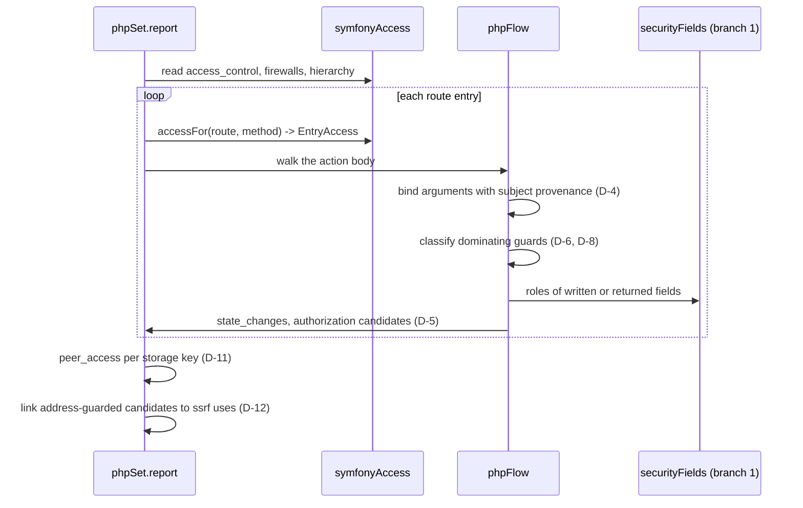

# Symfony analyzers 2 — entry access rules and authorization

- **Lane contract** [Symfony application-security analyzers](symfony-more-analyzers.md). Its §0,
  §2, §4 and §5 apply here and are not repeated.
- **Branch** `symfony-more-analyzers-2`, stacked on `symfony-more-analyzers-1`.
- **Depends on** [Branch 1](symfony-more-analyzers-1.md): the security-field census, the family
  registration pattern and the `security.yaml` reader.
- **Worktree** `symfony-more-analyzers`.
- **Review artifact** One draft PR whose base is `symfony-more-analyzers-1`.
- **Run log** `.zazz/ephemeral/symfony-more-analyzers-run-log.md`, section "Branch 2".

## 1. Capability

Code Scan learns what an entry requires of its caller and reports actions that change or reveal a
record without an adequate check.

1. **Entry access.** For each Symfony entry the scanner records whether a login is required and
   which roles, from `access_control`, firewalls, `#[IsGranted]` and in-code checks.
2. **Authorization** (`authorization`, CWE-862, CWE-639, CWE-285 and CWE-291). An action changes a
   stored record that the request selects, changes a privilege field, or returns account fields of
   other users. The record states which checks dominate the operation, by kind. The decision
   model judges whether they are adequate.
3. **Address-based guards.** A check of the client address against literal addresses is recorded
   as its own guard kind. It is weaker than a role or ownership check, and it is the reason an
   endpoint becomes reachable through a server-side request.
4. **State changes per entry**, including a change made on a safe HTTP method.

The claim is operation-centered: the scanner finds the protected operation and lists the checks
on its path. It never decides that a check is sufficient.

### 1.1 Sample rows owned by this branch

Paths are relative to the sample root at the pin. `security.yaml` requires `ROLE_ADMIN` for
`^/admin` and `ROLE_USER` for `^/user` (`config/packages/security.yaml:35`–`36`).

**Required positives.**

| ID | Entry | Operation anchor | Facets and evidence |
|---|---|---|---|
| `SYM-AUTHZ-01` | `POST /user/role/{user}` | `src/Controller/AdminController.php:32` | Writes `role_source` field `php-sql:user.is_admin` of a path-selected record. Entry roles `ROLE_USER`. No guard. Peer entries that write the same field require `ROLE_ADMIN` |
| `SYM-AUTHZ-02` | `POST /user/password/{user}` | `src/Controller/UserController.php:41` | Writes the `credential` field of a path-selected record. Entry roles `ROLE_USER`. No ownership guard |
| `SYM-AUTHZ-03` | `POST /user/email/{user}` | `UserController.php:62` | Writes the `login_identifier` field of a path-selected record. No ownership guard |
| `SYM-AUTHZ-04` | `GET /user/avatar/delete/{user}` | `UserController.php:159` (file delete), `:161` (field write) | Deletes a file named by a path-selected record's field and clears the field. No ownership guard. State change on `GET` |
| `SYM-LOCAL-01` | `ANY /local/promote/{user}` | `src/Controller/LocalController.php:77` | Writes `role_source` of a path-selected record. Entry authentication `none`. The only guard is `address_check` at `:22` against `127.0.0.1` and `::1` |

**Required controls.** None may be a finding in the judged scan.

| ID | Location | Offline expectation | Why it is protected |
|---|---|---|---|
| `SYM-AUTHZ-N01` | `UserController::uploadAvatar` `:99`–`102`, `getAvatarFromUrl` `:139`–`142` | `guarded`: a candidate with an `ownership_check` at `:75` and `:118` | `if ($user !== $this->getUser())` returns before the write |
| `SYM-AUTHZ-N02` | `UserController::about` `:214`, `edit` `:239`, `index` `:17`, `editForm` `:221` | `no_record` | The record is the session user (`#[CurrentUser]`), not a request-selected one |
| `SYM-AUTHZ-N03` | `AdminController::index` (output at `templates/admin/index.html.twig:44`), `deleteUser` `:53`, `createUser` `:101` | `guarded`: entry roles `ROLE_ADMIN` | `^/admin` requires `ROLE_ADMIN`. This is also README entry 8: the delete action is routed at `/admin/delete/{user}`, and no `/user/delete/{user}` route exists at the pin |
| `SYM-AUTHZ-N04` | `src/Controller/BlogController.php:53`–`58` | `no_record` | A new record is created as the session user. No existing record is changed |
| `SYM-AUTHZ-N05` | `src/Controller/PasswordResetController.php:78`–`80` | `guarded`: a `secret_check` at `:65` | The stored reset value of the selected account is compared with the path token before the write |
| `SYM-AUTHZ-N06` | `BlogController::post`, `index`, `search` | `no_record` | Public reads of non-account fields |
| `SYM-AUTHZ-N07` | `UserController::resizeAvatar` `:177`–`199` | `no_record` | No stored change and no file write or delete. Its command claim is `SYM-CMD-02` |
| `SYM-LOCAL-N01` | `LocalController::list` `:25`–`39` | `no_record` | Literal text only |
| `SYM-LOCAL-N02` | `LocalController::posts` `:84`–`102` | `no_record` | No census field is returned |

**Assessment-dependent rows.** A candidate is required offline (`present`). The judge decides.

| ID | Location | Note |
|---|---|---|
| `SYM-LOCAL-02` | `LocalController.php:51`–`63` | Returns `login_identifier` and `role_source` of every account behind the address guard only |
| `SYM-AUTHZ-R01` | `src/Services/Mail.php:38`, under `ANY /reset` | An unauthenticated entry writes a field of an account selected by a request value. That is how a reset flow works. The defect in this flow is branch 3's `SYM-RESET-01` |

## 2. Required reading

Beyond the lane contract's §1:

- [Branch 1](symfony-more-analyzers-1.md) D-4, D-5, D-11 and its §9 skeletons, and the
  branch 1 section of the run log (deviations and owner decisions).
- Branch 1 code this branch reads and does not rebuild or edit:
  `langphp/security_fields.go` (`s.securityFields(p)` for the census, `s.securityGaps(p)` for its
  gaps, `s.receiverType` for declared receiver types, `phpEnclosing`),
  `langphp/symfony_security.go` (`p.security(s)`, which reads entity user providers only and is
  extended here for `access_control`, firewalls and the role hierarchy),
  `langphp/exposure.go` (`throwingGuards`, `phpEndsInThrow`) and `langphp/mass_assignment.go`
  (`phpSkips`, `keyConditionGuards`, the `mass_assignment_candidate` sink used by D-7).
- [PHP Symfony support](php-symfony-support.md) D-8 (method narrowing), D-9 (entity arguments),
  D-15 (storage writes) and its invariant that security configuration is entry context.
- `scan/internal/langphp/symfony_entry.go` (argument binding, `#[CurrentUser]`),
  `symfony_controller.go` (`getUser`, `createAccessDeniedException`), `symfony_request.go`
  (`getClientIp`), `control.go` and `guards.go` (dominating conditions and early exits),
  `doctrine_storage.go`, `callable_summary.go`, `symfony_routes.go`.
- `scan/internal/analysis/entries.go`, `report_entries.go`; `scan/internal/judge/entry_context.go`.
- Symfony references the contracts cite:
  [access control](https://symfony.com/doc/6.4/security/access_control.html),
  [`IsGranted`](https://symfony.com/doc/6.4/security.html#security-securing-controller-attributes),
  [firewalls](https://symfony.com/doc/6.4/security.html#the-firewall),
  [client address and proxies](https://symfony.com/doc/6.4/deployment/proxies.html).

## 3. Invariants

- The lane's generality rule holds. No rule names a route, role, class or field of an
  application. `ROLE_ADMIN` has no special meaning to the scanner: a role is a string the entry
  requires.
- Entry access is context. It is added to the report's entry records and to the requests of the
  `authorization` family and later lane families. **No existing family's request bytes, protocol
  or digest changes**, and access rules never establish protection for an injection claim.
- The scanner lists guards. It never marks an authorization candidate protected on its own. The
  closed "no claim" cases of D-7 are the only way an operation makes no record.
- An entry access rule or attribute the reader cannot resolve is recorded as a gap. Access is
  then `unresolved`, never `none`. Operation guards follow the separate D-6 evidence boundary.
- Branch 1's files, records and outcomes are unchanged (AC12).

## 4. Scope and review shape

| Path | Change | Purpose |
|---|---|---|
| `scan/internal/analysis/authorization.go`, `entries.go`, `report_entries.go`, `json.go`, `analysis.go` | New, modified | `EntryAccess`, `StateChange`, `AuthorizationFacts`, guard kinds |
| `scan/internal/analysis/findings.go` | Modified | Report-only related finding IDs (D-12) |
| `scan/internal/langphp/symfony_access.go` | New | `access_control`, firewall and role-hierarchy reader; rule matching |
| `scan/internal/langphp/symfony_access_attr.go` | New | `#[IsGranted]` and annotation forms; in-code check contracts |
| `scan/internal/langphp/authorization.go` | New | Subject selection, protected operations, candidate assembly, peer access |
| `scan/internal/langphp/authorization_guards.go` | New | Guard classification, including the address guard |
| `scan/internal/langphp/symfony_security.go` | Modified | Expose the parsed `security.yaml` document to the access reader. No change to the provider reader |
| `scan/internal/langphp/symfony_entry.go`, `symfony_controller.go`, `symfony_request.go`, `calls.go`, `control.go`, `guards.go`, `doctrine_storage.go`, `modules.go`, `path.go` | Modified | Subject provenance on bound entities, check contracts, state-change collection, dispatch lines. `control.go` termination rules stay unchanged (D-3) |
| `scan/internal/langphp/class_index.go`, `flow.go`, `values.go` | Modified | Resolve helper and subject context, and propagate it through followed paths |
| `scan/internal/langphp/sql.go`, `twig.go` | Modified | Record plain-PHP SQL changes (D-9) and authorization evidence at template outputs (D-5 E3) |
| `scan/internal/langphp/*_test.go`, `testdata/symfony/access/`, `testdata/symfony/authorization/`, `testdata/symfony/authorization-transfer/`, `testdata/authorization-plain/` | New | Fixtures and tests of §8 |
| `scan/internal/analysispacks/authorization.go`, `families.go`, `descriptors.go`, `select.go`, `contracts.go`, tests | New, modified | Family, protocol `authorization-components-v3`, questions, contracts |
| `scan/internal/analysispacks/xss_selection.go`, `scan/internal/judge/injection.go` | Modified | Exclude authorization uses from XSS selection and dispatch the authorization judgment policy (D-13) |
| `scan/internal/judge/authorization.go`, `policy.go`, `components.go`, `client.go`, `bundle.go`, `budget.go`, `wire_facts.go`, tests | New, modified | Policy and wire facts |
| `scan/internal/report/finding_types.go`, `findings.go`, `application_findings.go`, `entries.go`, `sarif.go`, `guidance.go`, `html.go`, `report.html`, tests | Modified | Two finding types, entry access in the entry view, SARIF rules, the report-only SSRF link (D-12) |
| `scan/cli/main.go`, `schedule_cli_test.go`, `architecture_baseline_test.go`, `testdata/architecture-baseline.json` | Modified | Family name and filter parsing (AC8); baseline rows (AC9) |
| `scan/internal/pipeline/symfony_test.go` | Modified | This branch's sample assertions |
| `.zazz/evaluation/vuln-symfony-detection-guide.md`, `recall-gap-inventory/cases.json`, `check.py`, `test_check.py`, `symfony-results.md` | Modified | Rows, the `guarded` expectation, results |
| `.zazz/architecture/entry-access-and-authorization.md` | New | Design and approach (AC10) |
| `.zazz/architecture/application-security-analyzers.md`, `README.md`, `finding-types.md`, `common-entry-dispatch.md` | Modified | Fill the authorization section; link the design; entry access in the entry model |
| `docs/scan/detection-capabilities/missing-authorization.md` | New | Capability page (AC11) |
| `docs/scan/analysis/authorization.md` | New | Analysis rules (AC11) |
| `docs/scan/detection-capabilities.md`, `detection-capabilities/symfony.md`, `detection-capabilities/server-side-request-forgery.md`, `analysis/README.md`, `symfony-support.md`, `php-support.md`, `running-scans.md`, `interpreting-results.md`, `README.md` | Modified | Class row, Symfony coverage, the SSRF link note, family name |

Out of scope:

- Security voters, custom authenticators, `access_decision_manager` strategies and expression
  language in `allow_if` or `#[IsGranted(new Expression(…))]`. Each is a recorded gap (D-3).
- API Platform `security` attributes, Sonata and EasyAdmin permission systems.
- Tenant isolation through Doctrine filters.
- Object-level claims in plain PHP beyond D-9: there is no entity binding, so the selected record
  is established only by a SQL `WHERE` clause
  ([branch 5 D-2](symfony-more-analyzers-5.md#2-decisions)).
- CSRF. Branch 4 reads this branch's state-change facts for it.
- Building the full SSRF-to-internal-endpoint attack chain. The record link of D-12 is the only
  step taken.

## 5. Decisions

Each table is a closed list. A name outside a table is unmodeled and follows its "anything else"
row.

### Entry access

**D-1. Rules are evaluated as Symfony evaluates them: first match wins.** The reader walks
`security.access_control` in order and stops at the first rule whose `path` matches the route.
*Why:* a later rule never applies, and reporting it would overstate protection.

| Rule part | Reading |
|---|---|
| `path` | A regular expression. Matched against the route's static prefix, which is the path up to its first placeholder. The reader decides a match only for an expression made of `^`, literal characters, `/`, escaped characters, groups of literal alternatives (which may themselves contain such groups) and an optional `$`. Anything else gives `access_rule_unresolved` |
| `route` | Exact route name |
| `roles` | A string or list. `PUBLIC_ACCESS` and `IS_AUTHENTICATED_ANONYMOUSLY` give `authentication: none`. Every other attribute gives `required` and is listed in `roles` |
| `methods` | Compared with the entry's method. An `ANY` entry matches with the methods recorded |
| `ips`, `host`, `port`, `allow_if`, `requires_channel`, `request_matcher`, `attributes` | The rule is recorded with gap `access_rule_condition_unmodeled`. The result is `unresolved` |
| No rule matches | `authentication: none`, with the evidence that no rule matched |
| An earlier rule is unresolved | The result is `unresolved`. The reader does not skip it |

**D-2. Firewalls.** A firewall with `security: false` whose `pattern` matches (same expression
subset) gives `authentication: none` with that firewall as the source. The reader records each
firewall's authenticator keys (`form_login`, `http_basic`, `json_login`, `custom_authenticators`)
as evidence and gives `custom_authenticators` the gap `authenticator_unmodeled`.
`security.role_hierarchy` is read and attached as evidence so the model can see which roles a
role includes.

**D-3. Attributes and in-code checks.**

| Form | Result |
|---|---|
| `#[IsGranted('X')]` on the class or the action, from `Symfony\Component\Security\Http\Attribute\IsGranted` or `Sensio\Bundle\FrameworkExtraBundle\Configuration\IsGranted`, and the `@IsGranted("X")` docblock form | When `X` starts with `ROLE_` or `IS_AUTHENTICATED`: `required`, role added. Otherwise gap `voter_unmodeled` |
| `#[IsGranted('X', subject: …)]` | Gap `voter_unmodeled`, recorded as a guard of unknown kind |
| `$this->denyAccessUnlessGranted('X')` at the start of the action, before any branch | As `#[IsGranted('X')]` |
| `isGranted('X')` on the controller, `Security` or `AuthorizationCheckerInterface` in a condition with an early exit | A `role_check` guard on the operations it dominates |
| `$this->getUser()`, `Security::getUser()` or a `#[CurrentUser]` argument tested for null with an early exit | An `authenticated_check` guard |
| `@Security("…")` and expression arguments | Gap `access_expression_unmodeled` |

An early exit is a `return`, a `throw`, or a call that throws (`createAccessDeniedException`,
`createNotFoundException` with `throw`).

**The shared guard engine does not treat `throw` as terminating, and this branch does not change
that.** Making `control.go` end a path at `throw` would change existing requests: the sample's
`SYM-PATH-01` path claim has `throw $this->createNotFoundException()` at
`src/Controller/BlogController.php:93` before its sink at `:95` (lane halt 1). Guard
classification therefore detects a `throw` exit itself, syntactically, the way branch 1's
exposure records do: an earlier `if` in an enclosing block whose only branch ends in `throw`,
`return` or `exit` dominates the operations after it. Reuse `throwingGuards`, `phpEndsInThrow`
and `phpSkips`. Making the shared engine model `throw` is a recorded follow-up that needs a
protocol change for each affected family.

### The authorization claim

**D-4. Subject: a record the request selects.**

| How the record is obtained | Subject provenance |
|---|---|
| An entity argument bound from a route placeholder (the existing entity-argument binding) | `request_selected` |
| `find`, `findOneBy`, `findBy`, `getReference` on a repository or the entity manager with a request value in the identifier or criteria | `request_selected` |
| `findAll`, or `findBy` with literal criteria | `enumerated` |
| `#[CurrentUser]`, `getUser()`, `Security::getUser()`, or `getUser()->get…()` relations | `session_user` |
| `new` | `created` |
| A finder whose criteria include the session user or a field of it | `request_selected` with an `ownership_check` guard of form `query_scope` |

**The selecting source is a dependency.** A `request_selected` candidate's `dependencies`
include the request value that selects the subject: the route-placeholder input source of a bound
entity argument, or the request value in a finder's identifier or criteria, with its
`input_source` evidence also in the `subject_selection` role. *Why:* the key checker counts a
positive only when its candidate has a witnessed request source (`check.py` `witnessed`), so a
candidate without it cannot meet AC13's 21 of 21. An `enumerated`, `session_user` or `created`
subject has no selecting source. `authorization_candidate` is not added to `check.py`'s
`SOURCELESS_KINDS`.

**D-5. Protected operations.** A candidate is recorded for each of these on a path of the action.

| Rule | Operation | Facet |
|---|---|---|
| E1 | An update or delete of a `request_selected` stored record: a setter or property write that the storage model already records as a write, or `remove`. Also a file write or delete whose path is built from a field of such a record | `object_level` |
| E2 | A write to a `role_source` field of a `request_selected` record, or of a `created` record when the written value is request-derived. A value computed from a request value is request-derived, including the result of comparing it with a literal | `function_level` |
| E3 | A response or template output that carries a `credential`, `login_identifier` or `role_source` field of a `request_selected` or `enumerated` record | `data_exposure` |
| Anything else | No record | — |

*Why these three:* they are the operations where "who may do this" is a question in any
application. E3 is limited to census fields because a public page that shows a title selected by
path is correct, and reporting it would bury the real records. *Rejected:* reporting every
unguarded read of a path-selected record.

**D-6. Guards are classified and listed.** A condition with an early exit that dominates the
operation is recorded when it matches a modeled guard kind or the unclassified private-helper
case below. A dominating early exit alone is not authorization evidence.

| Kind | Shape |
|---|---|
| `ownership_check` | A comparison (`===`, `!==`, `==`, `!=`, or `->getId()` on both sides) between the subject, its identifier, or a relation getter of it, and the session user or its identifier. Or the `query_scope` form of D-4 |
| `role_check` | D-3's `isGranted` condition |
| `authenticated_check` | D-3's null test of the session user |
| `secret_check` | A comparison between a stored field of the subject and a request value, where the request value is not written to that field on the same path |
| `address_check` | D-8 |
| Unclassified call to a private helper of the same class | Record `guard_unclassified` and the available source span if following the call does not establish a modeled kind |
| Other unclassified condition | No authorization guard or `guard_unclassified` gap. This includes inline validation conditions such as a password-confirmation mismatch |

A guard reached through one private helper method of the same class is followed one step, as the
callable summaries allow. A deeper helper gives `guard_unclassified`.

**D-7. No-claim cases.** No record is made when the subject is `session_user`; when the operation
is on a `created` record and no `role_source` field receives a request-derived value; and when
the write is the key-controlled write branch 1 owns. *Why the last:* the same line would be
reported twice with two questions.

**D-8. The address guard.**

| Address source | `address_source` |
|---|---|
| `$request->getClientIp()`, `getClientIps()` | `framework_client_ip` |
| `$_SERVER['REMOTE_ADDR']`, `$request->server->get('REMOTE_ADDR')` | `peer_address` |
| `$_SERVER['HTTP_X_FORWARDED_FOR']`, `HTTP_CLIENT_IP`, `HTTP_X_REAL_IP`, `HTTP_FORWARDED`, and the same headers through `$request->headers->get` | `forwarded_header` |

The guard is an `address_check` when that value is compared with literals by `===`, `==`,
`in_array`, `str_starts_with`, `preg_match` or `IpUtils::checkIp`. The record holds the literals
and whether each is loopback, private or public. For `framework_client_ip` it also holds
`address_trust: {status: "unread"}` and gap `address_trust_configuration_unread`: whether the
value can be forged depends on trusted-proxy configuration, which branch 4 reads. The
`address_trust` field is part of this branch's protocol from the start, so branch 4 fills its
value without a protocol change. *Why its own kind:* an address is a property of the
connection, not of the user. The model needs to know the guard is of this type to weigh it, and
the CWE differs (291).

**D-9. Plain PHP.** With no access model and no entity binding, plain PHP makes an
`authorization_candidate` only for this shape: an `address_check` is the only guard that dominates
a modeled SQL `INSERT`, `UPDATE` or `DELETE`, a file write or delete, or a command execution. A
`$_SESSION` test with an early exit is recorded as `authenticated_check` and, when present, means
the shape does not apply. *Why so narrow:* it is the part that needs no framework fact, and a
wider plain-PHP claim would rest on guesses about what a record is.

*Amended 2026-11-22 by [branch 5 D-2](symfony-more-analyzers-5.md#2-decisions).* A second
shape is recorded with facet `object_level`: a SQL `UPDATE` or `DELETE` built from request
values whose `WHERE` clause compares a column with a request value. The `WHERE` clause states
which row changes, so the selected record is not a guess. The address-guard shape above is
unchanged.

**D-10. Facts.** `authorization.facets`, `authorization.subject` (class, provenance, selecting
source), `authorization.operation` (kind and storage keys), `security_fields` for the fields
written or returned, `authorization.guards` (kind, form, evidence), the entry's `access`,
`authorization.method_safe` (`yes` when the entry accepts only `GET` or `HEAD`, or is `ANY`, and
the operation is a state change), and `authorization.peer_access`.

**D-11. Peer access.** For a state change, the candidate lists up to eight other entries that
write the same storage key, each with its `access` and guard kinds, sorted by entry name and
then entry ID. *Why:*
the scanner cannot know which role an operation should need, but it can show that the same field
is written elsewhere only under a stronger rule. That is general evidence of an inconsistent
check, and it is what a reviewer would look for.

**D-12. The SSRF link is one-way on the wire.** When a report has an `address_check` authorization
candidate and at least one `ssrf_candidate`, the authorization candidate lists those SSRF use IDs
in `authorization.server_side_requests`. The SSRF candidates and their requests are unchanged.
After judgment the report adds a presentation-only `related_findings` reference to each such SSRF
finding. *Why one-way:* changing the SSRF request would change an existing protocol and invalidate
saved answers (lane halt 2). The punch list asked for a two-way link; the report gives it without
touching the wire.

**D-13. One family, three facets.** A candidate whose only guard is an `address_check` maps to
finding type `address-based-access`. Every other candidate maps to `missing-authorization`.
The protocol is `authorization-components-v3`, claim kind `authorization`. The shared policy
order is the lane contract §2.7. Required evidence roles: `subject_selection`,
`protected_operation`, `entry_access`, `control_flow`.

| Question | Answers | Asks |
|---|---|---|
| `subject_control` | `request_selected`, `not_selected`, `unknown` | Does the request choose which record the operation acts on, or which records are returned, as `authorization.subject` states? |
| `guard_adequacy` | `none`, `adequate`, `inadequate`, `unknown` | Do the recorded `authorization.guards`, judged by kind, limit the operation to a caller who should be allowed to perform it on this record? Answer `none` only when no guard is recorded. An `ownership_check`, `role_check`, `authenticated_check` or `secret_check` that dominates this operation on this subject is `adequate`; a `secret_check` is a stored-field comparison with a request value not written back on the same path. An `address_check` is a property of the connection, not of the user |
| `access_adequacy` | `adequate`, `inadequate`, `unknown` | Is the entry's recorded `access` enough for the fields in `security_fields` and the operation, given `peer_access`? When authentication is `none`, answer `inadequate`. Required roles are `adequate` for `data_exposure` of census fields. For `object_level` or `function_level` writes or deletes on a `request_selected` subject, listed roles alone are not `adequate` (any holder of those roles can still pick another caller's record) unless `peer_access` shows no stronger writer of the same key and the fields are not a weaker privilege write than those peers |

| Rule | Condition |
|---|---|
| Inconsistent | `guard_adequacy: none` when a guard is recorded (the answer must be `adequate` or `inadequate`). `guard_adequacy: adequate` when no guard is recorded. `access_adequacy: adequate` when `access.authentication` is `none`. `not_selected` when the subject provenance is `request_selected` from a route placeholder |
| Blocking gap | `access_rule_unresolved`, `access_rule_condition_unmodeled`, `voter_unmodeled`, `access_expression_unmodeled`, `authenticator_unmodeled`, `guard_unclassified`, `symfony_config_unread`, and `security_fields_unresolved` when the candidate's only facet depends on a census role |
| Not blocking | `address_trust_configuration_unread`. The address guard is judged as recorded; branch 4 adds evidence |
| Protected | `guard_adequacy: adequate`, or `guard_adequacy: none` with `access_adequacy: adequate` |
| Confirmed | `request_selected`, `guard_adequacy` of `none` or `inadequate`, and `access_adequacy: inadequate` |

For the `data_exposure` facet with an `enumerated` subject, `subject_control: request_selected`
is not required: the Confirmed rule needs only the guard and access answers. *Why one family:* the three facets share subject,
operation and guard evidence, and `AdminController`-style actions are function-level and
object-level at once.

## 6. Agent implementation rules

The lane contract §4 applies in full. Additional for this branch:

- Start from the top of the stack: `gh stack add symfony-more-analyzers-2`. The session is
  unattended (lane contract §4.2).
- The Lead Agent delivers S0 and S1 alone. S2 (guards) and S3 (subject and operations) are
  serialized, because both edit `control.go` and `symfony_entry.go`.
- **Stated exception to lane halt 1.** Two changes to pre-existing Symfony fixture rows of
  `scan/cli/testdata/architecture-baseline.json` are expected and are not a halt:
  1. Adding `access` and `state_changes` to entry records changes the report and SARIF digests.
  2. A pre-existing Symfony fixture that contains a D-5 shape gains `authorization_candidate`
     uses. Known cases at `stage`: `doctrine-storage` (`POST /note/{note}` calls
     `$note->setBody($request->get('b'))` on a route-bound entity), branch 1's `mass-assignment`
     fixture (the named-setter actions under `/account/{account}/…`), and possibly `coverage`,
     `services-ops` and `operations`, which contain setters. Branch 1 met the same situation with
     `doctrine-storage` and had to stop for the owner, who accepted the row.

  For each changed row, the run log records, from a comparison of the old and new golden rows,
  that (a) every pre-existing use keeps its ID, kind, request digest and signature digest, in
  the same relative order; (b) every added use is an `authorization_candidate`; and (c) the
  report's JSON diff is otherwise only the added `access` and `state_changes` fields. Update the
  golden with `go test ./scan/cli -run TestArchitectureBaseline -update-architecture-baseline`
  only after that check. Any other difference in an existing row is a halt.
- **Do not change `control.go` termination.** See D-3: `throw` is detected by guard
  classification, not by the shared engine.
- Additional halt: an authorization candidate appears on a pre-existing non-Symfony fixture other
  than through D-9.

## 7. Acceptance criteria

1. **AC1 (key).** The detection guide and `cases.json` hold the §1.1 rows. `check.py` accepts
   `authorization_candidate` and the offline expectation `guarded` (a candidate exists at the
   anchor and carries a guard of the stated kind, or entry roles as stated). Verified by
   `test_check.py` and by `check.py` on a branch 1 offline report, which reports the five
   positives missing.
   Each positive has `expect_status: confirmed_vulnerability`.
2. **AC2 (access rules).** Cases `AR-01` to `AR-14` pass in `TestSymfonyAccess`
   (`scan/internal/langphp/symfony_access_test.go`): first match wins; a literal-prefix rule
   gives `required` with its roles; `PUBLIC_ACCESS` gives `none`; no matching rule gives `none`;
   a rule with `ips` or `allow_if`, an unsupported expression, and an unresolved earlier rule give
   `unresolved` with the named gap; a `security: false` firewall gives `none`; method-limited
   rules apply per entry method.
3. **AC3 (attributes and checks).** Cases `AC-01` to `AC-08` pass in `TestSymfonyAccessChecks`:
   class and method `#[IsGranted]`, the docblock form, a leading `denyAccessUnlessGranted`, a
   voter attribute and an expression give the results of D-3.
4. **AC4 (guards).** Cases `GD-01` to `GD-12` pass in `TestAuthorizationGuards`: each shape of D-6
   and D-8 is classified with its kind, form and literals; a guard in a one-step private helper is
   followed; a comparison with no early exit is not a guard; a condition that dominates only one
   branch is recorded only for the operations on that branch.
5. **AC5 (candidates).** Cases `AZ-01` to `AZ-18` pass in `TestAuthorization`: E1, E2 and E3 each
   yield one candidate at the stated anchor with facets, subject provenance, storage keys, census
   roles, guards and entry access; every D-7 case records nothing; `method_safe` is `yes` for a
   `GET` state change; `peer_access` lists the other writers of the field with their access.
6. **AC6 (transfer and plain PHP).** Cases `AZ-19` to `AZ-24` pass on the
   `authorization-transfer` project (YAML routes, a `Member` entity, an owner relation compared by
   identifier, a role named `ROLE_STAFF`) and on `authorization-plain`. The command
   `grep -rnE 'ROLE_ADMIN|ROLE_USER|isAdmin|setAdmin|LocalController|isLocalRequest' scan --include='*.go' --include='*.md'`
   prints only lines in test files.
7. **AC7 (SSRF link).** Case `AZ-25`: a fixture with one address-guarded action and one
   `ssrf_candidate` lists the SSRF use ID in `authorization.server_side_requests`.
   `TestSSRFRequestUnchanged` proves the SSRF request bytes for that fixture equal the bytes
   produced with the authorization family skipped.
8. **AC8 (catalog and selection).** `go test ./scan/internal/analysispacks/... ./scan/internal/judge/... ./scan/internal/report/...`
   passes. The family is registered, `analysispacks.Select` accepts every new fixture candidate,
   `--only-family` and `--skip-family` accept `authorization`, and
   `TestExistingFamilyRequestsUnchanged` proves that the request bytes of every pre-existing
   family, and of the two branch 1 families, on the Symfony fixtures are identical with and
   without entry access computed. `TestAuthorizationPolicy` has one row per rule of the D-13
   table, including one row showing `address_trust_configuration_unread` does not block.
   `TestAuthorizationFindingsReport` asserts for stubbed Confirmed candidates: `type_ids` is
   `missing-authorization`, or `address-based-access` when the only guard is an `address_check`;
   SARIF rules carry `CWE-862`, `CWE-639` and `CWE-291` tags as the facet and guard state; the
   HTML entry view shows each entry's access; and a judged SSRF finding gains `related_findings`
   (D-12) while its saved request is unchanged.
9. **AC9 (isolation and determinism).** `TestArchitectureBaseline` passes: every pre-existing
   non-Symfony row is byte-identical, pre-existing Symfony rows differ only as §6 allows, and each
   new fixture directory has a row. `TestDVWASourceKey` passes. Two scans of each new fixture and
   of the sample are byte-identical.
10. **AC10 (architecture document).** `.zazz/architecture/entry-access-and-authorization.md`
    exists and states: the access model and its evaluation order; why access is entry context and
    never protection for another claim; subject provenance; the three operation rules and the
    reason reads are limited to census fields; guard kinds and why the address guard is separate;
    peer access; the one-way SSRF link; every gap and what resolving it would need.
    `application-security-analyzers.md` has its authorization section filled,
    `common-entry-dispatch.md` names `access` and `state_changes` in the entry record, and
    `finding-types.md` lists the two new types. Checked by reading and by `doc-check`.
11. **AC11 (user documentation).** Checked by reading and by `doc-check`.
    - New `docs/scan/detection-capabilities/missing-authorization.md`: what is reported, a table
      of the access sources read, the subject and operation rules, the guard kinds, "Recorded and
      decidable", "Recorded in Review" (each gap of D-1 to D-3 and D-8), "Not recorded" (D-7 and
      the §4 exclusions), and remediation for each facet.
    - `docs/scan/detection-capabilities.md`: a "Vulnerability classes" row, and entry access in
      "Languages and entry points".
    - `docs/scan/detection-capabilities/symfony.md`: entry access under "Entries", the family
      under "Operations", authorization removed from "Outside these claims".
    - `docs/scan/detection-capabilities/server-side-request-forgery.md`: the related-finding
      note for address-guarded endpoints.
    - New `docs/scan/analysis/authorization.md` with rules, fact codes and bounds, linked from
      `docs/scan/analysis/README.md`.
    - `docs/scan/interpreting-results.md`: how to read entry access and a guarded record.
      `docs/scan/symfony-support.md`, `php-support.md`, `running-scans.md` and `README.md` name
      the family.
12. **AC12 (no drift).** While stacked,
    `git diff origin/symfony-more-analyzers-1...HEAD --stat -- scan/internal/langphp/exposure.go scan/internal/langphp/mass_assignment.go scan/internal/langphp/security_fields.go scan/internal/analysis/exposure.go scan/internal/analysis/mass_assignment.go scan/internal/analysispacks/exposure.go scan/internal/analysispacks/mass_assignment.go scan/internal/judge/exposure.go scan/internal/judge/mass_assignment.go .zazz/specifications/scan/symfony-more-analyzers-1.md`
    prints nothing. After the branch 1 PR lands and `gh stack sync` runs, the same command against
    `origin/stage` prints nothing.
13. **AC13 (sample, offline).** `TestSymfonySourceKey` passes at the pin with all earlier
    assertions and these added: `FILE` entries carry no `access`; the 31 route entries carry `access`, with `required` and
    `ROLE_ADMIN` on the three `/admin` entries, `required` and `ROLE_USER` on the eleven `/user`
    entries, and `none` on the rest; each of the five positives has a candidate at its anchor with
    the facets, census roles, guards and access of §1.1; `SYM-AUTHZ-04` has `method_safe: yes`;
    `SYM-AUTHZ-01` lists `ANY /admin/create` in `peer_access`; `SYM-LOCAL-01` lists the
    `SYM-SSRF-01` use in `server_side_requests`; each control meets its offline expectation;
    `SYM-LOCAL-02` and `SYM-AUTHZ-R01` each have a candidate. `check.py` prints 21 of 21 positives
    and no control failure.
14. **AC14 (sample, judged).** Paid judged runs follow the lane contract §4.1.
    - Family checkpoint after S4: `--only-family authorization` reports the five positives as
      Confirmed, and the `guarded` controls (`SYM-AUTHZ-N01`, `-N03`, `-N05`) as not findings.
    - Branch acceptance: a full judged scan at the submitted commit reports the five positives as
      Confirmed findings, every earlier positive as Confirmed, and no control of this or an
      earlier branch as a finding. `symfony-results.md` records each run and
    the final status of every row, including the two assessment-dependent rows with a source
    review of the judge's answer.
15. **AC15 (gate).** The [contributor gate](../../../docs/contributing.md#verification) passes:
    `gofmt -l cmd scan` prints nothing, and `go vet ./...`, `go build ./...` and
    `go test -race ./... -count=1` succeed.
16. **AC16 (pull request).** A draft PR from `symfony-more-analyzers-2` exists whose base is
    `symfony-more-analyzers-1` (or `stage` after that PR landed), created with
    `gh stack submit --auto`. Its body links this specification and lists every criterion with
    its evidence or its blocked state.

## 8. Test strategy

Synthetic fixtures, table-driven tests, assertions on the JSON report, as branch 1's §8 states.
Every reported shape has a guarded sibling and a no-record sibling in the same table.

Not re-tested: entity argument binding, storage writes and route discovery, which existing tests
prove.

### Access rules (`testdata/symfony/access/`)

| Case | Configuration and route | Expected `access` |
|---|---|---|
| `AR-01` | `{ path: ^/manage, roles: ROLE_STAFF }`, route `/manage/items` | `required`, `[ROLE_STAFF]`, source at the rule |
| `AR-02` | Same rule, route `/items` | `none`, evidence "no rule matched" |
| `AR-03` | Rules `^/manage/public` `PUBLIC_ACCESS` then `^/manage` `ROLE_STAFF`; route `/manage/public/info` | `none` from the first rule |
| `AR-04` | The same two rules in the other order | `required` |
| `AR-05` | `roles: [ROLE_A, ROLE_B]` | Both roles listed |
| `AR-06` | `{ path: ^/api, roles: ROLE_API, methods: [POST] }`, entries `GET /api/x` and `POST /api/x` | `none` and `required` |
| `AR-07` | `{ path: ^/internal, roles: PUBLIC_ACCESS, ips: [127.0.0.1] }` | `unresolved`, gap `access_rule_condition_unmodeled` |
| `AR-08` | `{ path: '^/(?!open).*', roles: ROLE_X }` | `unresolved`, gap `access_rule_unresolved` |
| `AR-09` | An unresolved rule first, then a rule that matches | `unresolved` |
| `AR-10` | `{ path: ^/item, roles: ROLE_X }`, route `/item/{id}/edit` | `required`: the static prefix `/item/` matches |
| `AR-11` | `{ path: ^/item/special, roles: ROLE_X }`, route `/item/{id}` | `unresolved`: the placeholder can equal `special` |
| `AR-12` | Firewall `pattern: ^/health`, `security: false`; route `/health/live` | `none`, source at the firewall |
| `AR-13` | No `security.yaml` in the project | `unresolved`, gap `symfony_config_unread` |
| `AR-14` | `role_hierarchy: { ROLE_STAFF: ROLE_MEMBER }` | Hierarchy attached as evidence to an entry requiring `ROLE_MEMBER` |

### Attributes and checks (`testdata/symfony/access/`)

| Case | Source shape | Expected |
|---|---|---|
| `AC-01` | `#[IsGranted('ROLE_STAFF')]` on the class | `required` on every action |
| `AC-02` | `#[IsGranted('ROLE_STAFF')]` on one action | That action only |
| `AC-03` | `@IsGranted("ROLE_STAFF")` docblock | `required` |
| `AC-04` | `$this->denyAccessUnlessGranted('ROLE_STAFF');` as the first statement | `required` |
| `AC-05` | The same call inside an `if` | Not entry access. A `role_check` guard on the dominated operations |
| `AC-06` | `#[IsGranted('EDIT', subject: 'item')]` | Gap `voter_unmodeled` |
| `AC-07` | `@Security("is_granted('ROLE_X') and …")` | Gap `access_expression_unmodeled` |
| `AC-08` | Attribute and a matching `access_control` rule | Both sources listed, roles merged |

### Guards (`testdata/symfony/authorization/`)

| Case | Source shape | Expected guard |
|---|---|---|
| `GD-01` | `if ($item->getOwner() !== $this->getUser()) { throw $this->createAccessDeniedException(); }` | `ownership_check` |
| `GD-02` | `if ($account !== $this->getUser()) { return $this->redirectToRoute(…); }` | `ownership_check` |
| `GD-03` | `if ($item->getOwner()->getId() != $user->getId()) return …;` with `#[CurrentUser] $user` | `ownership_check` |
| `GD-04` | `$repo->findOneBy(['id' => $id, 'owner' => $this->getUser()])` | `ownership_check`, form `query_scope` |
| `GD-05` | `if (!$this->isGranted('ROLE_STAFF')) { throw … }` | `role_check` |
| `GD-06` | `if (!$this->getUser()) { return … }` | `authenticated_check` |
| `GD-07` | `if ($account->getResetCode() !== $code) { return … }`, `$code` a route value | `secret_check` |
| `GD-08` | `if (!in_array($request->getClientIp(), ['127.0.0.1', '::1'])) { return new Response('', 403); }` | `address_check`, `framework_client_ip`, two loopback literals, gap `address_trust_configuration_unread` |
| `GD-09` | The `GD-08` test in a private method called from the action | The same guard, followed one step |
| `GD-10` | `if ($_SERVER['HTTP_X_FORWARDED_FOR'] === '10.0.0.5') { … } else { exit; }` | `address_check`, `forwarded_header`, one private literal |
| `GD-11` | `if ($item->getOwner() !== $this->getUser()) { $this->addFlash('error', '…'); }` with no exit | No guard |
| `GD-12` | A comparison two helper methods deep | `guard_unclassified` |

### Candidates (`testdata/symfony/authorization/`, `…-transfer/`, `testdata/authorization-plain/`)

| Case | Source shape | Expected |
|---|---|---|
| `AZ-01` | Route `/item/{item}/rename`, entity argument, `setName(request)`, `flush`, entry `required` | Candidate, `object_level`, `request_selected`, no guard |
| `AZ-02` | `AZ-01` with `GD-01` first | Candidate with `ownership_check` |
| `AZ-03` | `AZ-01` with the record from `#[CurrentUser]` | No record |
| `AZ-04` | `$em->remove($item)` of a route-bound entity | Candidate, operation `delete` |
| `AZ-05` | `$repo->find($request->get('id'))` then a setter and `flush` | Candidate, `request_selected` |
| `AZ-06` | `unlink($dir . '/' . $item->getFile())` of a route-bound entity | Candidate, operation `file_delete` |
| `AZ-07` | `$account->setGrants($request->get('grants'))` on a route-bound account, entry `ROLE_MEMBER` | Candidate, `function_level` and `object_level`, `role_source` listed |
| `AZ-08` | A second entry under `ROLE_STAFF` writes the same field | `AZ-07` lists it in `peer_access` |
| `AZ-09` | `new Account()` with `setGrants(['ROLE_MEMBER'])` literal | No record |
| `AZ-10` | `new Account()` with `setGrants($request->get('grants'))` | Candidate, `function_level`, `created` |
| `AZ-11` | `new Comment()` with the author set to the session user and text from the request | No record |
| `AZ-12` | `GET /item/{item}/archive` sets a flag and flushes | Candidate with `method_safe: yes` |
| `AZ-13` | `findAll()` on accounts, response lists each `getMail()` | Candidate, `data_exposure`, `enumerated` |
| `AZ-14` | `findAll()` on posts, response lists titles | No record |
| `AZ-15` | Template renders `{{ account.mail }}` for a route-bound account | Candidate at the template output |
| `AZ-16` | Template renders `{{ post.title }}` for a route-bound post | No record |
| `AZ-17` | A dynamic property write loop on a route-bound entity | No authorization record. The mass-assignment candidate exists |
| `AZ-18` | A route-bound entity only read into a local, never written or output | No record |
| `AZ-19` | Transfer: YAML route, `Member`, owner compared by `getId()`, update | Candidate with `ownership_check` |
| `AZ-20` | Transfer: the same action without the comparison | Candidate, no guard |
| `AZ-21` | Transfer: `ROLE_STAFF` rule on `^/desk`, privilege write under `^/portal` requiring `ROLE_MEMBER` | Candidate, `peer_access` shows the `ROLE_STAFF` writer |
| `AZ-22` | Plain PHP: `if ($_SERVER['REMOTE_ADDR'] !== '127.0.0.1') exit;` then a `mysqli` `UPDATE` | Candidate, `address_check`, `peer_address` |
| `AZ-23` | Plain PHP: the same with a `$_SESSION['uid']` test and exit first | No record |
| `AZ-24` | Plain PHP: an unguarded `UPDATE` with no address check | No record (D-9) |
| `AZ-25` | Symfony: `GD-08` guarding a privilege write, plus an action with an `ssrf_candidate` | `server_side_requests` lists the SSRF use |

### Sample and regression

`TestSymfonySourceKey` gains the AC13 assertions. Branch 1 keeps the PR #39 row count separate
from the lane's rows: append this branch's row IDs to `symfonyLaneRows` in
`scan/internal/pipeline/symfony_test.go`, so `readSymfonyKey` still checks exactly 37 PR #39 rows
and the lane count grows. Handle `guarded` beside the existing control cases without changing
how they evaluate. `TestExistingFamilyRequestsUnchanged` and `TestSSRFRequestUnchanged` are the
guards for the invariant that no existing request changes.

`TestSymfonySourceKey/SYM-AUTHZ-02` also checks D-6: the password-confirmation early exit
does not introduce an unclassified guard or an authorization blocker.

## 9. Execution sequence

| Slice | Content | Owns | Depends on | ACs |
|---|---|---|---|---|
| **S0** | Stack branch, key rows, `guarded` expectation, offline baseline | `.zazz/evaluation/` | Branch 1 | AC1 |
| **S1** | `security.yaml` access reader, rule matching, attributes, entry `access` in the report | `symfony_access.go`, `symfony_access_attr.go`, `analysis/authorization.go` | S0 | AC2, AC3 |
| **S2** | Guard classification and the address guard | `authorization_guards.go`, `control.go`, `guards.go` | S1 | AC4 |
| **S3** | Subject provenance, operations E1 to E3, state changes, peer access, candidate assembly | `authorization.go`, `symfony_entry.go`, `doctrine_storage.go` | S2 | AC5, AC6 |
| **S4** | Family registration, protocol, policy, finding types, SSRF link | `analysispacks/`, `judge/`, `report/` | S3 | AC7, AC8 |
| **S5** | Policy and report tests, sample key test, determinism, no-drift, branch-acceptance judged run, results, architecture and user documents, draft PR | `pipeline/symfony_test.go`, `docs/`, `.zazz/architecture/` | All | AC8–AC16 |

S1 starts with `AR-01` failing.



Starting skeletons. Shapes are load-bearing; bodies adapt.

```go
// analysis/authorization.go
const AuthorizationKind = "authorization_candidate"
// EntryAccess is the shape of the lane contract §2.3.
type StateChange struct {
	StorageKey string `json:"storage_key,omitempty"`
	Operation  string `json:"operation"` // create | update | delete | file_write | file_delete
	Span       Span   `json:"span"`
}
type AuthorizationGuard struct {
	Kind          string   `json:"kind"` // role_check | ownership_check | authenticated_check | secret_check | address_check | guard_unclassified
	Form          string   `json:"form,omitempty"`
	AddressSource string   `json:"address_source,omitempty"`
	Literals      []string `json:"literals,omitempty"`
	AddressTrust  *AddressTrust `json:"address_trust,omitempty"` // {Status, Evidence}; "unread" here
	Evidence      Evidence `json:"evidence"`
	Gaps          []Gap    `json:"gaps,omitempty"`
}
type AuthorizationFacts struct {
	Facets              []string             `json:"facets"` // object_level | function_level | data_exposure
	SubjectClass        string               `json:"subject_class"`
	SubjectProvenance   string               `json:"subject_provenance"`
	Operation           StateChange          `json:"operation"`
	SecurityFields      []SecurityField      `json:"security_fields"`
	Guards              []AuthorizationGuard `json:"guards"`
	MethodSafe          string               `json:"method_safe"`
	PeerAccess          []PeerAccess         `json:"peer_access,omitempty"`
	ServerSideRequests  []string             `json:"server_side_requests,omitempty"`
}

// langphp/symfony_access.go
type symfonyAccessRule struct {
	path, route string
	roles, methods []string
	unmodeled      []string // rule parts of D-1's unmodeled row
	at             analysis.Span
}
func (p *symfonyProject) accessFor(r symfonyRoute, method string) analysis.EntryAccess
func accessPathMatches(expr, staticPrefix string, hasPlaceholder bool) (match, decided bool)

// langphp/authorization_guards.go
func (f *phpFlow) classifyGuard(cond *sitter.Node, subject phpValue) analysis.AuthorizationGuard

// langphp/authorization.go
func (f *phpFlow) protectedOperation(subject phpValue, op analysis.StateChange, at *sitter.Node)
```

## 10. Definition of done

- [ ] Required reading done and the standards-index lookup recorded in the run log.
- [ ] AC1 to AC16 verified, each with its command and output in the run log.
- [ ] The stack shows branch 2 on branch 1, and the no-drift check printed nothing.
- [ ] The diff against `origin/symfony-more-analyzers-1` matches §4.
- [ ] The architecture document and the user pages of AC10 and AC11 exist and are linked.
- [ ] A fresh-context Verifier Agent reran the §13 checks and reported PASS.
- [ ] The draft PR body links this specification and lists each AC's evidence.

## 11. Open questions

None. The owner's decisions are in the lane contract §5: entry 8 is accepted as not present,
and the authorization scope is state changes plus reads of census fields.

## 12. Run log protocol

Section "Branch 2" of the lane run log, with the items branch 1's §12 lists, plus the per-row
baseline diff review that §6 requires.

## 13. Agent implementation prompt

> You are implementing one branch of a stacked lane, unattended. Nobody will answer questions
> during this run. Everything you need is in the documents named here. Follow them exactly.
>
> **Setup.** Work only in the `symfony-more-analyzers` sibling worktree. Read `AGENTS.md`, then
> `.zazz/specifications/scan/symfony-more-analyzers.md` (the lane contract) in full, then
> `.zazz/specifications/scan/symfony-more-analyzers-2.md` in full, then the files §2 lists, then the
> run log at `.zazz/ephemeral/symfony-more-analyzers-run-log.md` and `git log`. Load the
> `spec-driven` skill and `.zazz/docs/using-gh-stack.md`. Run `pwd`, `git status --short
> --branch`, `git worktree list` and `gh stack view --json`.
>
> **Branch.** If the branch 1 PR has landed, run `gh stack sync` first. If
> `symfony-more-analyzers-2` does not exist, check out the top of the stack and run
> `gh stack add symfony-more-analyzers-2`. Branch 1 must be complete: if its run log section
> shows unmet criteria that this branch depends on (the census, the family registration
> pattern), that is a halt. Add a "Branch 2" section to the run log.
>
> **Work.** Deliver slices S0 to S5 of §9 in that order. For each slice: write its fixtures and
> failing tests from the §8 case tables, record the failing output, implement, make them pass,
> run the package tests, then commit on this branch. Implement the §5 decision tables
> literally. A name that is not in a table is not modeled. Use the question names, answers and
> status rules of D-13 exactly. Read branch 1's census with `securityFields`; do not rebuild it.
>
> **Rules that never bend.** The scanner lists guards and never decides that a guard is enough.
> No existing family's request, protocol or baseline row may change, except the entry-record
> additions §6 allows. A role name has no special meaning in scanner code. Nothing may name or
> copy the sample. Do not weaken, delete, skip or relabel a test, a §8 case, a §1.1 row or a §7
> criterion. Do not edit the branch 1 files AC12 lists. Do not merge anything.
>
> **Judged runs.** Paid judged runs of the sample are authorized. Run the checkpoints AC14
> lists as the lane contract §4.1 states, and stop judged iteration at 8 runs.
>
> **When blocked.** Follow the blocked item protocol of the lane contract §4.2. A failing test
> or build error is not a halt. Fix it.
>
> **Finish.** Run the gate of AC15 and the no-drift command of AC12. Start a fresh-context,
> read-only Verifier Agent with the text below and record its report. Open or update the draft
> PR with `gh stack submit --auto` (AC16). Update the run log. End with a list of AC1 to AC16,
> each marked met with its evidence, blocked, or not reached.
>
> **Verifier Agent prompt.** "Read-only. In the `symfony-more-analyzers` worktree on branch
> `symfony-more-analyzers-2`, run `go build ./...`, `go vet ./...`,
> `go test -race ./scan/internal/langphp/... ./scan/internal/analysispacks/... ./scan/internal/judge/... ./scan/internal/report/... -count=1`,
> `go test ./scan/cli -run TestArchitectureBaseline -count=1`, `TestDVWASourceKey`,
> `TestSymfonySourceKey`, and the no-drift command of AC12 in
> `.zazz/specifications/scan/symfony-more-analyzers-2.md`. Then scan the Symfony sample offline and
> read its JSON report. Check: (1) the three `/admin` entries have `access` `required` with
> `ROLE_ADMIN`, the eleven `/user` entries `required` with `ROLE_USER`, the other route entries
> `none`; (2) each of `SYM-AUTHZ-01` to `-04` and `SYM-LOCAL-01` has an
> `authorization_candidate` at its anchor with the guards §1.1 states; (3) the upload and
> avatar-from-URL actions carry an `ownership_check`; (4) the actions whose record is the
> session user have no `authorization_candidate`; (5) the request bytes of the `ssrf_candidate`
> equal those of a scan run with `--skip-family authorization`; (6) the AC6 grep prints only
> test-file lines; (7) the judged report named in `symfony-results.md` shows the five positives
> as `confirmed_vulnerability` and the three `guarded` controls as `protected_for_claim`.
> Report PASS or FAIL for each item with the command output. Change no file."

## 14. Implementation and review change log

### 2026-11-22 — Branch 2 PR review

**Source.** [PR #43 review](https://github.com/zazzcode/zazzles/pull/43#issuecomment-7084643997)
and the Branch 2 run log.

**Changed sections.** §4 names the implementation wiring already present in the review diff.
D-1 states that literal-alternative groups may be nested, as used by Symfony's default
development firewall. D-11 specifies the entry-ID tie-breaker for entries with the same name.

**Verification impact.** The access rules and firewall patterns are derived once per project
without changing the supported syntax. AC8 covers all three authorization CWE tags, HTML entry
access, and the reverse D-12 reference in the report. The latter is added only for judged SSRF
uses, without changing either family’s judge request. AC14 remains deferred.

### 2026-11-22 — D-6 guard scope clarification

**Source.** [PR #43 spec review](https://github.com/zazzcode/zazzles/pull/43#issuecomment-7084643997)
and the Branch 2 implementation deviation.

**Changed sections.** §3 limits the unresolved-access invariant to entry access. D-6 now
records unclassified conditions only for same-class private-helper calls and omits other
unclassified conditions. The early exit of an input-validation check does not establish
an authorization check, and should not by itself introduce a blocking authorization gap.

**Verification impact.** No scanner or judge protocol change. `TestAuthorizationGuards`
retains GD-12 for unresolved private helpers. `TestSymfonySourceKey/SYM-AUTHZ-02`
checks that the inline password-confirmation check does not introduce a
`guard_unclassified` guard or blocker.

### 2026-11-22 — Authorization judge retry for AC14 controls (not resolved)

**Source.** Owner steering after the branch 2 judged acceptance: authorize one more judged
budget with a tighter instruction; if still unmet, mark not implemented and carry into
branch 3 as follow-on work.

**Changed Sections.** D-13 (protocol id and the `guard_adequacy` / `access_adequacy` Asks
prose); §4 scope table protocol name; architecture and analysis docs that name the protocol;
`scan/internal/judge/client.go` family instruction; `scan/internal/analysispacks/authorization.go`
question and choice text; AC14 status (not met — follow-on).

**Rationale.** On `authorization-components-v1` the five positives Confirmed and
`SYM-AUTHZ-N01` Protected, but `SYM-AUTHZ-N03` (admin index template, `ROLE_ADMIN` entry,
no in-action guard) and `SYM-AUTHZ-N05` (credential write dominated by a `secret_check`) were
`confirmed_vulnerability`. The scanner listed the roles and the secret guard correctly; the
model answered `access_adequacy: inadequate` and `guard_adequacy: inadequate`.

**Summary.** One judged retry (`run-3075298902`, `--only-family authorization`, scanner
`c963f5d`, protocol `authorization-components-v2`) fixed both controls (`N03` and `N05`
`protected_for_claim`, `secret_check` / required-role census-read rules held) but regressed
required positives `SYM-AUTHZ-02` and `SYM-AUTHZ-04` to `protected_for_claim` by treating
listed `ROLE_USER` as adequate for request-selected object-level writes and deletes. AC14
is therefore **not implemented** on this branch. Protocol advanced to
`authorization-components-v3` with untested prose that keeps the `secret_check` and
census-read fixes and restores that listed roles alone do not cover request-selected
writes or deletes. No further judged run on this branch. Branch 3 owns the residual
(judge adequacy so all five positives Confirmed and `N01`/`N03`/`N05` Protected together).

**Verification Impact.** Recorded in the run log and `symfony-results.md`. Architecture
baseline digests follow v3. Reviewers treat AC14 as open residual, not a pass.

### 2026-11-22 — Findings from the branch 1 run

**Source.** Owner steering after the branch 1 run: "ideally any problem surfaced should be fix
in the -2 spec".

**Changed Sections.** §2, D-3, D-4, §4 scope table, §6, §8 "Sample and regression".

**Rationale.** Branch 1 halted twice on the same kinds of condition this branch meets more
widely: a pre-existing fixture containing the new family's shape (its baseline row changed), and
the shared guard engine not ending a path at `throw`. It also showed that the key checker needs a
witnessed source on positives and that the PR #39 row count must stay separate.

**Summary.** §6 now allows added `authorization_candidate` uses in pre-existing Symfony rows,
with a per-row check that every existing use is unchanged. D-3 states that `throw` exits are
detected by guard classification and `control.go` termination is not changed. D-4 requires the
selecting request source as a dependency. §8 names `symfonyLaneRows`. §2 names the branch 1
functions to reuse.

**Verification Impact.** The run log records the per-row baseline comparison of §6. GD-01, GD-05
and AC-05 are verified through the guard classifier, not through engine termination. AC13's
"21 of 21 positives" depends on the D-4 dependency rule.

### 2026-11-22 — Second pass and unattended execution

- **D-13.** Question names, answers, status rules, and which gaps block. The address-trust gap
  is stated as not blocking, without which `SYM-LOCAL-01` could not be Confirmed on this branch.
- **D-5.** "Request-derived" includes a comparison result, which the role-write rows depend on.
- **D-8.** The `address_trust` field exists from this branch so branch 4 fills a value without a
  protocol change.
- **§1.1.** The admin index control is anchored at its template output line.
- **AC1, AC8, AC13.** `expect_status` on positives; named policy and report tests; `FILE`
  entries carry no access.
- **AC15, AC16.** The gate names its commands. The draft PR is a criterion.
- **§11, §13.** No open question. The prompt is written for an unattended run.
- **Verification impact.** New offline tests: one policy test and one report test.

### 2026-11-22 — Drafted

Written with the lane contract. No code changed.
