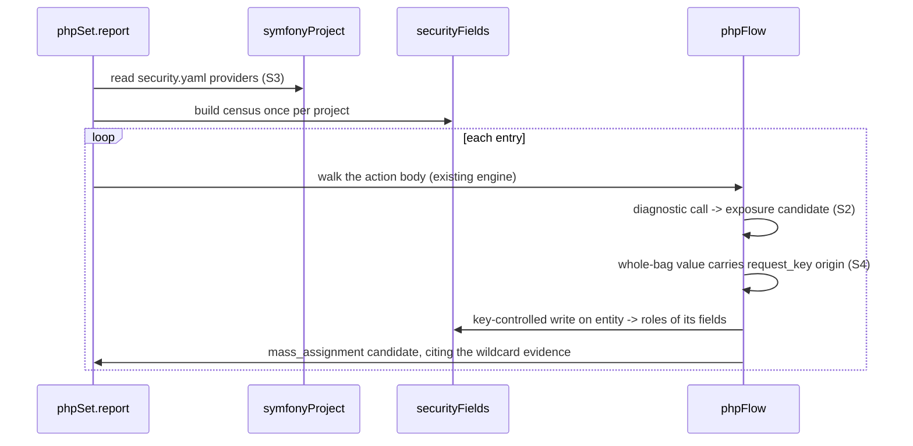

# Symfony analyzers 1 — information exposure, mass assignment and the security-field census

- **Lane contract** [Symfony application-security analyzers](symfony-more-analyzers.md). Its §0
  (stack model), §2 (cross-branch contract), §4 (agent rules and halts) and §5 (open questions)
  apply here and are not repeated.
- **Branch** `symfony-more-analyzers-1`, the bottom of the stack, based on `stage` at `af5dbc1`.
- **Worktree** `symfony-more-analyzers`.
- **Review artifact** One draft PR into `stage`.
- **Run log** `.zazz/ephemeral/symfony-more-analyzers-run-log.md`, section "Branch 1".

## 1. Capability

Code Scan gains two claim families for PHP websites and one shared fact.

1. **Information exposure** (`exposure`, CWE-200 and CWE-215). A diagnostic operation whose output
   reveals server configuration, environment or internal state is reachable from an entry with no
   guard on the path. The typical case is `phpinfo()` in a served file.
2. **Mass assignment** (`mass-assignment`, CWE-915). A request supplies the *names* of the
   properties it writes on a stored object, and that object has a field the request should not
   choose. The scanner already records the write as evidence (`storage_write_wildcard`). The
   claim is new.
3. **Security-field census.** Which stored fields hold a credential, the login identifier, or the
   source of a user's roles, established from framework contracts and code. Mass assignment uses
   it here. Branches 2 and 3 use it later.

This branch also commits and pushes the lane's documentation as its first checkpoint (the five
specifications, the specification index and the implementation-plan change), and it writes the
first version of the analyzer design document.

Per the lane contract §2.6, this branch extends existing code where it can: mass assignment is a
claim over the storage model's existing wildcard-write evidence, and exposure guards come from the
existing guard engine.

Both families follow the design intent: the scanner records source evidence and the decision
model judges it. Neither family adds a scanner-side verdict.

### 1.1 Sample rows owned by this branch

Paths are relative to the sample root at the pin.

| ID | Kind | Entry | Anchor | Offline expectation | Why |
|---|---|---|---|---|---|
| `SYM-INFO-01` | `info_exposure_candidate` | `FILE /public/info.php` | `public/info.php:2` | Positive | `phpinfo()` output in a served file with no guard |
| `SYM-INFO-N01` | `info_exposure_candidate` | Whole sample | — | Exactly one candidate of this kind in the report | No other diagnostic operation exists in `src/`, `public/` or `templates/` |
| `SYM-MASS-01` | `mass_assignment_candidate` | `POST /user/edit/` | Sink `src/Entity/User.php:59`, source `src/Controller/UserController.php:239` | Positive, with census roles on the written fields | The whole form bag reaches `$this->$key = $value`. `isAdmin` (`:48`) feeds `getRoles` through the lifecycle callbacks (`:63`–`73`), `password` (`:30`) is the credential, `email` (`:21`) is the login identifier |
| `SYM-MASS-N01` | `mass_assignment_candidate` | `ANY /admin/create`, `POST /register` | `src/Controller/AdminController.php:99`–`105`, `src/Controller/LoginController.php:102`–`106` | `no_record` | Each field is set by a named setter from a named request field |
| `SYM-MASS-N02` | `mass_assignment_candidate` | `POST /user/about/` | `src/Controller/UserController.php:213`–`215` | `no_record` | One named field through one named setter |

## 2. Required reading

Beyond the lane contract's §1:

- [PHP Symfony support](php-symfony-support.md) D-15 (storage keys, the wildcard write and the
  writer census) and D-11 (input facts).
- `scan/internal/langphp/doctrine_storage.go` (`doctrinePropertyWrite`, the wildcard branch),
  `doctrine_storage_link.go`, `symfony_request.go` (whole-bag readers), `symfony_project.go` and
  `symfony_yaml.go` (configuration reader and its limits), `class_index.go`, `entries.go`,
  `deserialization.go` (the most recent family adapter, as the shape to mirror).
- `scan/internal/analysispacks/families.go`, `deserialization.go`, `descriptors.go`, `select.go`;
  `scan/internal/judge/deserialization.go`, `policy.go`; `scan/internal/report/finding_types.go`,
  `findings.go`, `sarif.go`, `guidance.go`.
- User pages to mirror: `docs/scan/detection-capabilities/unsafe-deserialization.md` and
  `docs/scan/analysis/deserialization.md`.
- Symfony references the contracts cite:
  [security user](https://symfony.com/doc/6.4/security.html#the-user),
  [user providers](https://symfony.com/doc/6.4/security/user_providers.html),
  [Doctrine lifecycle callbacks](https://www.doctrine-project.org/projects/doctrine-orm/en/2.20/reference/events.html#lifecycle-callbacks),
  [`phpinfo`](https://www.php.net/manual/en/function.phpinfo.php).

## 3. Invariants

- The lane's generality rule holds: no rule, list or component names a sample identifier.
- The 14 required positives and every control of PR #39 keep their outcome.
  `TestSymfonySourceKey`, `TestDVWASourceKey` and every pre-existing row of
  `TestArchitectureBaseline` pass unchanged.
- The wildcard write stays a storage writer of every mapped field, exactly as D-15 states. This
  branch adds a claim that reads that evidence. It does not change the stored links.
- A field's census role comes from source evidence with a cited contract. A name alone never sets
  `credential`, `login_identifier` or `role_source`.
- A named setter fed by a named request field is not mass assignment, whatever the field is.
  Whether a named write is *authorized* is branch 2's claim.
- Resolution is source-only. Nothing runs the application or reads `vendor/` or `var/`.

## 4. Scope and review shape

| Path | Change | Purpose |
|---|---|---|
| `.zazz/specifications/symfony-more-analyzers.md`, `-1.md`, `-2.md`, `-3.md`, `-4.md`, `spec-index.md`, `README.md` | New, modified | The lane contract, four branch specifications, the delivery-ordered index and the index entry |
| `.zazz/project/implementation-plan.md` | Modified | The lane in "Next up" and "Planned functionality" |
| `.zazz/evaluation/vuln-symfony-detection-guide.md`, `recall-gap-inventory/cases.json`, `check.py`, `test_check.py` | Modified | The README-entry table of the lane contract §3, this branch's rows, the two new kinds |
| `scan/internal/analysis/exposure.go`, `mass_assignment.go`, `analysis.go`, `json.go` | New, modified | `ExposureFacts`, `MassAssignmentFacts`, `SecurityField`, fields on `CandidateUse` |
| `scan/internal/langphp/exposure.go` | New | Diagnostic operation contracts and candidate assembly |
| `scan/internal/langphp/security_fields.go`, `symfony_security.go` | New | The census; the `providers` reader for `security.yaml` |
| `scan/internal/langphp/mass_assignment.go` | New | Key-controlled write shapes and candidate assembly |
| `scan/internal/langphp/calls.go`, `doctrine_storage.go`, `flow.go`, `modules.go`, `symfony_project.go`, `symfony_request.go` | Modified | One dispatch line per contract, the wildcard write feeding the claim, the census cached on the set, key-origin tracking on whole-bag values |
| `scan/internal/langphp/*_test.go`, `testdata/exposure/`, `testdata/symfony/mass-assignment/`, `testdata/symfony/mass-assignment-transfer/`, `testdata/mass-assignment-plain/` | New | Fixtures and tests of §8 |
| `scan/internal/analysispacks/exposure.go`, `mass_assignment.go`, `families.go`, `descriptors.go`, `select.go`, `contracts.go`, tests | New, modified | Families, protocols `exposure-components-v1` and `mass-assignment-components-v1`, questions, descriptors, contracts |
| `scan/internal/guidelines/` (only if a family needs language material) | Modified | PHP guidance for the two families |
| `scan/internal/judge/exposure.go`, `mass_assignment.go`, `policy.go`, `components.go`, `client.go`, `bundle.go`, `budget.go`, `wire_facts.go`, tests | New, modified | Policy, question wiring, facts on the wire |
| `scan/internal/report/finding_types.go`, `findings.go`, `sarif.go`, `guidance.go`, `p5_explain.go`, tests | Modified | Finding types, SARIF rules for CWE-200 and CWE-915, guidance |
| `scan/cli/main.go`, `architecture_baseline_test.go`, `testdata/architecture-baseline.json` | Modified | Family names in flag help; baseline rows for new fixtures only |
| `scan/internal/pipeline/symfony_test.go` | Modified | `TestSymfonySourceKey` asserts this branch's rows |
| `.zazz/architecture/application-security-analyzers.md` | New | Design and approach (AC10) |
| `.zazz/architecture/README.md`, `finding-types.md` | Modified | Link the design document; add the two finding types |
| `docs/scan/detection-capabilities/information-exposure.md`, `mass-assignment.md` | New | Capability pages (AC11) |
| `docs/scan/analysis/information-exposure.md`, `mass-assignment.md` | New | Analysis rules (AC11) |
| `docs/scan/detection-capabilities.md`, `detection-capabilities/symfony.md`, `analysis/README.md`, `symfony-support.md`, `php-support.md`, `running-scans.md`, `README.md` | Modified | Class rows, Symfony coverage, family names, coverage table (AC11) |
| `.zazz/evaluation/symfony-results.md` | Modified | Offline and judged results of this branch |

Out of scope:

- Whether a named-setter write is allowed for the caller. That is branch 2.
- `extract($_POST)` and `parse_str` into the local scope (variable overwrite, CWE-621). A
  different claim with no stored object.
- Symfony Form `handleRequest`, serializer `denormalize` and `#[MapRequestPayload]` semantics.
  They are recorded with a gap (D-8) and not judged in this version.
- Doctrine XML or YAML mappings, API Platform resources and Laravel `$fillable`.
- Debug-mode and profiler exposure from configuration. Branch 4 owns it.
- Error-message and stack-trace disclosure through exception handling.

## 5. Decisions

Each table is a closed list. A name outside a table is unmodeled.

### Information exposure

**D-1. A diagnostic operation is the sink. There is no source.** The claim is that an entry
reaches an operation whose output is internal state. *Why:* no request value is involved, so the
flow-centered shape of the other families does not fit. The record is the operation, its
operand, its entry and the conditions on the path.

| Operation | Recorded when | Contract |
|---|---|---|
| `phpinfo()` | Always. The `INFO_*` flag argument is recorded when literal | `api.php-diagnostic-output-v1` |
| `var_dump`, `var_export` (not returning), `print_r` (not returning), `debug_zval_refcount` | An argument is `$_SERVER`, `$_ENV`, `$GLOBALS`, `getenv()` with no argument, `get_defined_vars()`, `ini_get_all()` or `get_defined_constants()` | Same |
| `debug_print_backtrace()` | Always | Same |
| `echo`, `print`, `Response` content, or a Twig output | The value is the return of `getenv()` with no argument, `php_uname()`, `phpversion()`, `ini_get_all()`, or `print_r` or `var_export` in returning mode over one of the arrays above | Same |
| Symfony `dump()` and `dd()` | Recorded with gap `diagnostic_output_environment_dependent`: the output depends on the debug environment | Same |
| Anything else | No record | — |

*Rejected:* recording every `var_dump` or `print_r`. Dumping a local value is a code smell, not
this claim, and it would make the family noise on real applications.

**D-2. Guards are evidence, not a filter.** A condition that dominates the operation is recorded
with its kind and source. The scanner emits the candidate either way. *Why:* whether
`if ($debug)` or a role check makes the exposure acceptable is a judgment. The one "no claim"
case is an operation with no entry (a console command or an unreferenced file outside the
document root).

**D-3. One candidate per operation per entry**, grouped as the existing families group sinks.
The facts are `exposure.operation`, `exposure.subject` (`configuration`, `environment`,
`runtime_state`, `stack`), `exposure.guards` and `exposure.entry_served` (the entry is a file
under the document root, or a route).

### Security-field census

**D-4. Roles come from framework contracts.** The lane contract §2.3 fixes the roles and the Go
shape. This branch implements `credential`, `login_identifier`, `role_source` and `name_hint`.

| Role | Evidence the scanner accepts |
|---|---|
| `credential` | A class implementing `Symfony\Component\Security\Core\User\PasswordAuthenticatedUserInterface`: the mapped field its `getPassword()` returns. Or any mapped field written from `password_hash(…)`, `PasswordHasherInterface::hash` or `UserPasswordHasherInterface::hashPassword` |
| `login_identifier` | `security.providers.<name>.entity.property` for the entity class, read by the bounded YAML reader. Or the mapped field `getUserIdentifier()` (or `getUsername()` on Symfony 5) returns |
| `role_source` | The mapped field `getRoles()` returns on a `UserInterface` class, directly or through a local variable assigned from it and then extended (`$r = $this->grants; $r[] = '…'; return array_unique($r);`). Plus each mapped field read by `getRoles()` or by a method carrying `#[ORM\PrePersist]`, `#[ORM\PreUpdate]` (or the docblock forms) whose body writes a `role_source` field. One step: a field read through a call to another method or service is not followed |
| `name_hint` | The property name, lower-cased with separators removed, is on this list: `isadmin`, `admin`, `issuperuser`, `superuser`, `isstaff`, `role`, `roles`, `permissions`, `privileges`, `password`, `passwordhash`, `apikey`, `token`, `resettoken`, `verified`, `isverified`, `balance`, `credit`, `ownerid`, `userid`, `tenantid` |

*Why contracts first:* an application can call its privilege flag anything. The framework
contract finds it in any Symfony application. *Why keep a hint list:* a plain-PHP application has
no such contract, and a non-user entity (an order's `price`, an account's `balance`) has none
either. The hint is passed to the model as a hint and labeled as one.

**D-5. Unresolved is stated.** When no class implements `UserInterface`, or `getRoles()` has a
body the one-step read cannot follow (a call into another service, a voter), the census records
gap `security_fields_unresolved` at that method. A candidate that depends on the census carries
the gap. Nothing is guessed.

### Mass assignment

**D-6. The claim is request-chosen property names on a stored object.** Three things are
established: the keys of the written data come from the request, the write selects its property
by that key, and the target is a stored object. *Why not "a whole bag reaches a setter":* a
whole bag passed to code that reads named keys from it is ordinary.

| Shape | Sink recorded | Version |
|---|---|---|
| `foreach ($data as $k => $v) { $obj->$k = $v; }` and `$obj->{$k} = $v` | The dynamic property write | Judged |
| `foreach ($data as $k => $v) { $obj->{'set' . ucfirst($k)}($v); }`, and the `call_user_func([$obj, 'set' . …], $v)` form | The dynamic method call | Judged |
| `PropertyAccessorInterface::setValue($obj, $k, $v)` with a request-chosen `$k` | The call | Judged |
| `ReflectionProperty::setValue` and `ReflectionClass::getProperty($k)` with a request-chosen `$k` | The call | Judged |
| Plain PHP: the same loops over `$_POST`, `$_GET`, `$_REQUEST` or decoded `php://input` | Same sinks | Judged |
| `$form->handleRequest($request)` or `$form->submit(…)` for a form bound to an entity | The call | Recorded with gap `mass_assignment_form_unmodeled` |
| `SerializerInterface::deserialize` or `DenormalizerInterface::denormalize` into an entity class, with or without `object_to_populate` | The call | Recorded with gap `mass_assignment_serializer_unmodeled` |
| `#[MapRequestPayload]` on an action argument whose type is a mapped entity | The parameter | Recorded with gap `mass_assignment_payload_unmodeled` |
| Anything else, including named setters and array literals with literal keys | No record | — |

**D-7. Key origin is tracked separately from value origin.** A whole-bag reader
(`$request->request->all()`, `->query->all()`, `->toArray()`, `getPayload()->all()`, a
superglobal) yields a value whose *keys* are request-controlled. A `foreach` key variable over
that value carries the `request_key` origin. An array built with literal keys does not. An
intersection with a literal key list (`array_intersect_key($data, array_flip([...]))`), a literal
`in_array($k, [...])` guard that dominates the write, and a `property_exists` test are recorded as
guard evidence with their kind (`key_allow_list`, `key_existence_check`). *Why:* an allow-list is
the fix, and whether a given list is adequate is a judgment. `property_exists` restricts nothing
and is recorded so the model can say so.

**D-8. The three framework shapes are recorded, not judged.** Their safety depends on form type
fields, serializer groups and validation that this version does not read. A record with a named
gap is visible in Review and does not claim a defect. *Why:* silence would read as "safe".

**D-9. Facts.** `mass_assignment.target_class`, `mass_assignment.target_stored` (`yes`, `no`,
`unresolved`), `mass_assignment.shape` (a row name of D-6), `mass_assignment.key_guards`, and
`security_fields` for every mapped field of the target that has a census role. When the target
has no field with a role, the candidate is still recorded with an empty list. *Why:* a
non-user object can still have a field the request should not choose, and the model sees the
field list.

**D-10. Relation to the storage link.** The existing wildcard evidence at the write is the same
source position as this claim's sink. The candidate cites it. Stored claims that list the wildcard
write as a writer (for example a stored command or path candidate) are unchanged.

### Registration and reporting

**D-11. Two new families, wired like `deserialization`.** Names are in the lane contract §2.2.
`exposure` has no source question. Its protocol asks: is the operation's output internal state,
is it reachable as recorded, and does a recorded guard restrict it. `mass-assignment` asks: are
the property names request-chosen as recorded, does a recorded guard restrict them to an adequate
set, and does the target have a field the request should not choose. Each question names the
facts it reads. *Why new families:* neither claim fits an existing protocol, and a changed
protocol on an existing family would invalidate its saved answers.

**D-13. Protocols and policy.** The shared order is the lane contract §2.7.

`exposure`, protocol `exposure-components-v1`, claim kind `exposure`. Required evidence roles:
`diagnostic_operation`, `entry`, `control_flow`.

| Question | Answers | Asks |
|---|---|---|
| `exposure_output` | `internal_state`, `benign`, `unknown` | Does the recorded operation emit server configuration, environment, runtime state or a stack, as `exposure.subject` states? |
| `exposure_reach` | `reachable`, `restricted`, `unknown` | Can a caller reach the operation through the recorded entry, given `exposure.guards` and `exposure.entry_served`? |

| Rule | Condition |
|---|---|
| Inconsistent | `restricted` with no guard recorded. `reachable` with `entry_served: no` |
| Blocking gap | `diagnostic_output_environment_dependent` |
| Protected | `exposure_output: benign`, or `exposure_reach: restricted` with at least one guard |
| Confirmed | `internal_state` and `reachable` |

`mass-assignment`, protocol `mass-assignment-components-v1`, claim kind `mass_assignment`.
Required evidence roles: `input_source`, `key_origin`, `property_write`, `target_class`,
`control_flow`.

| Question | Answers | Asks |
|---|---|---|
| `key_control` | `request_chosen`, `fixed`, `unknown` | Does the request choose which properties are written, as the key origin and `mass_assignment.shape` state? |
| `key_restriction` | `none`, `adequate`, `inadequate`, `unknown` | Do the recorded `key_guards` limit the names to a set that excludes the fields the request should not choose? |
| `field_impact` | `privileged_field`, `no_sensitive_field`, `unknown` | Does the target class have a field the request should not choose, judged from `security_fields` and the listed mapped fields? |

| Rule | Condition |
|---|---|
| Inconsistent | `adequate` with no `key_allow_list` guard recorded. `privileged_field` when `security_fields` is empty. `fixed` when the key origin is a whole request bag |
| Blocking gap | `mass_assignment_form_unmodeled`, `mass_assignment_serializer_unmodeled`, `mass_assignment_payload_unmodeled`. `security_fields_unresolved` blocks only when `security_fields` is empty |
| Protected | `key_restriction: adequate` with a `key_allow_list` guard |
| Confirmed | `request_chosen`, `key_restriction` of `none` or `inadequate`, and `privileged_field` |
| Stays Review | `no_sensitive_field`: the write is poor practice and is not confirmed as a privilege defect |

A `name_hint` role alone satisfies "`security_fields` is not empty". The question text tells the
model it is a hint.

**D-12. Entries.** `exposure` accepts HTTP entries, including server-mapped `FILE` entries.
`mass-assignment` accepts HTTP entries. Both are PHP-only in this version and say so in
`Languages`.

## 6. Agent implementation rules

The lane contract §4 applies in full, including its halt conditions. Additional for this branch:

- The lane setup and the documentation checkpoint are already done (lane contract §0). Verify
  them and continue. The session is unattended (lane contract §4.2).
- The Lead Agent works alone on S0 and S1. S2 (exposure) and S3 plus S4 (census and mass
  assignment) may go to two Contributor Agents in this worktree with the file ownership of §9.
  Only the Lead Agent edits `calls.go`, `families.go`, `descriptors.go`, `select.go`, `policy.go`
  and `finding_types.go`.
- Additional halt: the wildcard-write change alters any stored link of an existing candidate.

## 7. Acceptance criteria

"Candidate" means an entry of `uses` in the JSON report with the stated `kind`.

1. **AC1 (lane setup and first checkpoint).** The branch is named `symfony-more-analyzers-1`,
   `gh stack view --json` lists it as the only branch with base `stage`, and its first commit
   contains exactly the five specification files, `spec-index.md`, the `README.md` index entry
   and the implementation-plan change. That commit is pushed before any analyzer file changes.
   Verified by `git show --stat <first-commit>` and `git branch -r --contains <first-commit>`.
2. **AC2 (key).** The detection guide holds the README-entry table of the lane contract §3 and
   the §1.1 rows with source evidence. `cases.json` has one row per §1.1 ID with
   `app: vuln-symfony`, and each positive has `expect_status: confirmed_vulnerability`.
   `check.py` accepts `info_exposure_candidate` and `mass_assignment_candidate`, and treats a
   positive of a kind with no request source (lane contract §2.7) as met when the candidate is at
   its anchor with no completeness blocker. `test_check.py` has a case for that rule. Verified by
   `python3 .zazz/evaluation/recall-gap-inventory/test_check.py`, and by `check.py` on a baseline
   offline report, which reports both positives missing.
3. **AC3 (exposure).** Cases `EX-01` to `EX-12` pass in `TestPHPExposure`
   (`scan/internal/langphp/exposure_test.go`): each listed operation yields one
   `info_exposure_candidate` at its line with the stated `exposure.operation` and
   `exposure.subject`; a guarded operation carries the guard evidence and is still recorded; a
   dump of a local value, a returning `print_r` assigned and never output, and an operation in a
   file with no entry record nothing.
4. **AC4 (census).** Cases `SF-01` to `SF-09` pass in `TestSecurityFields`: each role is
   established by the evidence of D-4 and cites its source line; a privilege flag with an
   arbitrary name read by a lifecycle callback is `role_source`; a name on the hint list with no
   contract evidence is `name_hint` only; a `getRoles()` body that calls another service records
   `security_fields_unresolved`; two calls return identical output.
5. **AC5 (mass assignment).** Cases `MA-01` to `MA-16` pass in `TestMassAssignment`: each judged
   shape of D-6 yields one `mass_assignment_candidate` at the stated sink with the request source,
   `mass_assignment.shape`, the target class and its `security_fields`; an allow-list is recorded
   as `key_allow_list` and the candidate remains; the three framework shapes carry their gaps;
   named setters, literal-key arrays and a loop over a non-request array record nothing.
6. **AC6 (transfer and plain PHP).** The `mass-assignment-transfer` project and the
   `mass-assignment-plain` and `exposure` plain-PHP fixtures pass with the same code path as the
   first project (cases `MA-13` to `MA-16`, `EX-09` to `EX-12`). The command
   `grep -rnE 'isAdmin|fromArray|aboutMe|avatars_directory' scan --include='*.go' --include='*.php' --include='*.md'`
   prints only lines inside `scan/internal/pipeline/symfony_test.go`.
7. **AC7 (catalog and selection).** `go test ./scan/internal/analysispacks/... ./scan/internal/judge/... ./scan/internal/report/...`
   passes. Both families are in `Families()` with non-empty question names, every new contract
   has `Semantics` or material and a reference URL, `analysispacks.Select` accepts every candidate
   of the new fixtures (`TestApplicationFamiliesSelect`), and `--only-family` and `--skip-family`
   accept `exposure` and `mass-assignment` and reject an unknown name
   (`TestApplicationFamilyFilters` in `scan/cli/main_test.go`). The flag help and the error text
   in `scan/cli/main.go` list both names. `TestExposurePolicy` and `TestMassAssignmentPolicy`
   (`scan/internal/judge/`) have one row per rule of the D-13 tables and assert the status and
   the gap kind. `TestApplicationFindingsReport` (`scan/internal/report/`) asserts for one
   stubbed Confirmed candidate of each family: the JSON finding has `type_ids` of
   `information-exposure` or `mass-assignment`; the SARIF output has a rule whose tags include
   `CWE-200` or `CWE-915` and a result at the sink file and line; the HTML report shows the type
   label and the guidance text.
8. **AC8 (isolation and determinism).** `go test ./scan/cli -run TestArchitectureBaseline` passes
   with every pre-existing row byte-identical and one new row per new fixture directory.
   `TestDVWASourceKey` passes. Two scans of each new fixture and of the sample are byte-identical.
9. **AC9 (sample, offline).**
   `ZAZZLES_VULN_SYMFONY=<checkout> go test ./scan/internal/pipeline -run TestSymfonySourceKey`
   passes at the pin with its PR #39 assertions unchanged and these added: `SYM-INFO-01` has a
   candidate at `public/info.php:2` under `FILE /public/info.php` and is the only candidate of its
   kind; `SYM-MASS-01` has a candidate with sink `src/Entity/User.php:59`, a witnessed request
   source at `src/Controller/UserController.php:239`, `mass_assignment.shape` of the dynamic
   property write, and `security_fields` listing `role_source` for `php-sql:user.is_admin`,
   `credential` for `php-sql:user.password` and `login_identifier` for `php-sql:user.email`;
   `SYM-MASS-N01` and `SYM-MASS-N02` have no candidate. `check.py` prints 16 of 16 positives and
   no control failure.
10. **AC10 (architecture document).** `.zazz/architecture/application-security-analyzers.md`
    exists and states: why these families are operation-centered where the injection families are
    flow-centered; what each family records and what it leaves to the model; the census, its
    roles, evidence and limits; key origin versus value origin; the family registration pattern;
    and one section each for `exposure` and `mass-assignment` with its record shape and bounds.
    It carries headed placeholders for the three later families that say which branch fills
    them. `.zazz/architecture/README.md` links it under "Detailed analysis designs" and
    `finding-types.md` lists `information-exposure` and `mass-assignment`. Checked by reading and
    by `doc-check`.
11. **AC11 (user documentation).** Checked by reading and by `doc-check`.
    - New `docs/scan/detection-capabilities/information-exposure.md` and `mass-assignment.md`,
      in the layout of `unsafe-deserialization.md`: what the family reports, the covered
      operations or shapes as a table, "Recorded and decidable", "Recorded in Review" (each gap
      of D-1, D-5 and D-8), "Not recorded", and remediation.
    - `docs/scan/detection-capabilities.md`: two rows in "Vulnerability classes" linking the
      pages, and the census in "Shared evidence and stored values".
    - `docs/scan/detection-capabilities/symfony.md`: the two families under "Operations".
      Mass assignment and `phpinfo` leave "Outside these claims". Authorization stays there
      until branch 2.
    - New `docs/scan/analysis/information-exposure.md` and `mass-assignment.md` with the rules,
      fact codes and bounds, linked from `docs/scan/analysis/README.md`.
    - `docs/scan/symfony-support.md` and `docs/scan/php-support.md`: a row per family.
      `docs/scan/running-scans.md` and the CLI help list the two family names.
    - `README.md`: the two classes in "Current coverage".
12. **AC12 (sample, judged).** Paid judged runs follow the lane contract §4.1.
    - Family checkpoint after S2: `--only-family exposure` reports `SYM-INFO-01` as Confirmed.
    - Family checkpoint after S4: `--only-family mass-assignment` reports `SYM-MASS-01` as
      Confirmed and no finding for `SYM-MASS-N01` or `SYM-MASS-N02`.
    - Branch acceptance: a full judged scan at the commit submitted for review reports
      `SYM-INFO-01` and `SYM-MASS-01` as Confirmed findings, all 14 PR #39 positives as
      Confirmed, and no control as a finding.
    `.zazz/evaluation/symfony-results.md` records each run (run ID, commit, scope, request count,
    input tokens) and the row-by-row status of the final run.
13. **AC13 (gate).** The [contributor gate](../../docs/contributing.md#verification) passes:
    `gofmt -l cmd scan` prints nothing, and `go vet ./...`, `go build ./...` and
    `go test -race ./... -count=1` succeed.
14. **AC14 (pull request).** A draft PR from `symfony-more-analyzers-1` into `stage` exists,
    created with `gh stack submit --auto`. Its body links this specification, lists every
    criterion with its evidence or its blocked state, and repeats the invariants of §3.

## 8. Test strategy

Fixtures are synthetic. Symfony fixtures are minimal projects as the Symfony contract's §8
describes, under `scan/internal/langphp/testdata/symfony/<directory>/`. Plain-PHP fixtures live
under `scan/internal/langphp/testdata/<directory>/`. Tests are table-driven, one row per case ID,
and assert on the JSON report: `uses[].kind`, the sink span, source kind and name, the family
facts and gap kinds. Every vulnerable case has a sibling that must record nothing or must carry a
guard, so a rule that fires on everything fails.

Not re-tested: route discovery, bag readers and storage keys, which the Symfony tests already
prove. The first project uses an entity named `Account`. The transfer project uses `Member` with a
privilege flag named `staffLevel`, a `set…` dispatch loop where the first uses a property write,
and annotation routes where the first uses attributes.

### Exposure (`testdata/exposure/`, `testdata/symfony/exposure/`)

| Case | Source shape | Expected |
|---|---|---|
| `EX-01` | Symfony action calls `phpinfo()` | Candidate, `operation: phpinfo`, `subject: configuration` |
| `EX-02` | `phpinfo(INFO_MODULES)` | Candidate with the literal flag recorded |
| `EX-03` | `var_dump($_SERVER)` in an action | Candidate, `subject: environment` |
| `EX-04` | `new Response(print_r($_ENV, true))` | Candidate at the response |
| `EX-05` | `debug_print_backtrace()` | Candidate, `subject: stack` |
| `EX-06` | `phpinfo()` after `if (!$this->isGranted('ROLE_ADMIN')) { throw … }` | Candidate with one guard recorded |
| `EX-07` | `var_dump($post)` where `$post` is a local entity | No record |
| `EX-08` | `$text = print_r($_SERVER, true);` never output | No record |
| `EX-09` | Plain PHP: served `info.php` with `<?php phpinfo();` | Candidate under its `FILE` entry, `entry_served: yes` |
| `EX-10` | Plain PHP: `echo php_uname();` | Candidate, `subject: runtime_state` |
| `EX-11` | Plain PHP: `phpinfo()` in a file that only a console script includes | No record |
| `EX-12` | Symfony `dump($request)` | Candidate with gap `diagnostic_output_environment_dependent` |

### Census (`testdata/symfony/security-fields/`)

| Case | Source shape | Expected |
|---|---|---|
| `SF-01` | Entity implements `PasswordAuthenticatedUserInterface`; `getPassword()` returns `$this->secretHash` | `credential` on that field's key |
| `SF-02` | `security.yaml` provider `entity: { class: App\Entity\Account, property: handle }` | `login_identifier` on `handle` |
| `SF-03` | No provider property; `getUserIdentifier()` returns `$this->mail` | `login_identifier` on `mail` |
| `SF-04` | `getRoles()` returns `$this->grants` | `role_source` on `grants` |
| `SF-05` | `#[ORM\PreUpdate]` method sets `$this->grants` from `$this->staffLevel` | `role_source` on `staffLevel` too |
| `SF-06` | `getRoles()` computes from `$this->tier === 'gold'` | `role_source` on `tier` |
| `SF-07` | A `Product` entity with a field named `price` and one named `ownerId` | `name_hint` on `ownerId` only |
| `SF-08` | `getRoles()` returns `$this->roleService->rolesFor($this)` | Gap `security_fields_unresolved` at the method |
| `SF-09` | A field written from `$hasher->hashPassword($user, $plain)` on a class without the password interface | `credential` |

### Mass assignment (`testdata/symfony/mass-assignment/`, `…-transfer/`, `testdata/mass-assignment-plain/`)

| Case | Source shape | Expected |
|---|---|---|
| `MA-01` | `$account->fill($request->request->all())`; `fill` loops `$this->$k = $v` | Candidate at the property write, request source at the bag read, `shape: dynamic_property_write`, census roles listed |
| `MA-02` | The same loop inline in the action over `$request->toArray()` | Candidate |
| `MA-03` | Loop calls `$account->{'set' . ucfirst($k)}($v)` | Candidate, `shape: dynamic_setter_call` |
| `MA-04` | `$accessor->setValue($account, $k, $v)` inside a loop over `$request->query->all()` | Candidate, `shape: property_accessor` |
| `MA-05` | `MA-01` with `array_intersect_key($data, array_flip(['name', 'bio']))` first | Candidate with `key_guards: [key_allow_list]` and the literal list |
| `MA-06` | `MA-01` with `if (property_exists($this, $k))` | Candidate with `key_guards: [key_existence_check]` |
| `MA-07` | `$account->setName($request->get('name'))` and four more named setters | No record |
| `MA-08` | `$account->fill(['name' => $request->get('name')])` | No record: literal keys |
| `MA-09` | `$account->fill($this->defaults())`, a literal array from a method | No record |
| `MA-10` | `$form->handleRequest($request)` for a form created with the entity as data | Record with gap `mass_assignment_form_unmodeled` |
| `MA-11` | `$serializer->deserialize($request->getContent(), Account::class, 'json')` | Record with gap `mass_assignment_serializer_unmodeled` |
| `MA-12` | The dynamic write on a class with no Doctrine mapping, never persisted | Candidate with `target_stored: no` |
| `MA-13` | Transfer project: `Member`, annotation route, `set…` dispatch over `getPayload()->all()` | Candidate; `role_source` on `staffLevel` |
| `MA-14` | Transfer project: named setters only | No record |
| `MA-15` | Plain PHP: `foreach ($_POST as $k => $v) { $user->$k = $v; }` then a `mysqli` update | Candidate, `shape: dynamic_property_write`, census gap `security_fields_unresolved` and `name_hint` roles |
| `MA-16` | Plain PHP: `$user->name = $_POST['name'];` | No record |

### Sample and regression

`TestSymfonySourceKey` remains the only test that reads the sample. `TestArchitectureBaseline`
gains one row per new fixture directory.

## 9. Execution sequence

| Slice | Content | Owns | Depends on | ACs |
|---|---|---|---|---|
| **S0** | Verify the lane setup and checkpoint commit. Key rows, `check.py` kinds and the source-less positive rule, offline baseline | `.zazz/` | None | AC1, AC2 |
| **S1** | Family skeletons: analysis facts, family registration, descriptors, policy stubs, finding types, CLI names. No detection | `analysis/`, `analysispacks/`, `judge/`, `report/`, `cli/` | S0 | AC7 (partly) |
| **S2** | Exposure adapter | `langphp/exposure.go` | S1 | AC3 |
| **S3** | `security.yaml` provider reader and the census | `symfony_security.go`, `security_fields.go` | S1 | AC4 |
| **S4** | Key origin, mass-assignment shapes and candidate | `mass_assignment.go`, `doctrine_storage.go`, `symfony_request.go` | S3 | AC5, AC6 |
| **S5** | Policy and report tests, sample key test, determinism, branch-acceptance judged run, results record, architecture and user documents, draft PR | `pipeline/symfony_test.go`, `docs/`, `.zazz/architecture/` | All | AC7–AC14 |

S2 starts with `EX-01` failing. S3 starts with `SF-01` failing. S2 is independent of S3 and S4.



Starting skeletons. Field and function shapes are load-bearing; bodies adapt.

```go
// analysis/exposure.go
const ExposureKind = "info_exposure_candidate"
type ExposureFacts struct {
	Operation   string     `json:"operation"`
	Subject     string     `json:"subject"` // configuration | environment | runtime_state | stack
	Flag        string     `json:"flag,omitempty"`
	EntryServed string     `json:"entry_served"` // yes | no | unresolved
	Guards      []Evidence `json:"guards,omitempty"`
}

// analysis/mass_assignment.go
const MassAssignmentKind = "mass_assignment_candidate"
type SecurityField struct {
	StorageKey string     `json:"storage_key"`
	Roles      []string   `json:"roles"`
	Evidence   []Evidence `json:"evidence"`
}
type MassAssignmentFacts struct {
	Shape          string          `json:"shape"`
	TargetClass    string          `json:"target_class"`
	TargetStored   string          `json:"target_stored"` // yes | no | unresolved
	KeyGuards      []Evidence      `json:"key_guards,omitempty"`
	SecurityFields []SecurityField `json:"security_fields"`
}

// langphp/security_fields.go: the shape of the lane contract §2.3.
func (s *phpSet) securityFields(p *symfonyProject) map[string]securityField

// langphp/symfony_security.go
type symfonySecurity struct {
	providers map[string]symfonyUserProvider // name -> entity class and property
	read      bool
	unread    []analysis.Gap
}
func (p *symfonyProject) security(s *phpSet) *symfonySecurity

// langphp/exposure.go
func (f *phpFlow) diagnosticCall(n *sitter.Node, name string, values []phpValue) (phpValue, bool)

// langphp/mass_assignment.go
func (f *phpFlow) keyControlledWrite(target phpValue, key phpValue, at *sitter.Node, shape string)
```

## 10. Definition of done

- [ ] Required reading done and the standards-index lookup recorded in the run log.
- [ ] AC1 to AC14 verified, each with its command and output in the run log.
- [ ] `git diff origin/stage --stat` matches §4.
- [ ] The architecture document and the user pages of AC10 and AC11 exist and are linked.
- [ ] A fresh-context Verifier Agent reran the §13 checks and reported PASS.
- [ ] The draft PR body links this specification and lists each AC's evidence.

## 11. Open questions

None. The owner's decisions are in the lane contract §5.

## 12. Run log protocol

Section "Branch 1" of the lane run log. Record: the standards lookup, owner answers verbatim, the
sample pin and clean status around each scan, the fixture matrix with hand-computed anchors,
failing-first output per slice, architecture-baseline deltas, deviations, and each judged run with
its request count.

## 13. Agent implementation prompt

> You are implementing one branch of a stacked lane, unattended. Nobody will answer questions
> during this run. Everything you need is in two documents. Follow them exactly.
>
> **Setup.** Work only in the `symfony-more-analyzers` sibling worktree, on branch
> `symfony-more-analyzers-1`. Read `AGENTS.md`, then
> `.zazz/specifications/symfony-more-analyzers.md` (the lane contract) in full, then
> `.zazz/specifications/symfony-more-analyzers-1.md` in full, then the files §2 lists. Load the
> `spec-driven` skill and `.zazz/docs/using-gh-stack.md`. Run `pwd`, `git branch --show-current`,
> `git status --short --branch`, `git worktree list` and `gh stack view --json`, and confirm the
> stack has this one branch on `stage` with the documentation commit already present. Create the
> run log at `.zazz/ephemeral/symfony-more-analyzers-run-log.md` with a "Branch 1" section.
>
> **Work.** Deliver slices S0 to S5 of §9 in that order. For each slice: write its fixtures and
> its failing tests from the §8 case tables, run them and record the failing output, implement,
> run them until they pass, run the package tests, then commit on this branch with a bracketed
> scope label. Implement the §5 decision tables literally. A name that is not in a table is not
> modeled. Use the question names, answers and status rules of D-13 exactly. Use the lane
> contract §2.7 for the policy order and the wiring command.
>
> **Rules that never bend.** Every detection rule is a general PHP, Symfony or Doctrine contract.
> Nothing in scanner code, fixtures, component text or model requests may name or copy the
> sample. Do not weaken, delete, skip or relabel a test, a §8 case, a §1.1 row or a §7
> criterion. Do not change an existing family's request, protocol or baseline row. Do not merge
> anything. The sample checkout is read-only: check its pin and clean status before and after
> each scan.
>
> **Judged runs.** Paid judged runs of the sample are authorized. Run the checkpoints AC12
> lists, in the way the lane contract §4.1 states, and stop judged iteration at 8 runs.
>
> **When blocked.** If a halt condition of the lane contract §4 or of §6 applies, follow the
> blocked item protocol of the lane contract §4.2: log it, finish everything that does not
> depend on it, push, and report. A failing test or build error is not a halt. Fix it.
>
> **Finish.** Run the gate of AC13. Start a fresh-context, read-only Verifier Agent with the
> text below and record its report. Open or update the draft PR with `gh stack submit --auto`
> (AC14). Update the run log. End with a list of AC1 to AC14, each marked met with its evidence,
> blocked, or not reached.
>
> **Verifier Agent prompt.** "Read-only. In the `symfony-more-analyzers` worktree on branch
> `symfony-more-analyzers-1`, run `go build ./...`, `go vet ./...`,
> `go test -race ./scan/internal/langphp/... ./scan/internal/analysispacks/... ./scan/internal/judge/... ./scan/internal/report/... -count=1`,
> `go test ./scan/cli -run TestArchitectureBaseline -count=1`, and with `ZAZZLES_DVWA` and
> `ZAZZLES_VULN_SYMFONY` set to the sample checkouts, `TestDVWASourceKey` and
> `TestSymfonySourceKey`. Then scan the Symfony sample offline and read its JSON report. Check:
> (1) `public/info.php:2` is the only `info_exposure_candidate`; (2) the
> `mass_assignment_candidate` has sink `src/Entity/User.php:59` and lists `role_source`,
> `credential` and `login_identifier` roles; (3) the admin-create, register and about actions
> have no `mass_assignment_candidate`; (4) the AC6 grep prints only test-file lines; (5) no
> pre-existing row of `scan/cli/testdata/architecture-baseline.json` changed, by `git diff
> origin/stage -- scan/cli/testdata/architecture-baseline.json`; (6) the judged report named in
> `symfony-results.md` shows `SYM-INFO-01` and `SYM-MASS-01` as `confirmed_vulnerability`.
> Report PASS or FAIL for each item with the command output. Change no file."

## 14. Implementation and review change log

### 2026-11-22 — Second pass and unattended execution

- **D-13 (new).** Question names, answers and status rules for both families. The draft did not
  say how a judged status is reached.
- **D-4.** `role_source` now states the local-variable form of `getRoles()` and the one-step
  bound precisely.
- **AC2.** Positives carry `expect_status`, and `check.py` gets a rule for kinds with no source.
- **AC7.** Named policy, report and CLI filter tests replace a vague reference.
- **AC13, AC14.** The gate names its commands. The draft PR is a criterion.
- **§6, §11, §13.** No open question. The prompt is written for an unattended run.
- **Verification impact.** New offline tests: two policy tests, one report test, one CLI test.

### 2026-11-22 — Drafted

Written with the lane contract. No code changed.
