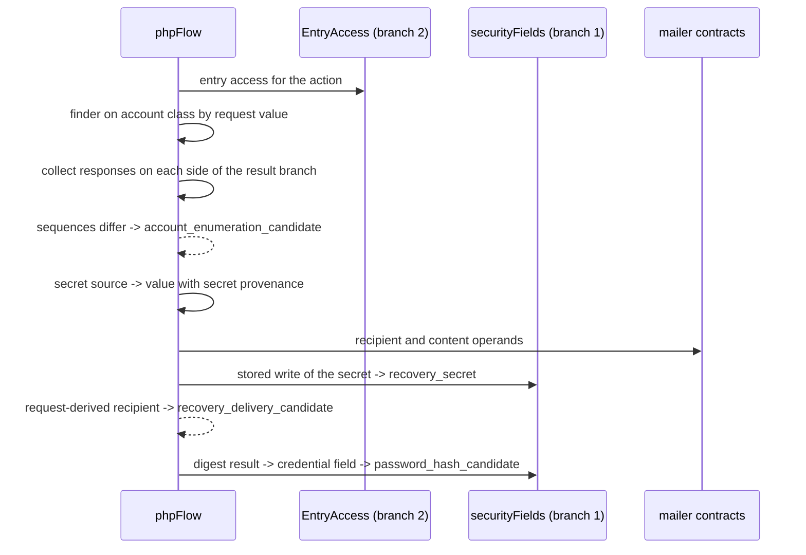

# Symfony analyzers 3 — account enumeration, recovery-secret delivery and weak password hashing

- **Lane contract** [Symfony application-security analyzers](symfony-more-analyzers.md). Its §0,
  §2, §4 and §5 apply here and are not repeated.
- **Branch** `symfony-more-analyzers-3`, stacked on `symfony-more-analyzers-2`.
- **Depends on** [Branch 1](symfony-more-analyzers-1.md) (census roles `credential` and
  `login_identifier`) and [Branch 2](symfony-more-analyzers-2.md) (entry access, `secret_check`).
- **Worktree** `symfony-more-analyzers`.
- **Review artifact** One draft PR whose base is `symfony-more-analyzers-2`.
- **Run log** `.zazz/ephemeral/symfony-more-analyzers-run-log.md`, section "Branch 3".

## 1. Capability

Code Scan reports three weaknesses in how a PHP website handles accounts. All three are in the
`account` family and each has its own candidate kind.

1. **Account enumeration** (CWE-204). An entry that needs no login looks up an account by a
   request value, and the "exists" and "does not exist" branches answer differently.
2. **Recovery-secret delivery** (CWE-640, with CWE-1287 for the input-type case). A generated
   secret is stored for an account and mailed to a recipient the request controls beyond what a
   check covered. The branch adds the mail sink, which no analyzer models today.
3. **Weak password hashing** (CWE-916). A fast digest is the stored form of a password.

The enumeration claim reuses the finder and flash models of the Symfony adapter. The recovery
claim reuses the storage model. None of the three is a new flow engine.

### 1.1 Sample rows owned by this branch

Paths are relative to the sample root at the pin.

**Required positives.**

| ID | Kind | Entry | Anchors | Evidence |
|---|---|---|---|---|
| `SYM-ENUM-01` | `account_enumeration_candidate` | `POST /register` | Lookups at `src/Controller/LoginController.php:76` and `:83`, responses at `:78` and `:85` | Entry access `none`. `findOneBy` on the user class by request `email`, then by request `username`. The found branch flashes a distinct literal and redirects; the other continues |
| `SYM-ENUM-02` † | `account_enumeration_candidate` | `ANY /reset` | Lookup at `src/Controller/PasswordResetController.php:34`, responses at `:36` and `:43` | Entry access `none`. `findBy` by request `email`. "Email not found" against the success message |
| `SYM-RESET-01` | `recovery_delivery_candidate` | `ANY /reset` | Secret at `PasswordResetController.php:40`, recipient at `src/Services/Mail.php:31`, send at `:35`, stored write at `:38`, request source at `PasswordResetController.php:28` | A `random_bytes` secret reaches a mail link and the stored field of each matching account. The recipient list is the request array. Only element `[0]` was checked (`:34`) |
| `SYM-HASH-01` † | `password_hash_candidate` | Several | `src/Security/Hasher/Md5Hasher.php:15`; `src/Controller/UserController.php:41`, `LoginController.php:106`, `src/Controller/AdminController.php:105`, `PasswordResetController.php:78` | `md5` is the return of a `PasswordHasherInterface::hash` implementation that `config/packages/security.yaml:5` selects, and `md5` of a request value is written to the `credential` field at four sites |

Rows marked † are not in the sample README's list.

**Required controls.**

| ID | Location | Offline expectation | Why |
|---|---|---|---|
| `SYM-ENUM-N01` | `LoginController::index` `:21`–`46` | `no_record` | The only finder (`:32`) takes a database value, not a request value. Every failure path uses one literal |
| `SYM-ENUM-N02` | `AdminController::createUser` `:79`–`90` | `no_record` | The same lookup-and-message shape under entry access `required` |
| `SYM-RESET-N01` | `PasswordResetController::resetPassword` `:63`–`84` | `no_record` | No secret is generated or mailed. Its authorization control is `SYM-AUTHZ-N05` |
| `SYM-HASH-N01` | `UserController.php:98`, `:138` | `no_record` | `md5(uniqid())` names a file. The input is not a password and the output is not a credential |

## 2. Required reading

Beyond the lane contract's §1:

- [Branch 1](symfony-more-analyzers-1.md) D-4 and [Branch 2](symfony-more-analyzers-2.md) D-1 to
  D-6.
- [PHP Symfony support](php-symfony-support.md) D-14 (finders bind their criteria), D-15 (flash
  storage keys and literal messages) and its exclusion of email bodies as an XSS sink, which this
  branch keeps.
- `scan/internal/langphp/doctrine_sql.go` and `doctrine_storage.go` (finder calls and criteria),
  `twig_functions.go` (`flashes`), `symfony_controller.go` (`addFlash`, `redirectToRoute`,
  `render`), `control.go`, `symfony_services.go`, `values.go`.
- `scan/internal/report/finding_types.go`: the existing `account-creation-validation` type, which
  stays a validation type (D-1).
- References the contracts cite:
  [Symfony Mailer](https://symfony.com/doc/6.4/mailer.html),
  [`mail`](https://www.php.net/manual/en/function.mail.php),
  [password hashers](https://symfony.com/doc/6.4/security/passwords.html),
  [`password_hash`](https://www.php.net/manual/en/function.password-hash.php),
  [`random_bytes`](https://www.php.net/manual/en/function.random-bytes.php).

## 3. Invariants

- The lane's generality rule holds. No rule matches a message text, a field name or a class name.
  A response is compared with another response, never with a phrase list.
- The scanner records the two branches and their responses. It never reads meaning into the
  text. Whether the difference tells a caller that an account exists is the model's judgment.
- Mail content is a delivery sink for the recovery claim only. It is not an XSS, header-injection
  or SSRF sink in this version.
- A password is established by evidence: a census `credential` field, a password-hasher contract
  or security configuration. A variable named `$password` alone establishes nothing in a Symfony
  project.
- Branch 1's and branch 2's files, records and outcomes are unchanged except as §4 lists (AC11).

## 4. Scope and review shape

| Path | Change | Purpose |
|---|---|---|
| `scan/internal/analysis/account.go`, `analysis.go`, `json.go` | New, modified | Three kinds and their fact structs |
| `scan/internal/langphp/account_enumeration.go` | New | Lookup-branch-response model |
| `scan/internal/langphp/mailer.go` | New | Symfony Mailer and `mail()` contracts |
| `scan/internal/langphp/recovery_delivery.go` | New | Secret sources, recipient shape, candidate assembly |
| `scan/internal/langphp/password_hash.go` | New | Digest contracts, hasher classes, configured algorithms |
| `scan/internal/langphp/security_fields.go` | Modified | Add the `recovery_secret` role only (lane contract §2.3) |
| `scan/internal/langphp/symfony_security.go` | Modified | Read `password_hashers` |
| `scan/internal/langphp/calls.go`, `control.go`, `values.go`, `symfony_controller.go`, `symfony_request.go`, `doctrine_storage.go` | Modified | Dispatch lines, branch-response collection, array-shape use of a request field, secret provenance |
| `scan/internal/langphp/*_test.go`, `testdata/symfony/account/`, `testdata/symfony/account-transfer/`, `testdata/account-plain/` | New | Fixtures and tests of §8 |
| `scan/internal/analysispacks/account.go`, `families.go`, `descriptors.go`, `select.go`, `contracts.go`, tests | New, modified | Family, protocol `account-components-v1`, contracts `api.symfony-mailer-v1`, `api.php-mail-v1`, `api.php-password-digest-v1` |
| `scan/internal/judge/account.go`, `policy.go`, `components.go`, `client.go`, `bundle.go`, `budget.go`, `wire_facts.go`, tests | New, modified | Policy and wire facts |
| `scan/internal/report/finding_types.go`, `findings.go`, `sarif.go`, `guidance.go`, tests | Modified | Three finding types and their SARIF rules |
| `scan/cli/main.go`, `architecture_baseline_test.go`, `testdata/architecture-baseline.json` | Modified | Family name; rows for new fixtures only |
| `scan/internal/pipeline/symfony_test.go` | Modified | This branch's sample assertions |
| `.zazz/evaluation/vuln-symfony-detection-guide.md`, `recall-gap-inventory/cases.json`, `check.py`, `test_check.py`, `symfony-results.md` | Modified | Rows and results |
| `.zazz/architecture/application-security-analyzers.md`, `finding-types.md` | Modified | Fill the account section (AC9); three finding types |
| `docs/scan/detection-capabilities/account-enumeration.md`, `weak-password-recovery.md`, `weak-password-hashing.md` | New | Capability pages (AC10) |
| `docs/scan/analysis/account-security.md` | New | Analysis rules (AC10) |
| `docs/scan/detection-capabilities.md`, `detection-capabilities/symfony.md`, `analysis/README.md`, `symfony-support.md`, `php-support.md`, `running-scans.md`, `README.md` | Modified | Class rows, Symfony coverage, family name |

Out of scope:

- Timing differences, rate limiting and lockout.
- Enumeration through login, where the lookup includes the credential. A login that answers
  differently for a known account with a wrong password is a separate shape with no sample.
- Host-header poisoning of a generated absolute reset link, token lifetime and token reuse.
- Symfony Notifier, Messenger-dispatched mail and third-party mail SDKs.
- Mail header injection and HTML mail bodies as a rendering sink.
- `crypt()` and its salt formats, `hash_pbkdf2` parameter adequacy, and pepper handling. A
  `crypt()` call that stores a credential is recorded with gap `password_digest_unmodeled`.
- Password policy (length and complexity).

## 5. Decisions

Each table is a closed list. A name outside a table is unmodeled.

### Family

**D-1. One new family, `account`, with three kinds. Enumeration is not folded into the
validation family.** The existing `account-creation-validation` type asks whether required fields
are enforced before an account is stored. Enumeration asks whether two responses differ, and it
also occurs in recovery flows where no account is created. *Why a new family:* a different
question on different evidence. The family's protocol carries a question set per kind, as the
`code` family does for its two kinds. If the `Family` registration cannot hold a question set per
kind, stop and ask the owner before splitting it into three families, because family names are
user-visible.

### Account enumeration

**D-2. The record is a lookup, a branch and two responses.**

| Element | Accepted evidence |
|---|---|
| Entry | Entry access `none`. With `unresolved`, the candidate is recorded and carries the access gap. With `required`, no record |
| Account class | A class implementing `UserInterface`, or the entity class of a user provider in `security.yaml` |
| Lookup | `find`, `findOneBy`, `findBy`, `count` or `exists`-style repository finder on that class whose identifier or criteria hold a request value, with no criterion compared to a `credential` field |
| Branch | A condition on the lookup result's truthiness, null test, `count`, or `empty` |
| Response | On each side, in order of appearance until the action returns: an `addFlash` literal, a `Response`, `JsonResponse` or `echo` literal, a status code, a `redirectToRoute` name, a `render` template name, a thrown HTTP exception class |
| Plain PHP | The lookup is a modeled SQL `SELECT` whose table also appears in a statement that writes a column from `password_hash` or a digest of D-7. Responses are `echo`, `header('Location: …')`, `http_response_code` and `die` literals |

**D-3. A candidate is recorded when the two response sequences differ.** They differ when their
literals, status, redirect target or template differ in any position. Identical sequences record
nothing. A response the reader cannot reduce to literals (a translated message key with a
request-built parameter, a response built in another service) is recorded on that side as
`response_unresolved`, and the candidate is recorded with that gap. *Why emit on any difference:*
the scanner does not know which wording reveals existence, and the registration case always
differs. The model weighs it.

**D-4. Facts.** `enumeration.lookup` (class, criteria fields, request source),
`enumeration.found` and `enumeration.not_found` (each a response list with spans), the entry's
`access`, and `security_fields` for the criteria fields that have a census role. One candidate per
lookup.

### Recovery-secret delivery

**D-5. Secret sources.**

| Source | `secret_strength` |
|---|---|
| `random_bytes`, `random_int`, `openssl_random_pseudo_bytes`, `Symfony\Component\Uid\Uuid::v4`, `ByteString::fromRandom`, `TokenGeneratorInterface::generateToken`, and `bin2hex` or `base64_encode` over one of them | `csprng` |
| `uniqid`, `mt_rand`, `rand`, `lcg_value`, `microtime`, `time`, and `md5` or `sha1` over one of them | `weak` |

**D-6. Mail sinks.**

| Contract | Recipient operands | Content operands | Send |
|---|---|---|---|
| `api.symfony-mailer-v1` | `to`, `addTo`, `cc`, `addCc`, `bcc`, `addBcc` on `Symfony\Component\Mime\Email` and `Symfony\Bridge\Twig\Mime\TemplatedEmail` | `html`, `text`, `subject`, `context` | `MailerInterface::send`, `TransportInterface::send` |
| `api.php-mail-v1` | Argument 1 of `mail` | Arguments 2 and 3 | The call |

A value passed to `UrlGeneratorInterface::generate` parameters or `generateUrl` and then into
content keeps its secret provenance.

**D-7. A candidate is recorded when a secret reaches mail content and the recipient is
request-derived.**

| Recipient origin | Result |
|---|---|
| A stored field of the looked-up account (`$user->getEmail()`) | No record. This is the correct shape |
| The same scalar request value that was the lookup criterion | Candidate, `recipient_validated: full` |
| A request value used as an array: iterated by `foreach`, passed to an `array`-typed parameter, or spread, while a check read it with a literal index (`$v[0]`) or read a different element | Candidate, `recipient_validated: partial`, with both use sites as evidence and `recipient_count: request_controlled` |
| A request value with no lookup on the path | Candidate, `recipient_validated: none` |

The facts also hold `recovery.secret` (source, strength), `recovery.stored_field` (the storage key
the secret is written to, when there is one) and `recovery.content` (the operand that carries
it). The field the secret is written to gets census role `recovery_secret`. *Why the array case is
called out:* a framework request reader returns an array when the client sends `name[]=`, so a
check of element zero says nothing about the rest. It is a general PHP input property, and it is
the whole defect in flows like this.

A secret with `secret_strength: weak` that is stored in a field compared by a `secret_check`
(branch 2) is recorded as a candidate with `recipient_validated` as found, even when the
recipient is the stored address. *Why:* a guessable recovery secret is the same weakness class.

### Weak password hashing

**D-8. A fast digest is recorded when evidence says its input is a password.**

| Digest (contract `api.php-password-digest-v1`) | |
|---|---|
| `md5`, `sha1`, `crc32`, `hash` and `hash_hmac` with a literal algorithm, `md5_file` excluded | Recorded with the algorithm |
| `password_hash`, `sodium_crypto_pwhash_str`, `UserPasswordHasherInterface::hashPassword`, a `PasswordHasherInterface` obtained from the factory | Never recorded. These establish a `credential` field (branch 1 D-4) |
| `crypt`, `hash_pbkdf2` | Recorded with gap `password_digest_unmodeled` |

| Password evidence | `password_basis` |
|---|---|
| The digest result is written to a census `credential` field | `credential_field` |
| The digest is the return value of `hash()` in a class implementing `PasswordHasherInterface` or `LegacyPasswordHasherInterface` | `hasher_class` |
| `security.password_hashers` selects `algorithm: md5`, `sha1`, `sha256`, `sha512` or `plaintext`, or an `id` naming a `hasher_class` candidate | `configuration`. The candidate's anchor is the configuration line |
| Plain PHP: the digest result reaches a SQL column in a statement where the same column is compared at a login query, and the digest input is a request value | `sql_credential_column` |
| Anything else, including a digest of a non-request value used as a name or cache key | No record |

Facts: `password_hash.algorithm`, `password_hash.salted` (`yes` when the digest input is a
concatenation with a non-literal second value, else `no`), `password_hash.iterated` (`no` for a
single call), `password_hash.basis` and the `security_fields` entry. Candidates of one algorithm
in one project are grouped as the existing families group sinks. The family needs no HTTP entry,
so a hasher class and a configuration line can be anchors.

## 6. Agent implementation rules

The lane contract §4 applies in full. Additional for this branch:

- Start from the top of the stack: `gh stack add symfony-more-analyzers-3`.
- S1 (enumeration), S2 with S3 (mailer and recovery) and S4 (hashing) own disjoint new files and
  may go to Contributor Agents. `control.go`, `calls.go`, `security_fields.go` and the family
  registration files are edited only by the Lead Agent.
- Additional halt: the `recovery_secret` role or the hasher reader changes any branch 1 or
  branch 2 candidate's facts on an existing fixture.

## 7. Acceptance criteria

1. **AC1 (key).** The detection guide and `cases.json` hold the §1.1 rows. `check.py` accepts the
   three kinds. Verified by `test_check.py` and by `check.py` on a branch 2 offline report, which
   reports the four positives missing.
2. **AC2 (enumeration).** Cases `EN-01` to `EN-14` pass in `TestAccountEnumeration`: a lookup by
   request value with differing branch responses yields one candidate with both response lists;
   identical responses, a lookup by a non-request value, a lookup that includes the credential, a
   non-account class and an entry with access `required` record nothing; `unresolved` access and
   an unreducible response carry their gaps.
3. **AC3 (mailer).** Cases `ML-01` to `ML-06` pass in `TestPHPMailer`: each recipient and content
   operand of D-6 is recorded with its contract for Symfony Mailer, `TemplatedEmail` and `mail()`;
   a secret passed through `generate` parameters into `html` keeps its provenance; a mail with no
   secret in its content makes no recovery record.
4. **AC4 (recovery delivery).** Cases `RC-01` to `RC-10` pass in `TestRecoveryDelivery`: each row
   of D-7 gives its `recipient_validated` value and evidence; the stored-address shape records
   nothing; the stored field gains census role `recovery_secret`; a weak secret behind a
   `secret_check` is recorded.
5. **AC5 (password hashing).** Cases `PH-01` to `PH-12` pass in `TestPasswordHash`: each
   `password_basis` row yields a candidate with its algorithm and basis; `password_hash` and the
   Symfony hasher service record nothing; a digest of a non-password value records nothing;
   a salted digest carries `salted: yes` and is still recorded.
6. **AC6 (transfer and plain PHP).** The `account-transfer` project (a `Member` class, JSON
   responses with status codes where the first project uses flashes, a `TemplatedEmail`, a hasher
   class using `sha1`) and the `account-plain` fixtures pass (cases `EN-11` to `EN-14`, `RC-09`,
   `RC-10`, `PH-10` to `PH-12`). The command
   `grep -rnE 'already in use|not found|Invalid credentials|Md5Hasher|sendReset' scan --include='*.go' --include='*.md'`
   prints only lines in test files.
7. **AC7 (catalog and selection).** `go test ./scan/internal/analysispacks/... ./scan/internal/judge/... ./scan/internal/report/...`
   passes. The family and its three contracts are registered with reference URLs,
   `analysispacks.Select` accepts every new fixture candidate, `--only-family account` is accepted,
   and `TestExistingFamilyRequestsUnchanged` (branch 2) still passes.
8. **AC8 (isolation and determinism).** `TestArchitectureBaseline` passes with every pre-existing
   row byte-identical and one row per new fixture directory. `TestDVWASourceKey` passes. Two scans
   of each new fixture and of the sample are byte-identical.
9. **AC9 (architecture document).** The account section of
   `.zazz/architecture/application-security-analyzers.md` states: the lookup-branch-response model
   and why responses are compared with each other; why enumeration is not part of validation; the
   secret-to-mail model, the recipient-origin table and the array-shape fact; the mail sink
   contracts and what they are not used for; how a password is established for the hashing claim;
   every gap. `finding-types.md` lists the three types. Checked by reading and by `doc-check`.
10. **AC10 (user documentation).** Checked by reading and by `doc-check`.
    - New `docs/scan/detection-capabilities/account-enumeration.md`, `weak-password-recovery.md`
      and `weak-password-hashing.md`, each in the layout of `unsafe-deserialization.md` with its
      covered shapes as a table, "Recorded and decidable", "Recorded in Review", "Not recorded"
      (the §4 exclusions that belong to it) and remediation.
    - `docs/scan/detection-capabilities.md`: three "Vulnerability classes" rows.
    - `docs/scan/detection-capabilities/symfony.md`: finders, flashes and Mailer as inputs to the
      new claims under "Operations"; the three items removed from "Outside these claims".
    - New `docs/scan/analysis/account-security.md` with rules, fact codes and bounds, linked from
      `docs/scan/analysis/README.md`.
    - `docs/scan/symfony-support.md`, `php-support.md`, `running-scans.md` and `README.md` name
      the family and its three claims.
11. **AC11 (no drift).** While stacked,
    `git diff origin/symfony-more-analyzers-2...HEAD --stat -- scan/internal/langphp/exposure.go scan/internal/langphp/mass_assignment.go scan/internal/langphp/symfony_access.go scan/internal/langphp/symfony_access_attr.go scan/internal/langphp/authorization.go scan/internal/langphp/authorization_guards.go scan/internal/analysis/authorization.go scan/internal/analysispacks/authorization.go scan/internal/judge/authorization.go .zazz/specifications/symfony-more-analyzers-1.md .zazz/specifications/symfony-more-analyzers-2.md`
    prints nothing, and the diff of `scan/internal/langphp/security_fields.go` only adds the
    `recovery_secret` role. After the lower PRs land and `gh stack sync` runs, the same check
    against `origin/stage` holds.
12. **AC12 (sample, offline).** `TestSymfonySourceKey` passes at the pin with all earlier
    assertions and these added: `SYM-ENUM-01` has two candidates under `POST /register` at the
    lookups `:76` and `:83`, each with differing response lists and entry access `none`;
    `SYM-ENUM-02` has one under `ANY /reset`; `SYM-RESET-01` has a candidate with the secret
    source at `PasswordResetController.php:40`, `secret_strength: csprng`,
    `recipient_validated: partial`, `recipient_count: request_controlled`, the two use sites
    `:34` and `Mail.php:23`, and stored field `php-sql:user.reset` with role `recovery_secret`;
    `SYM-HASH-01` has candidates at its five anchors with `algorithm: md5`, `salted: no` and the
    stated basis; each control has no candidate. `check.py` prints 25 of 25 positives and no
    control failure.
13. **AC13 (sample, judged).** Paid judged runs follow the lane contract §4.1.
    - Family checkpoints: `--only-family account` after S1 (the two enumeration rows Confirmed),
      after S3 (`SYM-RESET-01` Confirmed) and after S4 (`SYM-HASH-01` Confirmed). Each run also
      shows no finding for the controls of the kinds delivered so far.
    - Branch acceptance: a full judged scan at the submitted commit reports the four positives as
      Confirmed findings, every earlier positive as Confirmed, and no control of this or an
      earlier branch as a finding. `symfony-results.md` records each run and
    the final status of every row.
14. **AC14 (gate).** The [contributor gate](../../docs/contributing.md#verification) passes.

## 8. Test strategy

Synthetic fixtures, table-driven tests, assertions on the JSON report, as branch 1's §8 states.
The first project answers with flashes and redirects. The transfer project answers with JSON and
status codes, so a rule tied to one response form fails.

Not re-tested: finder binding, flash storage, entry access and the census, which lower tests
prove.

### Enumeration (`testdata/symfony/account/`, `…-transfer/`, `testdata/account-plain/`)

| Case | Source shape | Expected |
|---|---|---|
| `EN-01` | Public `POST /join`: `findOneBy(['mail' => request])`; found: flash literal A and redirect; else continues to create | Candidate with both response lists |
| `EN-02` | Two lookups in one action, each with its own found response | Two candidates |
| `EN-03` | Public `POST /forgot`: not found: flash literal B; found: flash literal C | Candidate |
| `EN-04` | `EN-03` with the same literal and redirect on both sides | No record |
| `EN-05` | `EN-01` under an `access_control` rule requiring a role | No record |
| `EN-06` | `EN-01` with access `unresolved` (rule with `ips`) | Candidate with the access gap |
| `EN-07` | Lookup value comes from a database row, not the request | No record |
| `EN-08` | Lookup on a `Product` class by request `sku`, differing responses | No record: not an account class |
| `EN-09` | Found branch responds through `$this->responder->fail($key)` in another service | Candidate with `response_unresolved` |
| `EN-10` | A finder whose criteria include a value compared with the `credential` field | No record |
| `EN-11` | Transfer: `Member`, `JsonResponse(['error' => …], 409)` against `201` | Candidate; responses hold literal and status |
| `EN-12` | Transfer: both sides return `JsonResponse(['ok' => true], 202)` | No record |
| `EN-13` | Plain PHP: `SELECT` on the table a `password_hash` write targets, `echo` literal A against literal B | Candidate |
| `EN-14` | Plain PHP: the same on a table with no credential evidence | No record |

### Mailer (`testdata/symfony/account/`)

| Case | Source shape | Expected |
|---|---|---|
| `ML-01` | `(new Email())->to($a)->subject('…')->html($b)`, then `$mailer->send($email)` | Recipient and content operands recorded, `api.symfony-mailer-v1` |
| `ML-02` | `addTo`, `cc` and `bcc` forms | Each a recipient operand |
| `ML-03` | `TemplatedEmail` with `context(['link' => $url])` | `context` is a content operand |
| `ML-04` | `$url = $router->generate('route', ['code' => $secret])` then `html('…' . $url)` | Content carries the secret provenance |
| `ML-05` | `mail($to, 'subject', $body)` | `api.php-mail-v1` operands |
| `ML-06` | A mail whose content holds no secret | No recovery record |

### Recovery delivery

| Case | Source shape | Expected |
|---|---|---|
| `RC-01` | Secret from `bin2hex(random_bytes(16))`, stored with a setter, mailed to `$account->getMail()` | No record; the field has role `recovery_secret` |
| `RC-02` | Mailed to the scalar request value that was the lookup criterion | Candidate, `recipient_validated: full` |
| `RC-03` | Lookup on `$v[0]`; a service method with an `array` parameter loops over `$v`, mails each and stores the secret per match | Candidate, `partial`, `request_controlled`, both use sites |
| `RC-04` | `RC-03` with the loop inline in the action | Candidate, same facts |
| `RC-05` | Mailed to a request value with no lookup | Candidate, `none` |
| `RC-06` | Secret from `uniqid()`, stored, later compared by a `secret_check`, mailed to the stored address | Candidate with `secret_strength: weak` |
| `RC-07` | Secret from `random_bytes`, mailed to the stored address, same comparison | No record |
| `RC-08` | A request value mailed in content, with no generated secret | No record |
| `RC-09` | Transfer: `TemplatedEmail`, `Uuid::v4()`, recipients from `$request->toArray()['mail']` iterated, lookup on element zero | Candidate, `partial` |
| `RC-10` | Plain PHP: `$_POST['mail']` checked by a `SELECT`, then `mail($_POST['mail'], …)` with a `random_bytes` token | Candidate, `full` |

### Password hashing

| Case | Source shape | Expected |
|---|---|---|
| `PH-01` | `$account->setSecretHash(md5($request->get('pw')))`, field is `credential` | Candidate, `md5`, `credential_field`, `salted: no` |
| `PH-02` | `sha1($salt . $pw)` to the same field, `$salt` a stored value | Candidate, `sha1`, `salted: yes` |
| `PH-03` | `hash('sha256', $pw)` to the same field | Candidate, `sha256` |
| `PH-04` | A class implementing `PasswordHasherInterface` whose `hash()` returns `md5($plain)` | Candidate at the return, `hasher_class` |
| `PH-05` | `password_hashers: { App\Entity\Account: { algorithm: sha1 } }` | Candidate at the configuration line, `configuration` |
| `PH-06` | `password_hashers` with `id:` naming the `PH-04` class | Candidate at the configuration line, linked to `PH-04` |
| `PH-07` | `password_hash($pw, PASSWORD_DEFAULT)` to the field | No record |
| `PH-08` | `$hasher->hashPassword($account, $pw)` with `algorithm: auto` configured | No record |
| `PH-09` | `md5(uniqid())` used as a file name; `md5($sku)` as a cache key | No record |
| `PH-10` | Transfer: hasher class returning `sha1($plain)`, selected by `id` | Two candidates as `PH-04` and `PH-06` |
| `PH-11` | Plain PHP: `md5($_POST['pass'])` in an `INSERT` column that a login `SELECT` compares | Candidate, `sql_credential_column` |
| `PH-12` | `crypt($pw, $salt)` to the credential field | Candidate with gap `password_digest_unmodeled` |

## 9. Execution sequence

| Slice | Content | Owns | Depends on | ACs |
|---|---|---|---|---|
| **S0** | Stack branch, key rows, `check.py` kinds, family skeleton and registration | `.zazz/evaluation/`, `analysis/account.go`, `analysispacks/account.go`, `judge/account.go` | Branch 2 | AC1, AC7 (partly) |
| **S1** | Enumeration: branch-response collection and candidate | `account_enumeration.go`, `control.go` | S0 | AC2 |
| **S2** | Mailer contracts | `mailer.go` | S0 | AC3 |
| **S3** | Secret sources, array-shape use, recovery candidate, `recovery_secret` role | `recovery_delivery.go`, `security_fields.go` | S2 | AC4 |
| **S4** | Digest contracts, hasher classes, `password_hashers` reader | `password_hash.go`, `symfony_security.go` | S0 | AC5 |
| **S5** | Transfer and plain fixtures, sample key test, determinism, no-drift, judged runs, results, documents | `pipeline/symfony_test.go`, `docs/`, `.zazz/architecture/` | All | AC6–AC14 |

S1 starts with `EN-01` failing. S1, S2 with S3, and S4 are independent after S0.



Starting skeletons. Shapes are load-bearing; bodies adapt.

```go
// analysis/account.go
const (
	AccountEnumerationKind = "account_enumeration_candidate"
	RecoveryDeliveryKind   = "recovery_delivery_candidate"
	PasswordHashKind       = "password_hash_candidate"
)
type BranchResponse struct {
	Kind    string `json:"kind"` // flash | body | status | redirect | template | exception | response_unresolved
	Literal string `json:"literal,omitempty"`
	Span    Span   `json:"span"`
}
type EnumerationFacts struct {
	LookupClass    string           `json:"lookup_class"`
	CriteriaFields []string         `json:"criteria_fields"`
	Found          []BranchResponse `json:"found"`
	NotFound       []BranchResponse `json:"not_found"`
}
type RecoveryFacts struct {
	SecretSource       Evidence   `json:"secret_source"`
	SecretStrength     string     `json:"secret_strength"`     // csprng | weak
	StoredField        string     `json:"stored_field,omitempty"`
	RecipientValidated string     `json:"recipient_validated"` // full | partial | none
	RecipientCount     string     `json:"recipient_count"`     // one | request_controlled
	ShapeUses          []Evidence `json:"shape_uses,omitempty"`
	MailContract       string     `json:"mail_contract"`
}
type PasswordHashFacts struct {
	Algorithm string `json:"algorithm"`
	Basis     string `json:"basis"` // credential_field | hasher_class | configuration | sql_credential_column
	Salted    string `json:"salted"`
	Iterated  string `json:"iterated"`
}

// langphp/account_enumeration.go
func (f *phpFlow) lookupBranch(cond *sitter.Node, lookup phpValue, found, notFound *sitter.Node)
// langphp/mailer.go
func (f *phpFlow) mailerCall(n *sitter.Node, receiver phpValue, method string, values []phpValue) (phpValue, bool)
// langphp/password_hash.go
func (f *phpFlow) digestCall(n *sitter.Node, name string, values []phpValue) (phpValue, bool)
```

## 10. Definition of done

- [ ] Required reading done and the standards-index lookup recorded in the run log.
- [ ] AC1 to AC14 verified, each with its command and output in the run log.
- [ ] The stack shows branch 3 on branch 2, and the no-drift check held.
- [ ] The diff against `origin/symfony-more-analyzers-2` matches §4.
- [ ] The architecture section and the user pages of AC9 and AC10 exist and are linked.
- [ ] A fresh-context Verifier Agent reran the §13 checks and reported PASS.
- [ ] The draft PR body links this specification and lists each AC's evidence.

## 11. Open questions

The lane's OQ-1, OQ-3 (weak password hashing in scope) and OQ-6 apply. None is specific to this
branch.

## 12. Run log protocol

Section "Branch 3" of the lane run log, with the items branch 1's §12 lists.

## 13. Agent implementation prompt

> Work in the `symfony-more-analyzers` sibling worktree. Read AGENTS.md, the orientation contents,
> `.zazz/specifications/symfony-more-analyzers.md`, then
> `.zazz/specifications/symfony-more-analyzers-3.md` and its §2 reading. Load the `spec-driven`
> skill and `.zazz/docs/using-gh-stack.md`. Read the run log and `git log`. Verify the path, the
> worktree list and `gh stack view --json`.
>
> Add the branch with `gh stack add symfony-more-analyzers-3` from the top of the stack. Carry any
> lower-branch review change upward with `gh stack rebase --upstack`, or run `gh stack sync` if a
> lower PR has landed.
>
> Deliver S0 to S5 in order. Add each slice's fixtures and failing test before its code. Implement
> the decision tables as written. Compare responses with each other and never with a phrase list.
> Read entry access and the census from the lower branches; do not rebuild them. Do not weaken,
> delete or relabel a case of §8 or a row of §1.1. Stop on any halt condition.
>
> Open the draft PR with `gh stack submit --auto`. Its base is `symfony-more-analyzers-2`. Never
> merge.
>
> Verifier Agent, fresh context, read-only: run `go build ./...`, `go vet ./...`,
> `go test ./scan/internal/langphp/... ./scan/internal/analysispacks/... ./scan/internal/judge/... ./scan/internal/report/...`,
> `go test ./scan/cli -run TestArchitectureBaseline`, `TestDVWASourceKey`,
> `TestSymfonySourceKey` and the AC11 no-drift command. Then check by reading the sample's JSON
> report that (1) the registration and reset entries have their enumeration candidates and the
> login and admin-create entries have none; (2) the recovery candidate has
> `recipient_validated: partial` with two use sites; (3) the five hashing anchors are present and
> the two `md5(uniqid())` lines are not; (4) the AC6 grep prints only test lines; (5) no
> pre-existing baseline row changed. Report PASS or FAIL per item with the command output.

## 14. Implementation and review change log

### 2026-11-22 — Drafted

Written with the lane contract. No code changed.
