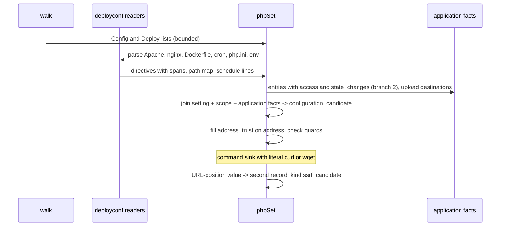

# Symfony analyzers 4 — configuration, SSRF through a shell URL client, and lane closure

- **Lane contract** [Symfony application-security analyzers](symfony-more-analyzers.md). Its §0,
  §2, §4 and §5 apply here and are not repeated.
- **Branch** `symfony-more-analyzers-4`, the top of the stack, on `symfony-more-analyzers-3`.
- **Depends on** [Branch 2](symfony-more-analyzers-2.md): entry access, state changes and the
  address guard's `address_trust` field. It also reads the upload family's
  `destination_served` fact, which is on `stage`.
- **Worktree** `symfony-more-analyzers`.
- **Review artifact** One draft PR whose base is `symfony-more-analyzers-3`.
- **Run log** `.zazz/ephemeral/symfony-more-analyzers-run-log.md`, section "Branch 4".

## 1. Capability

1. **Configuration** (`configuration`, CWE-548, CWE-352, CWE-1004, CWE-489, CWE-732 and CWE-269).
   Code Scan reads a bounded, allow-listed set of framework and deployment files and records
   settings that weaken the application, each joined to the application facts that give it
   meaning: which directory a listing exposes and whether uploads land there, which entries
   change state under a disabled CSRF setting, which file a privileged scheduled command runs
   and who can rewrite it.
2. **SSRF through a shell URL client.** The existing `ssrf` family gains one contract: a request
   value in the URL position of a `curl` or `wget` command line. This extends an existing
   analyzer. No family is added for it.
3. **Address trust.** The trusted-proxy evidence that decides whether a client address can be
   forged is read and attached to branch 2's address-guard records.
4. **Lane closure.** Whole-sample acceptance for the lane, and the documents that state Symfony
   website support as delivered.

Configuration scanning is a new input class for Code Scan. It stays bounded: closed file lists,
closed check lists, no template expansion, no execution. It is not a general
infrastructure-as-code scanner (lane OQ-2).

### 1.1 Sample rows owned by this branch

Paths are relative to the sample root at the pin.

**Required positives.**

| ID | Kind | Anchors | Evidence |
|---|---|---|---|
| `SYM-CONF-01` | `configuration_candidate`, check `directory_listing` | `docker/apache.conf:2` | `Options +Indexes` on `/app/public`, which the Dockerfile maps to the project's `public/` (`Dockerfile:4`, `:33`). The upload destination `public/uploads/avatars` is inside it |
| `SYM-CONF-02` | `configuration_candidate`, check `scheduled_privileged_writable` | `Dockerfile:50` (schedule), `bin/script:3` (executed file), `Dockerfile:47` (ownership) | A `root` cron line runs `bash bin/script`, which runs `php bin/console`. `bin/console` is owned by `www-data` |
| `SYM-CONF-03` † | `configuration_candidate`, check `csrf_disabled` | `config/packages/framework.yaml:4` | `csrf_protection: false`, with the state-changing entries that require a session login listed |
| `SYM-CONF-04` † | `configuration_candidate`, check `session_cookie_script_readable` | `config/packages/framework.yaml:13` | `cookie_httponly: false` |
| `SYM-SSRF-02` | `ssrf_candidate`, contract `api.php-shell-url-client-v1` | Sink `src/Services/Analytics.php:32`, source `:25` | The `Referer` header is the URL argument of `curl`. The only check is `FILTER_VALIDATE_URL` (`:40`) |

Rows marked † are not in the sample README's list.

**Required controls.**

| ID | Location | Offline expectation | Why |
|---|---|---|---|
| `SYM-CONF-N01` | `docker/apache.conf:2`–`8` other directives | `no_record` | `+FollowSymLinks`, `AllowOverride`, `Require`, `ServerTokens Prod` and `ServerSignature Off` are not on the check list or are the hardened value |
| `SYM-CONF-N02` | `Dockerfile:43`, `:45` | `no_record` | Ownership of `var/` and `public/uploads` is changed, and no scheduled command executes a file there |
| `SYM-CONF-N03` | `docker/php.ini:15`–`16`, `.env:18`, `docker/.env.local:2` | `no_record` | `display_errors = Off` and `APP_ENV=prod` |
| `SYM-CONF-N04` | `config/packages/framework.yaml:12` | `no_record` | `cookie_secure: auto` |
| `SYM-SSRF-N02` | `src/Controller/UserController.php:195` | `no_record` for `ssrf_candidate` | The program is `convert`, not a URL client. Its command claim is `SYM-CMD-02` |
| `SYM-CMD-01` (existing) | `Analytics.php:32` | Unchanged | The command candidate and its request bytes are identical with and without the new contract |

**Evidence row.** `SYM-LOCAL-01` (branch 2) gains `address_trust` with the Apache `remoteip`
module enabled at `Dockerfile:22`, no `RemoteIPHeader` directive in the read configuration, and
no `framework.trusted_proxies`. Its status stays a required positive.

## 2. Required reading

Beyond the lane contract's §1:

- [Branch 2](symfony-more-analyzers-2.md) D-8, D-10 and D-12.
- [PHP Symfony support](php-symfony-support.md) D-19 (shell functions and `Process`), D-20
  (upload facts), D-21 (URL-open SSRF and its operand table), D-25 and D-26 (walk allow-lists and
  YAML reader limits).
- `scan/internal/walk/walk.go` (`projectConfig`, `Result.Config`), `scan/internal/parse/inventory.go`,
  `scan/internal/langphp/symfony_yaml.go`, `symfony_project.go` (`servedPath`), `command.go`,
  `symfony_process.go`, `php_url_open.go`, `upload.go`.
- `scan/internal/analysispacks/ssrf.go`, `command.go`, `guard_contracts.go`;
  `scan/internal/judge/ssrf.go`.
- [SSRF rules](../../docs/scan/analysis/ssrf.md) and
  [command rules](../../docs/scan/analysis/command-injection.md).
- [Next.js rules](../../docs/scan/analysis/nextjs.md#phase-2-flow-and-practice-boundaries) for
  how model-free practice observations are reported. This branch's records are judged claims
  (D-3), and the vocabulary must not collide.
- References the contracts cite:
  [Apache `Options`](https://httpd.apache.org/docs/2.4/mod/core.html#options),
  [nginx `autoindex`](https://nginx.org/en/docs/http/ngx_http_autoindex_module.html),
  [Symfony framework configuration](https://symfony.com/doc/6.4/reference/configuration/framework.html),
  [Symfony proxies](https://symfony.com/doc/6.4/deployment/proxies.html),
  [Dockerfile reference](https://docs.docker.com/reference/dockerfile/),
  [`crontab(5)`](https://man7.org/linux/man-pages/man5/crontab.5.html),
  [curl manual](https://curl.se/docs/manpage.html).

## 3. Invariants

- The lane's generality rule holds. A check is a documented directive of Apache, nginx, PHP,
  Symfony, Docker or cron. No check names a path, file or user of an application.
- File reading is allow-listed and bounded (D-1). Nothing outside the lists is opened. Nothing is
  executed, and no variable or template is expanded beyond the literal forms a decision names.
- `.env` files are read for two keys only (D-2). No other key or value of an environment file
  enters a record, a report or a model request.
- A configuration record is a fact about a file plus application facts. The scanner does not
  decide that a setting is a defect. The one exception is the hardened value of a check, which
  makes no record.
- The `ssrf` family's existing contracts, the `command` family, and every existing request are
  unchanged. The new contract adds candidates. It changes none.
- Lower branches' files, records and outcomes are unchanged except as §4 lists (AC12).

## 4. Scope and review shape

| Path | Change | Purpose |
|---|---|---|
| `scan/internal/walk/walk.go`, `walk_test.go` | Modified | Extend `Result.Config`; add the `Result.Deploy` allow-list (D-1) |
| `scan/internal/parse/inventory.go`, `scan/internal/pipeline/pipeline.go` | Modified | Carry the deploy list to the adapter |
| `scan/internal/deployconf/` (`apache.go`, `nginx.go`, `dockerfile.go`, `cron.go`, `phpini.go`, `envfile.go`, tests, `testdata/`) | New | Line-oriented readers, each returning directives with spans. No language adapter imports are needed |
| `scan/internal/analysis/configuration.go`, `analysis.go`, `json.go` | New, modified | `ConfigurationKind`, `ConfigurationFacts` |
| `scan/internal/langphp/configuration.go`, `configuration_symfony.go`, `configuration_deploy.go` | New | Checks, joins to application facts, candidate assembly |
| `scan/internal/langphp/address_trust.go` | New | Fills `address_trust` on address-guard records |
| `scan/internal/langphp/php_shell_url_client.go` | New | The `curl` and `wget` URL-argument contract |
| `scan/internal/langphp/command.go`, `symfony_process.go`, `calls.go`, `modules.go`, `symfony_project.go`, `authorization_guards.go` | Modified | Dispatch lines; hand the parsed command text to the new contract; `address_trust` hook (the one branch 2 file changed) |
| `scan/internal/langphp/*_test.go`, `testdata/configuration/`, `testdata/symfony/configuration/`, `testdata/symfony/configuration-transfer/`, `testdata/shell-url-client/` | New | Fixtures and tests of §8 |
| `scan/internal/analysispacks/configuration.go`, `ssrf.go`, `families.go`, `descriptors.go`, `select.go`, `contracts.go`, tests | New, modified | Family, protocol `configuration-components-v1`, contract `api.php-shell-url-client-v1` |
| `scan/internal/judge/configuration.go`, `policy.go`, `components.go`, `client.go`, `bundle.go`, `budget.go`, `wire_facts.go`, tests | New, modified | Policy and wire facts |
| `scan/internal/report/finding_types.go`, `findings.go`, `sarif.go`, `guidance.go`, `html.go`, tests | Modified | `insecure-configuration` type; findings anchored at non-source files |
| `scan/cli/main.go`, `architecture_baseline_test.go`, `testdata/architecture-baseline.json` | Modified | Family name; rows for new fixtures |
| `scan/internal/pipeline/symfony_test.go` | Modified | This branch's and the lane's closing sample assertions |
| `.zazz/evaluation/vuln-symfony-detection-guide.md`, `recall-gap-inventory/cases.json`, `check.py`, `test_check.py`, `symfony-results.md`, `sample-reference-manifests.json` | Modified | Rows, results, the closing table; manifest entries for the newly read files |
| `.zazz/architecture/configuration-analysis.md` | New | Design and approach (AC10) |
| `.zazz/architecture/application-security-analyzers.md`, `README.md`, `finding-types.md`, `repository-graph.md` | Modified | Fill the configuration section; package map gains `deployconf`; walk lists |
| `docs/scan/detection-capabilities/insecure-configuration.md` | New | Capability page (AC11) |
| `docs/scan/analysis/configuration.md` | New | Analysis rules (AC11) |
| `docs/scan/detection-capabilities.md`, `detection-capabilities/symfony.md`, `detection-capabilities/server-side-request-forgery.md`, `detection-capabilities/missing-authorization.md`, `analysis/ssrf.md`, `analysis/README.md`, `symfony-support.md`, `php-support.md`, `running-scans.md`, `README.md` | Modified | Class rows, closing Symfony coverage, the new SSRF contract, address trust |
| `.zazz/project/implementation-plan.md`, `vulnerable-sample-apps.md`, `.zazz/specifications/README.md`, `spec-index.md`, `symfony-more-analyzers.md`, `.zazz/docs/zazzles-agent-orientation.md` | Modified | Delivered state (AC14) |

Out of scope:

- Committed secrets in `.env` and other files (lane OQ-3).
- Kubernetes manifests, Helm, Terraform, Ansible, docker-compose service definitions, CI files,
  and systemd units and timers.
- Apache and nginx beyond the D-4 check list: TLS settings, header policy, access rules.
- Dockerfile practice checks (unpinned base image, `USER root`, package hygiene).
- Shell script analysis beyond one level of indirection from a scheduled command.
- `curl` or `wget` reached through `-K` config files, `xargs`, or a URL read from a file.
- HTTP clients run through a shell other than `curl` and `wget` (`http`, `aria2c`, `lynx`).
- Security response headers and cookie attributes set in PHP code. The roadmap item "cookie,
  session and header configuration" owns them.

## 5. Decisions

Each table is a closed list. A name outside a table is unmodeled.

### Files

**D-1. Two allow-lists, both bounded.** `Result.Config` holds framework files of a detected
project. `Result.Deploy` is new and holds deployment files. Neither is a language. Limits: 256 KiB
per file, 200 files per list, no symbolic links, and paths under `vendor/`, `var/` and
`node_modules/` are never read. An over-limit or unreadable file records `config_file_unread`.

| List | Paths, relative to a project root |
|---|---|
| `Config` (added) | `config/packages/framework.yaml`, `config/packages/web_profiler.yaml`, `.env`, `.env.local`, `.env.prod`, `.env.prod.local`, and a file a Dockerfile `COPY` places as one of those |
| `Deploy` | `Dockerfile`, `Dockerfile.*`, `*.dockerfile`; `.htaccess` in any directory; `*.conf` and `php.ini` under `docker/`, `.docker/`, `deploy/`, `config/apache/`, `config/nginx/`, `apache/`, `nginx/` and `etc/`; files named `crontab` or `*.cron`, and files under a `cron.d/` directory; a script a schedule line executes, when it resolves to a project file |

*Why allow-lists:* an open-ended search for configuration would read arbitrary files and make
results depend on directory noise. The lists are the common locations, and a file outside them is
simply not covered, which the user page states.

**D-2. Environment files give two keys.** `APP_ENV` and `APP_DEBUG`. The reader discards every
other line before any value is stored. *Why:* these files hold secrets, and this branch has no
reason to carry them.

### The configuration claim

**D-3. A configuration record is a judged candidate, not a model-free observation.** Each record
carries the setting, its scope and the application facts it joins to. The family asks: is the
setting in effect for the deployed application as recorded; do the joined application facts make
it a weakness; and does a recorded mitigation remove it. *Why judged:* `Options +Indexes` on a
directory of static assets and on a directory that receives uploads are different findings, and
that distinction is context the model is here to weigh. *Rejected:* model-free practice
observations in the style of the Next.js checks, which cannot weigh the join.

**D-4. Checks.**

| Check | Recorded when | Joined application facts | No record when |
|---|---|---|---|
| `directory_listing` | Apache `Options` whose effective list includes `Indexes` in a `<Directory>`, `<VirtualHost>`, server or `.htaccess` scope; nginx `autoindex on` | The scope directory; whether it maps to the project's document root (D-5); upload candidates whose destination is inside it | `-Indexes`, `Options None`, `autoindex off`, or the directive absent |
| `csrf_disabled` | `framework.csrf_protection: false` or `{ enabled: false }` outside a `when@test` or `when@dev` block | Up to eight entries with `access.authentication: required` and a `state_changes` entry, sorted by name, with their methods; every `isCsrfTokenValid` call and `csrf_token_id` form option in project source as mitigation evidence | `true`, `~`, or the key absent |
| `session_cookie_script_readable` | `framework.session.cookie_httponly: false`; `session.cookie_httponly = 0`, `Off` or `false` in a read `php.ini`; `ini_set('session.cookie_httponly', …)` with a literal false value | Whether the project has a session-authenticated entry | `true`, absent, or `On` |
| `session_cookie_insecure_transport` | `framework.session.cookie_secure: false`; `session.cookie_secure = 0` or `Off` | Same | `true`, `auto`, absent |
| `debug_enabled` | `APP_DEBUG` of `1` or `true`, or `APP_ENV=dev`, in an environment file the deployment uses (D-5); `display_errors = On`, `1` or `stdout` in a read `php.ini`; `web_profiler` enabled outside `when@dev` and `when@test` | Which file is the deployed one and the evidence for it | `prod`, `0`, `Off`, or a `when@dev` block |
| `scheduled_privileged_writable` | D-6 | The schedule, the execution chain, the writable file and who can write it | No link of the chain is writable by a lower-privileged user |

**D-5. Deployment mapping is read from the Dockerfile, literally.** `WORKDIR`, `COPY <src> <dst>`
and `ADD` with literal operands give a map from container paths to project paths. Apache
`DocumentRoot` and `<Directory>` paths are resolved through it. An environment file is "deployed"
when a `COPY` places it at the project root as `.env` or `.env.local`, or when it is the project's
`.env` and nothing overrides it. An operand with a build argument or a glob is recorded as
`deploy_mapping_unresolved`, and the record depending on it carries that gap. *Why literal only:*
resolving build arguments needs the build context, which the scanner does not have.

**D-6. A scheduled privileged command and a writable link.** Three facts are joined.

| Fact | Accepted evidence |
|---|---|
| Schedule and user | A system-crontab line (six fields, the sixth a user) in a `cron.d/` file, a `crontab` file, or the literal text a Dockerfile `RUN echo "…" > /etc/cron.d/<name>` writes. A five-field line installed by `crontab <file>` runs as the Dockerfile's current `USER`, default `root` |
| Execution chain | The command's program and literal path arguments, after `cd <dir> &&` is applied. When an argument is a project script (`bash x`, `sh x`, `php x`, or `./x`), that script is read and each line's program and literal path arguments are added, one level only |
| Writable link | In the same Dockerfile: `chown` of a chain file, or of a directory containing it with `-R`, to a user other than the schedule's user; or `chmod` giving group or other write (`o+w`, `g+w`, `a+w`, or an octal mode with those bits). `COPY --chown=` to such a user counts |

The candidate is recorded when all three exist. The schedule user is compared by name with the
owner; `root` against any other name is the privileged case, and two equal names record nothing.
The anchors are the schedule line, the chain line and the ownership line. *Why one level:* it
covers a cron line that calls a wrapper script, the usual shape, without becoming a shell
interpreter.

**D-7. Facts.** `configuration.check`, `configuration.setting` (file, directive, value, span),
`configuration.scope`, `configuration.joined` (the facts of the D-4 column, each with evidence),
`configuration.mitigations` and gaps. The family needs no HTTP entry. One candidate per check per
setting.

### Address trust

**D-8. Branch 2's `address_trust` field is filled.** For each `address_check` guard with
`address_source: framework_client_ip`, the scanner attaches: `framework.trusted_proxies` and
`trusted_headers` values when present; Apache `remoteip` enabled (`a2enmod … remoteip`,
`LoadModule remoteip_module`) and any `RemoteIPHeader` and `RemoteIPTrustedProxy` directives;
nginx `real_ip_header` and `set_real_ip_from`. `address_trust.status` becomes `configured`,
`not_configured` or `partial`, and the gap `address_trust_configuration_unread` is removed when
every list was readable. *Why here:* the evidence lives in files only this branch reads. The
field's shape is fixed in branch 2, so this is a value change inside an existing field and the
authorization protocol does not change.

### SSRF through a shell URL client

**D-9. One new contract on the existing `ssrf` family.** `api.php-shell-url-client-v1` applies
when the existing command model has a shell command whose literal program token is `curl` or
`wget`, and a request-derived value occupies a URL position.

| Command form | URL position |
|---|---|
| Shell text built by concatenation or interpolation (`shell_exec`, `exec`, `system`, `passthru`, `popen`, `proc_open`, backticks, `Process::fromShellCommandline`) | A non-literal piece that follows the program token and is not the value of a value-taking option. The piece directly after one of these literal tokens is that option's value: curl `-o`, `-O` excluded, `-d`, `--data*`, `-H`, `-u`, `-A`, `-e`, `-b`, `-c`, `-x`, `-X`, `-w`, `-T`, `-F`, `--output`, `--header`, `--user`, `--proxy`, `--request`, `--write-out`, `--connect-timeout`, `-m`, `--max-time`; wget `-O`, `-o`, `-P`, `-U`, `--header`, `--user`, `--password`, `--post-data`, `--output-document`, `-t`, `-T` |
| Argument array (`new Process([...])`, `proc_open` with an array) | An element after the program that is not an option and not the value of an option in the same list |
| A piece that is the value of `-x`, `--proxy`, or follows `--url` | Recorded as a URL position with `operand: proxy` or `url` |
| The program token is not literal, or is another program | No `ssrf` record |

The candidate has the kind `ssrf_candidate`, the same source and guard evidence the command
candidate has (including an existing `filter_var` guard contract), and
`ssrf.transport: shell_client` with the program. *Why extend `ssrf` and not report under
`command`:* the two claims have different fixes. Quoting the argument with `escapeshellarg`
removes the command injection and leaves the request to an attacker-chosen host. Today the
report would go clean after that fix. *Why not a new family:* the claim is exactly SSRF, and the
family's questions already ask about destination control and restriction.

**D-10. The command candidate is untouched.** The same sink keeps its
`command_execution_candidate` with identical facts and request bytes. The new record is a second
use at the same span with a different kind, as the URL-open contract already produces a `path`
and an `ssrf` record for one operand.

## 6. Agent implementation rules

The lane contract §4 applies in full. Additional for this branch:

- Start from the top of the stack: `gh stack add symfony-more-analyzers-4`.
- S1 (readers) has no dependency on the PHP adapter and may go to a Contributor Agent. S2 to S4
  are the Lead Agent's or serialized Contributor work, because they share `configuration.go`.
  S5 (shell URL client) owns disjoint files and may run beside S2 to S4.
- The closing judged run (AC13) is the lane's acceptance run. Make it last, on the commit that is
  submitted, with no `--only-family`, `--entry` or `--route` scope.
- Additional halts: a reader would need to open a file outside D-1; an environment-file value
  other than the two keys of D-2 appears in a report or request; the `ssrf` family's selected
  component digest changes for an existing JavaScript, Python or PHP URL-open request.

## 7. Acceptance criteria

1. **AC1 (key).** The detection guide and `cases.json` hold the §1.1 rows. `check.py` accepts
   `configuration_candidate` and rows anchored at non-PHP files. Verified by `test_check.py` and
   by `check.py` on a branch 3 offline report, which reports the five positives missing.
2. **AC2 (walk and readers).** `TestWalkDeployList` proves the D-1 lists, the limits, that a
   symlink and a file under `vendor/` are not read, and that `ByLanguage` and `Files` are
   unchanged for an existing fixture. Cases `RD-01` to `RD-14` pass in
   `go test ./scan/internal/deployconf/...`: each reader returns the directives of its table with
   file and line; a continuation line, a comment and a quoted value are handled; the environment
   reader returns only the two keys and the test asserts that a third key's value is absent from
   the result.
3. **AC3 (Symfony configuration checks).** Cases `CF-01` to `CF-12` pass in
   `TestSymfonyConfiguration`: each framework check yields a candidate at its line with setting,
   value and joined facts; hardened values, absent keys and `when@dev` or `when@test` blocks
   record nothing; `csrf_disabled` lists the session-authenticated state-changing entries and any
   `isCsrfTokenValid` call as mitigation.
4. **AC4 (deployment checks).** Cases `DP-01` to `DP-16` pass in `TestDeployConfiguration`:
   `directory_listing` for Apache and nginx with its scope mapped to the project and the upload
   destination joined; `debug_enabled` and the cookie checks from `php.ini`;
   `scheduled_privileged_writable` only when all three facts of D-6 exist; an unresolved mapping
   carries `deploy_mapping_unresolved`.
5. **AC5 (address trust).** Cases `AT-01` to `AT-05` pass in `TestAddressTrust`: an address-guard
   record gains `address_trust` with status `configured`, `not_configured` or `partial` from the
   stated files, and keeps the gap when a list was unreadable. The authorization protocol
   identifier is unchanged.
6. **AC6 (shell URL client).** Cases `SU-01` to `SU-14` pass in `TestPHPShellURLClient`: a request
   value in a URL position of `curl` or `wget` yields one `ssrf_candidate` with
   `ssrf.transport: shell_client`; a value that is an option's value, a non-client program and a
   non-literal program yield none; each case's `command_execution_candidate` is byte-identical
   to the one produced with the contract disabled (`TestCommandCandidateUnchanged`).
   `TestSSRFComponentSelection` selects `api.php-shell-url-client-v1` for these candidates and is
   unchanged for existing JavaScript, Python and PHP URL-open candidates.
7. **AC7 (transfer and plain PHP).** The `configuration-transfer` project (nginx where the first
   uses Apache, a `crontab` file where the first uses a Dockerfile `echo`, `chmod 777` where the
   first uses `chown`, a `.htaccess` listing) and the plain-PHP `configuration` fixture pass
   (cases `DP-11` to `DP-16`). The command
   `grep -rnE 'www-data|/app/public|bin/script|bin/console|avatars' scan --include='*.go' --include='*.md'`
   prints only lines in test files.
8. **AC8 (catalog and selection).** `go test ./scan/internal/analysispacks/... ./scan/internal/judge/... ./scan/internal/report/...`
   passes. The family and the new contract are registered with reference URLs,
   `analysispacks.Select` accepts every new fixture candidate, `--only-family configuration` is
   accepted, a finding anchored at a Dockerfile or YAML line renders in HTML and SARIF with its
   file and line (`TestConfigurationFindingLocations`), and `TestExistingFamilyRequestsUnchanged`
   still passes.
9. **AC9 (isolation and determinism).** `TestArchitectureBaseline` passes with every pre-existing
   row byte-identical and one row per new fixture directory. `TestDVWASourceKey` passes. Two
   scans of each new fixture and of the sample are byte-identical.
10. **AC10 (architecture documents).** `.zazz/architecture/configuration-analysis.md` exists and
    states: why configuration is in Code Scan and where it stops; the two allow-lists and their
    limits; the environment-file rule; why records are judged with joined application facts; each
    check's evidence and join; the deployment mapping and its literal-only bound; the three-fact
    cron model; address trust; every gap. The SSRF design in
    `application-security-analyzers.md` or the existing SSRF architecture text states the shell
    client contract and why it is a second record at the command sink. `README.md` lists
    `deployconf` in the package map and `repository-graph.md` names the deploy list.
    `finding-types.md` lists `insecure-configuration`. Checked by reading and by `doc-check`.
11. **AC11 (user documentation).** Checked by reading and by `doc-check`.
    - New `docs/scan/detection-capabilities/insecure-configuration.md`: the files read, as a
      table; each check with its directive forms; "Recorded and decidable"; "Recorded in Review"
      (each gap); "Not recorded" (the §4 exclusions, and that a file outside the lists is not
      read); remediation per check.
    - `docs/scan/detection-capabilities/server-side-request-forgery.md`: `curl` and `wget`
      through a shell as a covered operation, with the option table's bound and the note that a
      quoting fix does not remove the request.
    - `docs/scan/detection-capabilities/missing-authorization.md`: address trust evidence.
    - `docs/scan/detection-capabilities.md`: a "Vulnerability classes" row for configuration and
      the deployment files in "Languages and entry points".
    - `docs/scan/detection-capabilities/symfony.md`: the closing state. "Outside these claims"
      lists only what the lane leaves out: committed secrets, voters and custom authenticators,
      Form and serializer mass assignment, and the §4 exclusions of each branch.
    - New `docs/scan/analysis/configuration.md`; `docs/scan/analysis/ssrf.md` gains the contract;
      both linked from `docs/scan/analysis/README.md`.
    - `docs/scan/symfony-support.md`, `php-support.md`, `running-scans.md` and `README.md` name
      the family and state Symfony website support with every lane family.
12. **AC12 (no drift).** While stacked,
    `git diff origin/symfony-more-analyzers-3...HEAD --stat -- scan/internal/langphp/exposure.go scan/internal/langphp/mass_assignment.go scan/internal/langphp/security_fields.go scan/internal/langphp/symfony_access.go scan/internal/langphp/authorization.go scan/internal/langphp/account_enumeration.go scan/internal/langphp/mailer.go scan/internal/langphp/recovery_delivery.go scan/internal/langphp/password_hash.go scan/internal/analysispacks/authorization.go scan/internal/analysispacks/account.go .zazz/specifications/symfony-more-analyzers-1.md .zazz/specifications/symfony-more-analyzers-2.md .zazz/specifications/symfony-more-analyzers-3.md`
    prints nothing, and the diff of `scan/internal/langphp/authorization_guards.go` only adds the
    `address_trust` hook. After the lower PRs land and `gh stack sync` runs, the same check
    against `origin/stage` holds.
13. **AC13 (sample, offline and judged; lane acceptance).** `TestSymfonySourceKey` passes at the
    pin with all earlier assertions and the §1.1 rows: the four configuration candidates at their
    anchors with their joined facts (`SYM-CONF-01` lists the upload destination; `SYM-CONF-02`
    lists the three anchors and `root` against `www-data`; `SYM-CONF-03` lists state-changing
    `/user` and `/admin` entries); `SYM-SSRF-02` at `Analytics.php:32` with source `:25` and the
    `filter_var` guard; the `SYM-CMD-01` candidate unchanged; every control with no record.
    `check.py` prints 30 of 30 positives and no control failure. Paid judged runs follow the
    lane contract §4.1.
    - Family checkpoints: `--only-family configuration` after S6 (the four configuration rows
      Confirmed, no control a finding), and `--only-family ssrf` after S5 (`SYM-SSRF-02` and the
      existing `SYM-SSRF-01` Confirmed, `SYM-SSRF-N02` absent).
    - Lane acceptance: a full judged scan at the submitted commit **confirms every capability on
      the sample**. All 30 required positives of the lane and of PR #39 are Confirmed findings,
      no control of any branch is a finding, and each assessment-dependent row has a recorded
      status with a source review.
    `symfony-results.md` records each run, the final status of every row grouped by family, and a
    closing table of the sample README's 21 entries with the row that detects each and its judged
    status, entry 8 recorded as not present in source with its evidence, and committed secrets
    recorded as outside the lane. The table is the statement that Symfony website support is
    closed for this sample.
14. **AC14 (closing project documents).** `.zazz/project/implementation-plan.md` moves the lane to
    its delivered state with one "Completed functionality" row per new family and the updated
    SSRF and PHP rows. `.zazz/project/vulnerable-sample-apps.md`, the detection guide's "Not
    covered" section, `.zazz/specifications/README.md`, `spec-index.md`, the lane contract's
    definition of done and the orientation's documentation map name the delivered state. Checked
    by reading and by `doc-check`.
15. **AC15 (gate).** The [contributor gate](../../docs/contributing.md#verification) passes.

## 8. Test strategy

Reader tests are unit tests on small files under `scan/internal/deployconf/testdata/`. Check
tests are synthetic projects, table-driven, asserting on the JSON report. Every recorded setting
has a hardened sibling that records nothing.

Not re-tested: shell command parsing, `filter_var` guards and upload facts, which existing tests
prove.

### Readers (`scan/internal/deployconf/testdata/`)

| Case | Input | Expected |
|---|---|---|
| `RD-01` | Apache `<Directory /srv/site/web>` with `Options +Indexes +FollowSymLinks` | Directive `Options`, values, scope `/srv/site/web`, line |
| `RD-02` | Apache `Options -Indexes` and `Options None` | Parsed; effective list has no `Indexes` |
| `RD-03` | A nested `<Directory>` that turns `Indexes` off under a parent that turns it on | Two scopes with their own effective lists |
| `RD-04` | nginx `location /files { autoindex on; }` | Directive with its `location` scope |
| `RD-05` | Dockerfile `WORKDIR`, `COPY . /srv/site`, `COPY deploy/env.prod /srv/site/.env.local` | Path map and the deployed environment file |
| `RD-06` | Dockerfile `RUN a && \` continuation with `chown -R web:web /srv/site/tools` | One instruction, the `chown` operands, the line of the `chown` |
| `RD-07` | Dockerfile `RUN echo "*/5 * * * * root cd /srv/site && sh tools/tick.sh" > /etc/cron.d/site` | A system-crontab line with user `root` and the command |
| `RD-08` | Dockerfile `COPY ${SRC} /srv/site` | `deploy_mapping_unresolved` |
| `RD-09` | A `cron.d` file with a comment, an environment line and one job | One job |
| `RD-10` | A five-field user crontab line | Job with no user field |
| `RD-11` | `php.ini` with `display_errors = On` and `session.cookie_httponly = 0` | Two directives |
| `RD-12` | `.env` with `APP_ENV=dev`, `APP_DEBUG=1` and `DATABASE_URL=…` | Two keys. The third value is absent from the result |
| `RD-13` | `.htaccess` with `Options +Indexes` | Directive scoped to the file's directory |
| `RD-14` | A file over the size limit | `config_file_unread` |

### Symfony configuration (`testdata/symfony/configuration/`)

| Case | Setting | Expected |
|---|---|---|
| `CF-01` | `csrf_protection: false`, two login-required entries that write, one public entry that writes | `csrf_disabled`, the two entries joined |
| `CF-02` | `csrf_protection: { enabled: false }` | `csrf_disabled` |
| `CF-03` | `csrf_protection: true`, and the key absent | No record |
| `CF-04` | `csrf_protection: false` only under `when@test` | No record |
| `CF-05` | `CF-01` plus an action that calls `isCsrfTokenValid` | Candidate with the call under `mitigations` |
| `CF-06` | `session: { cookie_httponly: false }` | `session_cookie_script_readable` |
| `CF-07` | `cookie_httponly: true`, and the key absent | No record |
| `CF-08` | `cookie_secure: false` | `session_cookie_insecure_transport` |
| `CF-09` | `cookie_secure: auto` | No record |
| `CF-10` | `web_profiler: { toolbar: true }` at the top level | `debug_enabled` |
| `CF-11` | The same under `when@dev` | No record |
| `CF-12` | An unparseable `framework.yaml` | `config_file_unread`, no candidate |

### Deployment (`testdata/symfony/configuration/`, `…-transfer/`, `testdata/configuration/`)

| Case | Setting | Expected |
|---|---|---|
| `DP-01` | Apache listing on the directory the Dockerfile maps to `public/`; an upload action stores under `public/media` | `directory_listing`, scope mapped, the upload destination joined |
| `DP-02` | The same listing with no upload action | Candidate with an empty upload join |
| `DP-03` | Listing on a directory outside the document root | Candidate with `scope_served: no` |
| `DP-04` | `Options -Indexes` | No record |
| `DP-05` | Deployed environment file with `APP_ENV=dev` | `debug_enabled`, the `COPY` line as evidence |
| `DP-06` | The project `.env` has `APP_ENV=dev`, and the Dockerfile copies a `prod` file over it | No record |
| `DP-07` | `php.ini` `display_errors = On` | `debug_enabled` |
| `DP-08` | Root cron line runs `sh tools/tick.sh`; the script runs `php tools/job.php`; `chown web tools/job.php` | `scheduled_privileged_writable` with three anchors |
| `DP-09` | `DP-08` without the `chown` | No record |
| `DP-10` | `DP-08` with the cron line's user also `web` | No record |
| `DP-11` | Transfer: nginx `autoindex on` on the web root | `directory_listing` |
| `DP-12` | Transfer: a `crontab` file installed by `crontab`, default user, script made `chmod 777` | `scheduled_privileged_writable` |
| `DP-13` | Transfer: `chown -R web /srv/site/tools` on the directory holding the script | `scheduled_privileged_writable` |
| `DP-14` | Transfer: `.htaccess` `Options +Indexes` in `public/files` | `directory_listing` scoped to that directory |
| `DP-15` | Plain PHP: no framework, Apache listing and a `move_uploaded_file` destination in scope | `directory_listing` with the upload joined |
| `DP-16` | `COPY ${SRC}` mapping and a listing | Candidate with `deploy_mapping_unresolved` |

### Address trust (`testdata/symfony/configuration/`)

| Case | Evidence | Expected `address_trust.status` |
|---|---|---|
| `AT-01` | No `trusted_proxies`, no proxy module | `not_configured` |
| `AT-02` | `framework.trusted_proxies: '10.0.0.0/8'` with `trusted_headers` | `configured`, values attached |
| `AT-03` | Apache `remoteip` enabled with no `RemoteIPHeader` | `partial` |
| `AT-04` | `RemoteIPHeader X-Forwarded-For` and `RemoteIPTrustedProxy` | `configured` |
| `AT-05` | `framework.yaml` unreadable | Gap kept |

### Shell URL client (`testdata/shell-url-client/`)

| Case | Source shape | Expected |
|---|---|---|
| `SU-01` | `shell_exec('curl -s ' . $_GET['u'])` | `ssrf_candidate`, program `curl`, plus the unchanged command candidate |
| `SU-02` | `exec("wget -q $url")`, `$url` from the request | `ssrf_candidate`, program `wget` |
| `SU-03` | `shell_exec('curl -s ' . escapeshellarg($url))` | `ssrf_candidate` remains. The command candidate carries its existing quoting evidence |
| `SU-04` | `shell_exec('curl -s -o ' . $name . ' https://example.org/a')` | No `ssrf` record: the value is an option's value |
| `SU-05` | `shell_exec('curl -H ' . $h . ' https://example.org/a')` | No `ssrf` record |
| `SU-06` | `shell_exec('curl -x ' . $proxy . ' https://example.org/a')` | `ssrf_candidate`, `operand: proxy` |
| `SU-07` | `shell_exec('curl https://api.example.org/items/' . $id)` | `ssrf_candidate` with the literal origin prefix recorded, as the URL-open contract records it |
| `SU-08` | `shell_exec('convert ' . $file . ' out.png')` | No `ssrf` record |
| `SU-09` | `shell_exec($tool . ' ' . $url)` with `$tool` from configuration | No `ssrf` record |
| `SU-10` | `new Process(['curl', '-s', $url])` | `ssrf_candidate` |
| `SU-11` | `new Process(['curl', '-o', $name, 'https://example.org/a'])` | No `ssrf` record |
| `SU-12` | `curl` with the request value after a `filter_var(…, FILTER_VALIDATE_URL)` guard | `ssrf_candidate` with the guard evidence |
| `SU-13` | Backticks: `` `curl -s $url` `` | `ssrf_candidate` |
| `SU-14` | Symfony service method reached from an action, value from a request header | `ssrf_candidate` under the action's entry |

## 9. Execution sequence

| Slice | Content | Owns | Depends on | ACs |
|---|---|---|---|---|
| **S0** | Stack branch, key rows, `check.py`, family skeleton | `.zazz/evaluation/`, `analysis/configuration.go` | Branch 3 | AC1 |
| **S1** | Walk lists and the `deployconf` readers | `walk/`, `deployconf/` | S0 | AC2 |
| **S2** | Symfony configuration checks | `configuration_symfony.go` | S1 | AC3 |
| **S3** | Deployment mapping and checks, including the schedule model | `configuration_deploy.go` | S1 | AC4 |
| **S4** | Address trust | `address_trust.go` | S1 | AC5 |
| **S5** | Shell URL client contract | `php_shell_url_client.go`, `analysispacks/ssrf.go` | S0 | AC6 |
| **S6** | Family registration, policy, report locations | `analysispacks/`, `judge/`, `report/` | S2, S3 | AC8 |
| **S7** | Transfer fixtures, sample key test, determinism, no-drift, the lane's judged run, results, architecture, user and closing documents | `pipeline/symfony_test.go`, `docs/`, `.zazz/` | All | AC7, AC9–AC15 |

S1 starts with `RD-01` failing. S5 starts with `SU-01` failing and is independent of S1 to S4.



Starting skeletons. Shapes are load-bearing; bodies adapt.

```go
// deployconf: every reader returns directives with their source position.
type Directive struct {
	File   string
	Line   int
	Name   string
	Values []string
	Scope  string // directory, location or "" for server scope
}
func Apache(file string, src []byte) ([]Directive, []Gap)
func Nginx(file string, src []byte) ([]Directive, []Gap)
type DockerImage struct {
	PathMap   map[string]string // container path -> project path, literal operands only
	Owners    []Ownership       // chown, chmod and COPY --chown, with lines
	Schedules []ScheduleLine    // from RUN echo ... > /etc/cron.d/<name> and copied cron files
	Modules   []Directive       // a2enmod and similar
	Gaps      []Gap
}
func Dockerfile(file string, src []byte) DockerImage
type ScheduleLine struct {
	File, User, Command string
	Line                int
}
func Cron(file string, src []byte, system bool) []ScheduleLine
func EnvKeys(file string, src []byte) map[string]string // APP_ENV and APP_DEBUG only

// analysis/configuration.go
const ConfigurationKind = "configuration_candidate"
type ConfigurationFacts struct {
	Check       string     `json:"check"`
	Setting     Evidence   `json:"setting"`
	Value       string     `json:"value"`
	Scope       string     `json:"scope,omitempty"`
	Joined      []Evidence `json:"joined"`
	Mitigations []Evidence `json:"mitigations,omitempty"`
}

// langphp/php_shell_url_client.go
func (f *phpFlow) shellURLClient(n *sitter.Node, command phpValue, argv []phpValue)
```

## 10. Definition of done

- [ ] Required reading done and the standards-index lookup recorded in the run log.
- [ ] AC1 to AC15 verified, each with its command and output in the run log.
- [ ] The stack shows four branches in order, and the no-drift check held.
- [ ] The diff against `origin/symfony-more-analyzers-3` matches §4.
- [ ] The architecture, user and closing documents of AC10, AC11 and AC14 exist and are linked.
- [ ] The lane contract's definition of done is complete.
- [ ] A fresh-context Verifier Agent reran the §13 checks and reported PASS.
- [ ] The draft PR body links this specification and lists each AC's evidence.

## 11. Open questions

The lane's OQ-1, OQ-2 (configuration scanning in scope) and OQ-3 (CSRF and cookie checks in
scope, secrets out) apply. If the owner answers OQ-2 with "out of scope", this branch keeps D-8 to
D-10, the Symfony framework checks of D-4 and the closure, and drops `Result.Deploy`, the
`deployconf` package, D-5, D-6 and rows `SYM-CONF-01` and `SYM-CONF-02`, which are then recorded
as outside Code Scan.

## 12. Run log protocol

Section "Branch 4" of the lane run log, with the items branch 1's §12 lists, plus the list of
every file the two allow-lists opened on the sample.

## 13. Agent implementation prompt

> Work in the `symfony-more-analyzers` sibling worktree. Read AGENTS.md, the orientation contents,
> `.zazz/specifications/symfony-more-analyzers.md`, then
> `.zazz/specifications/symfony-more-analyzers-4.md` and its §2 reading. Load the `spec-driven`
> skill and `.zazz/docs/using-gh-stack.md`. Read the run log and `git log`. Verify the path, the
> worktree list and `gh stack view --json`.
>
> Add the branch with `gh stack add symfony-more-analyzers-4` from the top of the stack. Carry any
> lower-branch review change upward with `gh stack rebase --upstack`, or run `gh stack sync` if a
> lower PR has landed.
>
> Deliver S0 to S7 in order. Add each slice's fixtures and failing test before its code. Read only
> the files of D-1 and only the two environment keys of D-2. Implement the check tables as
> written. Join each setting to application facts and leave the judgment to the model. The shell
> URL client contract adds a record and changes none. Do not weaken, delete or relabel a case of
> §8 or a row of §1.1. Stop on any halt condition.
>
> This branch closes the lane: make the full judged run last, record the closing table, and
> update the closing documents of AC14. Open the draft PR with `gh stack submit --auto`. Its base
> is `symfony-more-analyzers-3`. Never merge.
>
> Verifier Agent, fresh context, read-only: run `go build ./...`, `go vet ./...`, `go test ./...`,
> `go test ./scan/cli -run TestArchitectureBaseline`, `TestDVWASourceKey`,
> `TestSymfonySourceKey` and the AC12 no-drift command. Then check by reading the sample's JSON
> report that (1) the four configuration candidates are at their anchors with their joins;
> (2) no report text contains a value from an environment file other than `APP_ENV` and
> `APP_DEBUG`; (3) `Analytics.php:32` has both a command and an SSRF record and
> `UserController.php:195` has only a command record; (4) the address-guard record carries
> `address_trust`; (5) `check.py` prints 30 of 30; (6) no pre-existing baseline row changed.
> Report PASS or FAIL per item with the command output.

## 14. Implementation and review change log

### 2026-11-22 — Drafted

Written with the lane contract. No code changed.
