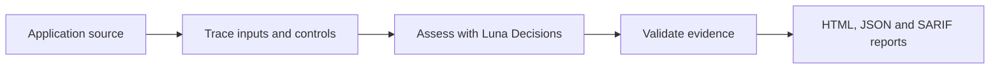

# Zazzles

Zazzles analyzes application source to help developers find security problems, understand existing
protection, and make well-supported fixes. It combines static analysis with OpenAI Luna Decisions
and produces reports with code evidence, assessment results, and remediation guidance.

**Available today:** a command-line scanner for supported JavaScript, TypeScript, and Python
applications. Zazzles is under active development. Analysis is bounded to modeled frameworks and
operations; unresolved behavior stays visible in the report.

[Get started](#quick-start) · [Explore sample reports](#saved-results) ·
[Understand results](#interpret-results) · [Contributor guide](docs/contributing.md)

## How it works

Zazzles locates supported application entry points, follows input values to sensitive operations,
and collects the relevant source, transformations, and guards. The decision model assesses specific
security questions using that evidence. The scanner checks evidence completeness and consistency
before classifying a result.



The target application does not need to run. A finding includes the operation and supporting code;
a protection result applies to the stated claim and analyzed paths. Missing evidence remains a
review task. The [technical approach](docs/technical-approach.md) explains the analysis and its limits.

<a id="setup"></a>

## Quick start

### 1. Build the scanner

Install **Go 1.27.2 or newer** and a **C compiler** for the Tree-sitter bindings. On macOS, install
Apple's command-line tools with `xcode-select --install` if needed. On Linux, use your distribution's
C development toolchain. Check `go version` and `cc --version` before building.

The current development branch is `stage`:

```bash
git clone --branch stage https://github.com/zazzcode/zazzles.git
cd zazzles
go build -o bin/scan ./cmd/scan
./bin/scan --list /absolute/path/to/your/app
```

The first build downloads Go modules. Zazzles reads an existing local target checkout; it does not
install its dependencies, start its server, or modify its source. See the
[setup guide](docs/getting-started.md) for more detail.

### 2. Configure OpenAI Luna Decisions

For a new setup, copy the configuration sample:

```bash
cp .env.sample .env
```

If `.env` already exists, edit it in place instead of replacing it. Set these values locally:

```dotenv
JUDGE_DECISION_MODEL=gpt-6-luna
OPENAI_API_KEY=your-api-key
```

Keep `.env` private and Git-ignored. Load your trusted file in bash or zsh:

```bash
set -a
. ./.env
set +a
```

The scanner reads process environment variables; it does not load `.env` automatically. OpenAI Luna
is the primary model used for development and calibration. Manage spending in your API account;
no local pricing or rate configuration is needed. The [decision-model guide](docs/decision-models.md)
covers optional providers and RPM/TPM settings.

<a id="run"></a>

### 3. Scan and open the report

```bash
./bin/scan --analyze --judge openai --judge-limit 10 \
  --output-dir "$HOME/zazzles-findings" /absolute/path/to/your/app
```

`--judge` enables model requests and transmits bounded source evidence. `--judge-limit` caps
assessment requests for the run; the default is 10. A small cap is useful for an initial scan and
may leave work unassessed. For a focused scan, add `--entry <registration-file>` and
`--route <exact-route-pattern>`, or select a family with `--only-family command`.

The command prints a fresh results folder containing:

| File | Use |
|---|---|
| `findings.html` | Open in a browser to review findings, source evidence, and remediation |
| `findings.json` | Full evidence and assessment records for inspection and coding agents |
| `findings.sarif` | SARIF 2.1.0 output for security-tool integrations |

Open the printed `findings.html` path. On macOS, use `open /path/to/run/findings.html`; on other
systems, open the file through your browser or file manager. Each run gets a new folder.

Reports are retained when an assessment is incomplete. **Exit 0** means the requested operation
completed, **exit 1** indicates an execution or assessment failure/incompleteness, and **exit 2**
indicates invalid arguments. Finding counts do not determine the exit code. Read the report's
assessment reasons when a request cap, unsupported outbound assessment, or provider error leaves
work incomplete.

For evidence inspection without model calls:

```bash
./bin/scan --analyze --output-dir "$HOME/zazzles-findings" /absolute/path/to/your/app
```

This leaves model assessments unrun. Saved HTML/SARIF exports also work offline. The
[running guide](docs/running-scans.md) covers entry selection, filters, exports, and CI usage.

## Interpret results

Expand an entry in the HTML report to inspect the finding location, code, assessment, unresolved
facts, and recommended changes. Category labels describe the analysis area; they are not verdicts.

| Result | Meaning |
|---|---|
| **Findings** | Source-supported vulnerabilities or established poor practice that warrants correction |
| **Review** | Unassessed or unresolved behavior needing investigation; it is not a confirmed vulnerability |
| **Protected** | Evidence and assessment support protection for the named operation and scope |

Counts describe individual records and entry contexts, not necessarily unique defects. One shared
handler can appear under several routes. Equivalent contexts may reuse a decision while retaining
separate findings and explicit provenance; differing inputs and controls stay separate.

A completed scan does not certify an application as secure. Read
[interpreting results](docs/interpreting-results.md) for statuses, evidence, and counting rules, and
[the project philosophy](docs/philosophy.md) for how to fix issues while preserving intended behavior.

<a id="explore-sample-findings"></a>

## Saved results

Explore existing reports without installing Zazzles or making API calls:

| Application | Examples | Reports and source expectations |
|---|---|---|
| OWASP Juice Shop | Browser/server XSS and database operations | [Browse HTML](https://zazzcode.github.io/zazzles/docs/samples/juice-shop/findings.html) · [Sample notes](docs/samples/juice-shop/README.md) |
| Node.js Goof | Command injection, XSS, and database review | [Browse HTML](https://zazzcode.github.io/zazzles/docs/samples/nodejs-goof/findings.html) · [Sample notes](docs/samples/nodejs-goof/README.md) |
| Vulnerable TypeScript app | Command injection at `/api/ping`, reflected XSS, and logging | [Browse HTML](https://zazzcode.github.io/zazzles/docs/samples/vulnerable-typescript-app/findings.html) · [Sample notes](docs/samples/vulnerable-typescript-app/README.md) |
| VulnPy | Shared Python sinks across framework adapters | [Browse HTML](https://zazzcode.github.io/zazzles/docs/samples/vulnpy/findings.html) · [Sample notes](docs/samples/vulnpy/README.md) |

The [sample index](docs/samples/README.md) links downloadable HTML, JSON, and SARIF, target revisions,
source-reviewed expectations, and known misses. These are historical snapshots; their notes identify
the scanner and target versions used. They may predate the current analyzer coverage.

### Verify a sample finding yourself

Start with one known case rather than comparing whole-report totals. For the TypeScript command
injection example, clone and pin the source outside the scanner checkout:

```bash
git clone https://github.com/ryanmcmorrowsnyk/vulnerable-typescript-app.git \
  ../vulnerable-typescript-app
git -C ../vulnerable-typescript-app checkout --detach 7f8b240a2f02beba099da3632d1ba679ff8bc32f

./bin/scan --analyze --entry src/server.ts --route /api/ping \
  --only-family command --judge openai --judge-limit 1 \
  --output-dir "$HOME/zazzles-findings" ../vulnerable-typescript-app
```

No target installation or server startup is needed. In the generated HTML, expand `GET /api/ping`
and inspect the process call at `src/server.ts:90`, the `host` input, and the shell-command evidence.
The [source-reviewed detection guide](.zazz/evaluation/vulnerable-typescript-app-detection-guide.md)
records the expected command-injection case; the
[saved sample](docs/samples/vulnerable-typescript-app/README.md) records its prior assessment.

Verify the target revision with `git -C ../vulnerable-typescript-app rev-parse HEAD` and confirm it
has no local changes with `git -C ../vulnerable-typescript-app status --short`. Compare the same
source location, input-to-operation flow, status, and evidence—not just the number of findings.
A fresh model response may be inconclusive; inspect its reason rather than treating that as protection.
Keep vulnerable baselines unchanged and make repairs in a separate copy. The
[reference policy](docs/samples/reference-policy.md) explains baseline hashes and verification.

<a id="scan-current-implementation"></a>
<a id="entry-use-cases-and-delivery-status"></a>

The [implementation plan](.zazz/project/implementation-plan.md#supported-capability-checklist)
tracks supported analyzers, language coverage, limitations, and delivery status.

## Project goals: Scan, Inspect, Audit and Fix

<a id="project-goals-scan-audit-and-fix"></a>
<a id="project-goals-scan-quality-audit-and-fix"></a>

| Capability | Purpose | Status |
|---|---|---|
| **Scan** | Assess application security using source evidence | Available; coverage tracked in the implementation plan |
| **Inspect** | Assess code quality and conformance to engineering standards | Planned; existing practice checks provide a foundation |
| **Audit** | Assess dependency vulnerabilities through ecosystem tooling | Planned |
| **Fix** | Help coding agents make, test, and reassess repairs for human review | Planned |

These capabilities are intended to work independently or in a combined remediation workflow.
Fix should also accept an existing report or user-specified issue. The
[project plan](.zazz/project/implementation-plan.md) owns the detailed roadmap.

## Contributing

See the [contributor setup and notes](docs/contributing.md) for development prerequisites, tests,
repository structure, worktree conventions, and the review process. User setup does not require
adopting the project's contributor workflow.

## Documentation

- [Getting started](docs/getting-started.md) and [running scans](docs/running-scans.md)
- [Decision-model setup](docs/decision-models.md) and [interpreting results](docs/interpreting-results.md)
- [Sample reports and verification](docs/samples/README.md)
- [Technical approach](docs/technical-approach.md) and [analysis rules](docs/analysis/README.md)
- [CI integration](docs/ci.md) and [documentation index](docs/README.md)
