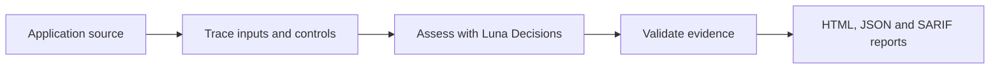

# Zazzles

**Scan and inspect your application or microservice code, then make it secure and reliable.**

Zazzles reviews application and microservice code for two kinds of problems:

- **Security vulnerabilities** in your own source code and in the libraries your project depends on.
- **Poor practice** that weakens security, reliability or functionality. Examples are missing or weak
  input validation, unsafe query and command construction, and sensitive data written to logs. These
  are worth fixing even when no one has shown an exploit.

Every result points at the exact line of source. It explains the protection that is already there and
says what to change. Coding agents can then make small, focused repairs that keep the application's
intended behavior, check their own work, and hand a pull request to a person to review.

Many scanners show where a problem is and the path an input takes to reach it. Zazzles adds a
**decision model** that judges what the code actually does, working from a case the scanner builds:

- **The scanner is the analyst.** It finds where input enters, traces the path the value takes to a
  sensitive operation, records the checks along the way and notes what it could not resolve. From
  that it builds the evidence and the specific questions to ask.
- **The model is the judge.** For each sensitive operation it answers those questions. Can a request
  value do harm here? Is the guard or validation already in place adequate? Those answers decide
  whether a result is a vulnerability or is protected.
- **The analyst holds the judge to the record.** Each answer is checked against the established
  facts before it counts:
  - An answer that contradicts the source is rejected. An example is "not applicable" when a request
    value plainly reaches the operation.
  - A vulnerability needs complete evidence for that path. Unresolved gaps on the path keep the
    result in Review.
  - Protection needs a control that covers every path the request value can take. A confident answer
    never fills a missing fact.
- **Some poor practice needs no model.** Rules over the source establish certain problems directly.
  A SQL query built by string concatenation is one. It is reported without anyone proving an exploit.
- **Not knowing is a result.** Anything unresolved is marked **Review**. A clean report is never
  presented as proof that code is safe.

Every result keeps its evidence trail:

- where the input enters the application,
- the path the value takes to a sensitive operation,
- the checks it passes along the way, and
- anything the scanner could not resolve.

[Get started](#quick-start) · [What exists today](#what-exists-today) · [Explore sample reports](#saved-results) ·
[Understand results](#interpret-results) · [Roadmap](.zazz/project/implementation-plan.md) ·
[Contributor guide](docs/contributing.md)

<a id="project-goals-scan-inspect-audit-and-fix"></a>
<a id="project-goals-scan-audit-and-fix"></a>
<a id="project-goals-scan-quality-audit-and-fix"></a>

## The vision: Scan, Inspect, Audit and Fix

| Capability | What it does | Status |
|---|---|---|
| **Scan** | Finds security vulnerabilities in your code and judges whether existing protection is adequate | Available for supported JavaScript, TypeScript, Python and PHP |
| **Inspect** | Reviews code for poor practice in validation, query and command construction, logging and reliability | Partly available: practice checks ship inside Scan; a distinct Inspect workflow is planned |
| **Audit** | Finds known vulnerabilities in your dependencies and guides upgrades, using ecosystem tools such as `npm audit` and `pip-audit`, with SBOM artifacts | Planned |
| **Fix** | Provides agent skills and automation so coding agents can read findings and deficiencies, repair the code, upgrade libraries, verify the changes and prepare a pull request for review | Planned |

The capabilities can be used alone or together, on demand or on a schedule. Fix can start from a saved
report or from an issue you describe.

Two principles shape the results:

- **Name the real problem.** An unsafe query *construction* is reported as that. It is not quietly
  promoted to a confirmed injection.
- **Keep serious risks visible.** Security problems should be easy to prioritize and not buried under
  routine quality notes.

The [philosophy](docs/philosophy.md) explains how fixes should preserve behavior and existing
protection. The [implementation plan](.zazz/project/implementation-plan.md) holds the detailed roadmap
and delivery status.

<a id="what-exists-today"></a>
<a id="scan-current-implementation"></a>
<a id="entry-use-cases-and-delivery-status"></a>

## What exists today

Today Zazzles is a command-line scanner for **JavaScript, TypeScript, Python and PHP** applications,
including Express, Fastify, Hapi and **Next.js** (App Router and Pages Router; see
[Next.js support](docs/nextjs-support.md) · [Code injection](docs/analysis/code-injection.md) · [Open redirect](docs/analysis/open-redirect.md)),
and plain **PHP** with mysqli/PDO/SQLite3, command, XSS, path, code and redirect families (see
[PHP support](docs/php-support.md)).

- It reads source only. It does not run your app or install its dependencies.
- It covers the frameworks and operations it models. Anything else is reported as unresolved,
  not silently skipped.

**The decision model**

- Judges whether each finding is a real vulnerability and whether existing protection is adequate
- Answers specific questions about code the scanner could not follow; a cited, verified answer is
  marked **Model-resolved**
- OpenAI Luna is the primary model; Google Gemini is optional
- One model is used for a whole scan, with no automatic fallback
- A request cap and optional rate limits keep runs predictable
- Equivalent contexts share one decision to save calls

**Security checks**

- SQL injection
- NoSQL injection (MongoDB-style databases)
- Cross-site scripting (XSS): server-rendered, stored, and browser/DOM
- Command injection
- Path traversal and unsafe file/archive use: Node `fs` reads/writes (including `open`, `copyFile`,
  and `rename`), Zip Slip when extracting uploaded archives, Python `FileResponse` / upload
  filenames, `shutil` copy/move, and `tarfile.extractall` (with explicit filter/runtime facts)
- Server-side request forgery (SSRF) when a verified `fetch`, `axios`, Node `http`/`https`, or
  Python HTTP client call takes its destination from the request; other outbound calls are grouped
  observations for review

**Good-practice checks**

- Input validation
- Safe construction of queries and other destination calls
- Sensitive data written to logs

**How it finds problems**

- Finds entry points: web routes (including each stage of an Express middleware chain), Next.js
  route handlers, pages, Server Actions, Pages Router API routes and `getServerSideProps`, browser
  events, GraphQL and gRPC
- Follows request input to the sensitive operation it reaches, including URL fields
  (`path` / `url` / `originalUrl`) and verified upload filename or file content on Node apps
- Notices the checks on the way, such as `if` guards and allow-lists. In JavaScript and TypeScript it
  follows each side of an `if`/`else` separately, so a check on one branch never protects another
- Reads each library's version for the part of a monorepo being analyzed
- Sends compact, source-backed evidence to the model and lists anything it had to leave out
- Checks each model answer against the source facts and the evidence supplied before it counts
- Can replay a saved decision offline to reproduce a result

**Reports**

- HTML to read, JSON for tools and coding agents, SARIF for security platforms
- Saved even when part of the assessment could not be completed

**How we measure efficacy**

The useful metric is not “every bug in every sample app.” It is: for each analyzer we ship, do we
confirm the source-reviewed required positives on pinned vulnerable apps, and keep known protected
or inconclusive cases in Review/Protected instead of inventing reds?

**Accuracy against the answer keys** (every sample report rescanned 2026-11-19; Node.js Goof, DVWA and the Python insecure app judged again on 2026-11-19 after the [findings-gaps work](.zazz/evaluation/close-findings-gaps-results.md); DVWA judged again on 2026-11-20 after [command bypass support](.zazz/evaluation/command-bypass-support-results.md)). *Expected* counts the source-reviewed vulnerable cases keyed for our
implemented analyzers. *Found* means Zazzles reports the case as a finding: Confirmed, or a
construction-practice finding where the key expects one. *False positives* counts the known-safe
cases (keyed controls) that Zazzles reports as a finding, plus any finding source review showed
to be false.

| Sample | Expected | Zazzles found | Review (not found) | Missed | False positives | Notes |
|---|---:|---:|---:|---:|---:|---|
| Juice Shop | 15 | 15 | 0 | 0 | 0 | 3 safe cases checked. 8 findings outside the key match known challenge routes |
| OSS OopsSec Store | 13 | 13 | 0 | 0 | 0 | 5 safe cases checked. 8 findings outside the key, unreviewed |
| DVWA | 11 | 11 | 0 | 0 | 0 | Includes the API health command (`HealthController.php:88`), unrestricted upload (CWE-434, its path claim not a finding) and stored XSS judged in path groups. Two false positives on impossible-level controls were found and fixed: a bound PDO statement (`brute/impossible.php:90`) and the `is_numeric`-guarded ping (`exec/impossible.php:26`), which is now Protected with a note that the check still admits a line break. 154 findings outside the key in this run, unreviewed |
| Node.js Goof | 7 | 7 | 0 | 0 | 0 | Command injection (`routes/index.js:174`) Confirmed: its regex capture admits any character. Open redirect (`routes/index.js:74`) now keyed |
| Vulnerable TypeScript app | 6 | 6 | 0 | 0 | 0 | Includes `eval` and open redirect |
| vuln-nextjs lab | 13 | 13 | 0 | 0 | 0 | 23 safe cases checked, none red. Includes code execution and open redirect |
| vuln-demo-app | 11 | 11 | 0 | 0 | 0 | 7 safe cases checked. No published sample report |
| ThreatByte | 5 | 5 | 0 | 0 | 0 | 6 safe cases checked. Dashboard XSS found as a construction-practice finding |
| Vulnerable Flask App | 4 | 4 | 0 | 0 | 0 | 4 findings outside the key, unreviewed |
| Python insecure app | 3 | 3 | 0 | 0 | 0 | XSS plus template injection from both the name and the remote response. The name-field validation row expects Review |
| VulnPy | 6 | 6 | 0 | 0 | 0 | No keyed safe cases. 369 findings outside the key, unreviewed (repeated contexts share sinks) |
| **Total** | **94** | **94** | **0** | **0** | **0** | 57 known-safe cases checked; 546 findings outside the key |

Findings outside the key are not counted as true or false until someone reviews their source.

Scored with
[`accuracy.py`](.zazz/evaluation/recall-gap-inventory/accuracy.py); details are in the
[evidence-resolution results](.zazz/evaluation/model-resolution-results.md#accuracy-against-the-answer-keys).

On the current Node samples (Juice Shop, Node.js Goof, Vulnerable TypeScript app and
vuln-demo-app), the cataloged XSS, SQL, NoSQL, command, path/Zip Slip, logging, SSRF,
`eval`/code-injection and open-redirect positives are found, including Goof's command
injection. Cases the answer keys mark as Review stay
Review (for example Juice Shop subtitle XSS). Defects outside those analyzers (authentication,
IDOR, secrets, cookie flags and most Juice Shop challenge categories) are **not covered** yet; a
clean row there is not a pass.

On the two Next.js samples (OSS OopsSec Store and the vuln-nextjs lab), every required positive in
those families is found, including the lab's code-execution and open-redirect rows, and no safe
control is red; the dependency row is not covered yet.

Details and per-app expected-vs-actual tables live in
[vulnerable sample applications](.zazz/project/vulnerable-sample-apps.md). Sample HTML reports are
snapshots of those runs, not a claim of whole-application security.

**Not yet available:** dependency auditing, a separate Inspect report, automated fixes and scheduled runs.

Code injection (`eval`, CWE-94/95) and open redirect (CWE-601) are implemented; see the
[combined implementation contract](.zazz/specifications/nextjs-phase-2-and-code-redirect.md) and
[verification results](.zazz/evaluation/nextjs-phase-2-results.md).

The JavaScript and TypeScript prototype pollution analyzer follows request-derived keys to verified
Lodash and source-visible writes. It reports CWE-1321 when the write and its paths meet the claim's
evidence requirements. [Prototype pollution rules](docs/analysis/prototype-pollution.md).

The [implementation plan](.zazz/project/implementation-plan.md#next-up) records further analyzer,
language and workflow work, including npm library scanning, PHP, agent workflows and external
finding imports. XXE and dependency auditing (SCA) remain deferred.
The [capability checklist](.zazz/project/implementation-plan.md#supported-capability-checklist) records
exactly which languages, frameworks and operations each analyzer supports, with its limits.

## How it works

Zazzles locates supported application entry points, follows input values to sensitive operations,
and collects the relevant source, transformations, and guards. The decision model assesses specific
security questions using that evidence. The scanner checks evidence completeness and consistency
before classifying a result.



The target application does not need to run. A finding includes the operation and supporting code;
a protection result applies to the stated claim and analyzed paths. Missing evidence remains a
review task. The [technical approach](docs/technical-approach.md) explains the analysis and its limits.

### How the decision model judges a result

For each sensitive operation the scanner sends the model one bounded request: the source of the
entry point, every step the value takes, the guards and transformations on the way, the library
contract for the operation, the gaps it could not resolve, and a short list of multiple-choice
questions about that one claim. For a file read the questions ask whether a request value can
leave the intended directory, which control contains it, and whether that control covers every
path. For a SQL query they ask whether input can change the query's syntax. The model answers each
question. It does not write the verdict.

The scanner then decides the status from those answers and its own facts:

- **Vulnerable** needs a consistent answer and a source-to-operation path the scanner can show.
  "Vulnerable" with no supporting path, or with an unresolved gap on that path, stays in Review.
- **Protected** needs a control the scanner found on every path the value can take, plus answers
  that say the control is adequate and covers them all. One protected branch never lends protection
  to an unresolved sibling.
- **Contradictions are rejected.** An answer that says "not applicable" when a request value plainly
  reaches the operation, or "protected" with no control in the source, is kept for audit and changes
  nothing.

This is where the model earns its place. Rules can say a guard exists; they are weak at saying
whether it is enough. Whether an allow-list really contains a path, whether a regular expression
lets a shell metacharacter through, whether a sanitizer suits this output context: those are
judgments about what the code does, and the model makes them from the evidence in front of it. The
scanner keeps the model to that evidence, so a confident answer never fills a missing fact.

When the scanner stops at code it cannot follow (a list comprehension, a helper just outside its
reach, a stored value whose writers it cannot link), it asks the model a specific question about
that point and offers chains of request evidence to cite. The answer counts only if the cited chain
checks out against the request. A result reached this way keeps its ordinary status and carries a
**Model-resolved** mark that names the model, the question version and the cited lines. It can move
a record from Review to a finding; it moves a record to Protected only when the scanner itself
holds the fact that makes protection complete. A record that no answer could change is not sent at
all. See [decision models](docs/decision-models.md#model-resolved-facts).

<a id="setup"></a>

## Quick start

### 1. Build the scanner

Install **Go 1.27.2 or newer** and a **C compiler** for the Tree-sitter bindings. On macOS, install
Apple's command-line tools with `xcode-select --install` if needed. On Linux, use your distribution's
C development toolchain. Check `go version` and `cc --version` before building.

The current development branch is `stage`:

```bash
git clone --branch stage https://github.com/zazzcode/zazzles.git
cd zazzles
go build -o bin/scan ./cmd/scan
./bin/scan --list /absolute/path/to/your/app
```

The first build downloads Go modules. Zazzles reads an existing local target checkout; it does not
install its dependencies, start its server, or modify its source. See the
[setup guide](docs/getting-started.md) for more detail.

### 2. Configure OpenAI Luna Decisions

For a new setup, copy the configuration sample:

```bash
cp .env.sample .env
```

If `.env` already exists, edit it in place instead of replacing it. Set these values locally:

```dotenv
JUDGE_DECISION_MODEL=gpt-6-luna
OPENAI_API_KEY=your-api-key
```

Keep `.env` private and Git-ignored. Load your trusted file in bash or zsh:

```bash
set -a
. ./.env
set +a
```

The scanner reads process environment variables; it does not load `.env` automatically. To load
it on every `cd` into the checkout instead, install [direnv](https://direnv.net) and run
`direnv allow` once — the tracked `.envrc` only says `dotenv` (see
[getting started](docs/getting-started.md#local-environment-file)). OpenAI Luna
is the primary model used for development and calibration. Manage spending in your API account.
Every candidate is judged by default. Optional `.env` settings pace requests (`JUDGE_RPM`,
`JUDGE_TPM`) or cap one scan (`JUDGE_LIMIT`); see [`.env.sample`](.env.sample).

#### Optional: use Google Gemini Decisions instead

Use one model per scan. To use Google Gemini:

1. Create an API key in [Google AI Studio](https://aistudio.google.com/api-keys).
2. In your `.env`, set the key and select the Gemini model. Keep only one `JUDGE_DECISION_MODEL`
   line in the file.

   ```dotenv
   JUDGE_DECISION_MODEL=gemini-decision-1
   GEMINI_API_KEY=your-gemini-api-key
   ```

3. Load the file in a fresh shell so an earlier OpenAI value is not left behind, then scan with the
   matching provider:

   ```bash
   ./bin/scan --analyze --judge gemini --judge-limit 10 \
     --output-dir "$HOME/zazzles-findings" /absolute/path/to/your/app
   ```

The provider you pass to `--judge` must match the model in `JUDGE_DECISION_MODEL`. Zazzles never falls
back to another provider automatically. The [decision-model guide](docs/decision-models.md) covers
these options, plus RPM/TPM pacing and the Jev adapter.

<a id="run"></a>

### 3. Scan and open the report

```bash
./bin/scan --analyze --judge openai --judge-limit 10 \
  --output-dir "$HOME/zazzles-findings" /absolute/path/to/your/app
```

`--judge` enables model requests and transmits bounded source evidence. `--judge-limit` caps
assessment requests for the run; the default is 10. A small cap is useful for an initial scan and
may leave work unassessed. For a focused scan, add `--entry <registration-file>` and
`--route <exact-route-pattern>`, or select a family with `--only-family command`.

The command prints a fresh results folder containing:

| File | Use |
|---|---|
| `findings.html` | Open in a browser to review findings, source evidence, and remediation |
| `findings.json` | Full evidence and assessment records for inspection and coding agents |
| `findings.sarif` | SARIF 2.1.0 output for security-tool integrations |

Open the printed `findings.html` path. On macOS, use `open /path/to/run/findings.html`; on other
systems, open the file through your browser or file manager. Each run gets a new folder.

Reports are retained when an assessment is incomplete. **Exit 0** means the scan ran to the end,
even if some assessments are incomplete (stderr then warns). **Exit 1** means a setup or execution
failure, or the judge stopped because the decision-model account failed or the model stopped
responding. **Exit 2** indicates invalid arguments. Finding counts do not determine the exit code. Read the report's
assessment reasons when a request cap, unsupported outbound assessment, or provider error leaves
work incomplete.

For evidence inspection without model calls:

```bash
./bin/scan --analyze --output-dir "$HOME/zazzles-findings" /absolute/path/to/your/app
```

This leaves model assessments unrun. Saved HTML/SARIF exports also work offline. The
[running guide](docs/running-scans.md) covers entry selection, filters, exports, and CI usage.

### How fast is a scan?

Full scans on a Mac mini (Apple M6, 32 GB RAM) on 2026-11-18, judging every candidate with OpenAI
`gpt-6-luna`:

| Target | Offline analysis | Full judged scan, 1 request at a time | Full judged scan, 4 at a time (default) |
|---|---|---|---|
| OWASP Juice Shop `f189f52` (157 requests) | 9.5 s | 43.0 s | **19.0 s** |
| OSS OopsSec Store `2d530ef` (114 requests) | 1.3 s | 28.2 s | **7.2 s** |

Concurrent judging (`--judge-concurrency`, default 4) gave the same answers and token use as the
serial runs. See [scan speed](docs/running-scans.md#scan-speed) for the details and how to size the
rate settings.

## Interpret results

Expand an entry in the HTML report to inspect the finding location, code, assessment, unresolved
facts, and recommended changes. Category labels describe the analysis area; they are not verdicts.

| Result | Meaning |
|---|---|
| **Findings** | Source-supported vulnerabilities or established poor practice that warrants correction |
| **Review** | Unassessed or unresolved behavior needing investigation; it is not a confirmed vulnerability |
| **Protected** | Evidence and assessment support protection for the named operation and scope |

Counts describe individual records and entry contexts, not necessarily unique defects. One shared
handler can appear under several routes. Equivalent contexts may reuse a decision while retaining
separate findings and explicit provenance; differing inputs and controls stay separate.

A completed scan does not certify an application as secure. Read
[interpreting results](docs/interpreting-results.md) for statuses, evidence, and counting rules, and
[the project philosophy](docs/philosophy.md) for how to fix issues while preserving intended behavior.

<a id="explore-sample-findings"></a>

## Saved results

Explore existing reports without installing Zazzles or making API calls:

| Application | Examples | Reports and source expectations |
|---|---|---|
| OWASP Juice Shop | Browser/server XSS and database operations | [Browse HTML](https://zazzcode.github.io/zazzles/docs/samples/juice-shop/findings.html) · [Sample notes](docs/samples/juice-shop/README.md) |
| Node.js Goof | Command injection, XSS, and database review | [Browse HTML](https://zazzcode.github.io/zazzles/docs/samples/nodejs-goof/findings.html) · [Sample notes](docs/samples/nodejs-goof/README.md) |
| Vulnerable TypeScript app | Command injection at `/api/ping`, reflected XSS, and logging | [Browse HTML](https://zazzcode.github.io/zazzles/docs/samples/vulnerable-typescript-app/findings.html) · [Sample notes](docs/samples/vulnerable-typescript-app/README.md) |
| VulnPy | Full all-family Python scan: 3,350 records across the supported adapters, 520 judged | [Browse HTML](https://zazzcode.github.io/zazzles/docs/samples/vulnpy/findings.html) · [Sample notes and full JSON/SARIF downloads](docs/samples/vulnpy/README.md) |
| ThreatByte (Python) | Flask/RESTX SQL, reflected/stored XSS, SSRF and protected controls | [Browse HTML](https://zazzcode.github.io/zazzles/docs/samples/ThreatByte/findings.html) · [Sample notes](docs/samples/ThreatByte/README.md) |
| Python insecure app | FastAPI HTML/template construction | [Browse HTML](https://zazzcode.github.io/zazzles/docs/samples/python-insecure-app/findings.html) · [Sample notes](docs/samples/python-insecure-app/README.md) |
| Vulnerable Flask App | Command, SQL, path and response findings with unresolved-flow review | [Browse HTML](https://zazzcode.github.io/zazzles/docs/samples/vulnerable-flask-app/findings.html) · [Sample notes](docs/samples/vulnerable-flask-app/README.md) |
| OSS OopsSec Store | Next.js App Router: SQL, path, SSRF, logging and client XSS | [Browse HTML](https://zazzcode.github.io/zazzles/docs/samples/oss-oopssec-store/findings.html) · [Sample notes](docs/samples/oss-oopssec-store/README.md) |
| vuln-nextjs lab | Pages Router: PGlite, command, path, SSRF and XSS with safe controls | [Browse HTML](https://zazzcode.github.io/zazzles/docs/samples/vuln-nextjs/findings.html) · [Sample notes](docs/samples/vuln-nextjs/README.md) |
| vuln-nextjs prototype pollution | CWE-1321: Lodash merge and set-by-path by version, recursive merges, path walks, unflatten, complete and incomplete key guards | [Browse HTML](https://zazzcode.github.io/zazzles/docs/samples/vuln-nextjs-prototype-pollution/findings.html) · [Sample notes](docs/samples/vuln-nextjs-prototype-pollution/README.md) |
| DVWA (PHP) | Plain-PHP SQL, command, XSS, path, code and redirect families across all security levels | [Browse HTML](https://zazzcode.github.io/zazzles/docs/samples/dvwa/findings.html) · [Sample notes](docs/samples/dvwa/README.md) |

The [sample index](docs/samples/README.md) links downloadable HTML, JSON, and SARIF. VulnPy’s complete JSON/SARIF downloads are gzip-compressed to retain every record. Hosted previews update after changes merge into `stage`. Compare counts
against the [expected-vs-actual tables](.zazz/project/vulnerable-sample-apps.md)—efficacy is
in-scope analyzer catch on those keys, not total bugs in each app. Notes identify scanner and target
versions; older snapshots may predate current coverage.

### Verify a sample finding yourself

Start with one known case rather than comparing whole-report totals. For the TypeScript command
injection example, clone and pin the source outside the scanner checkout:

```bash
git clone https://github.com/ryanmcmorrowsnyk/vulnerable-typescript-app.git \
  ../vulnerable-typescript-app
git -C ../vulnerable-typescript-app checkout --detach 7f8b240a2f02beba099da3632d1ba679ff8bc32f

./bin/scan --analyze --entry src/server.ts --route /api/ping \
  --only-family command --judge openai --judge-limit 1 \
  --output-dir "$HOME/zazzles-findings" ../vulnerable-typescript-app
```

No target installation or server startup is needed. In the generated HTML, expand `GET /api/ping`
and inspect the process call at `src/server.ts:90`, the `host` input, and the shell-command evidence.
The [source-reviewed detection guide](.zazz/evaluation/vulnerable-typescript-app-detection-guide.md)
records the expected command-injection case; the
[saved sample](docs/samples/vulnerable-typescript-app/README.md) records its prior assessment.

Verify the target revision with `git -C ../vulnerable-typescript-app rev-parse HEAD` and confirm it
has no local changes with `git -C ../vulnerable-typescript-app status --short`. Compare the same
source location, input-to-operation flow, status, and evidence—not just the number of findings.
A fresh model response may be inconclusive; inspect its reason rather than treating that as protection.
Keep vulnerable baselines unchanged and make repairs in a separate copy. The
[reference policy](docs/samples/reference-policy.md) explains baseline hashes and verification.

## Contributing

See the [contributor setup and notes](docs/contributing.md) for development prerequisites, tests,
repository structure, worktree conventions, and the review process. User setup does not require
adopting the project's contributor workflow.

## Documentation

- [Getting started](docs/getting-started.md) and [running scans](docs/running-scans.md)
- [Decision-model setup](docs/decision-models.md) and [interpreting results](docs/interpreting-results.md)
- [Sample reports and verification](docs/samples/README.md)
- [Technical approach](docs/technical-approach.md) and [analysis rules](docs/analysis/README.md)
- [CI integration](docs/ci.md) and [documentation index](docs/README.md)
- [Implementation plan and roadmap](.zazz/project/implementation-plan.md)
